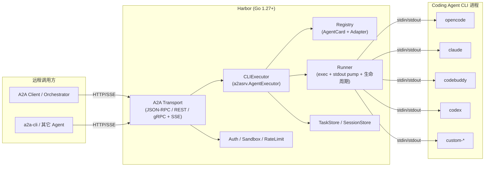

# Harbor — 把 Coding Agent CLI 封装成 A2A 远程 Agent 的设计方案

> 版本：v1-rc（关键决策已定，见 A.12）
> 目标语言：Go 1.27+（`iter.Seq2`、`log/slog`、`os/exec`、context 取消）
> 依赖：`github.com/a2aproject/a2a-go/v2`（A2A 协议 v1.0，当前 v2.6.0，要求 Go 1.25+）
> 项目代号：Harbor（停泊/调度各类“专业编程 Agent 进程”的港口）

---

## 1. 背景与目标

`opencode`、`codebuddy`、`claude`、`codex` 等 CLI 都是能力很强的编程 Agent，且**多数已具备服务端/远程模式**（如 `opencode serve`、`codebuddy --serve`、`codex app-server`）。问题不在“能否远程”，而在**各自的协议与 API 互不相同**：

| CLI | 可被封装形态 | 接口形态 |
|---|---|---|
| opencode | `serve` / `web` / `acp` | 自有 REST + SSE |
| codebuddy | `--serve`（REST/ACP-over-SSE）**与无头 `-p`** | 自有 REST + ACP / 无头 |
| codex | `app-server` / `exec-server` / `remote-control`**与无头 `exec`** | 自有 JSON-RPC 类协议 / 无头 |
| claude | **无本地 serve**（仅无头 `-p` / SDK / `--cloud`） | 无头 stream-json / SDK |

> 注：`-p/--print` 是**无头（非交互）**模式，**不是 serve**；Harbor 的 `exec` / `stream-json` 适配的正是无头模式，`serve` / `app-server` 才是常驻服务。

它们的**发现、认证、会话、任务、流式与能力模型均不统一**，远程系统与其它 Agent 难以用**一套客户端**统一调用与编排。

**目标**：用 Go 编写一个服务，把任意 coding-agent CLI 归一为符合 **A2A（Agent2Agent）v1.0** 的统一 Agent Server，从而：

- 以**统一协议**（JSON-RPC + SSE）调用这些异构 CLI，而非各写一套客户端；
- 每个 CLI 暴露标准 **AgentCard**，可被发现与协商（含多 CLI 联邦）；
- 支持 **流式输出、任务取消、多轮会话续跑、权限/澄清交互**；
- 统一 **鉴权、配额、沙箱、审计**（§9/§10/§11）；
- **无需改代码即可扩展**新的 coding-agent CLI（配置驱动），也保留 Go 接口级扩展能力。

**协议范围**：**仅支持 A2A v1.0**（以 `github.com/a2aproject/a2a-go/v2` 导出的 `a2a.Version` 为准）；不兼容 v0.x / 早期草案。请求携带的 `A2A-Version` 不匹配时返回 `ErrVersionNotSupported`。

**非目标（v1）**：不做 UI；不做多 Agent 自动路由决策（DAG 编排留给上层）；不实现自己的模型访问，完全复用各 CLI 自带能力与凭据。

---

## 2. 设计原则

| 原则 | 说明 |
|---|---|
| **薄封装、不重造** | 只负责“调用 CLI + 解析输出 + 翻译成 A2A 事件”，不复制 CLI 的 agent 逻辑。 |
| **CLI 差异隔离** | 每个 CLI 的差异集中在 `Adapter`，核心执行器与 A2A 层保持零特判。 |
| **配置优先扩展** | 新增 CLI 首选 YAML 配置 + 内置解析器；特殊场景再写 Go 代码。 |
| **A2A 语义对齐** | 用 A2A 的 `TaskState`、`contextId`、`artifact`、`input-required` 精确表达 CLI 行为。 |
| **机制内建、策略可配** | Harbor 只内建“可强制边界”的机制（鉴权钩子、工作目录约束、进程隔离、并发/超时上限）；具体开关与取值均为配置项，默认取最小权限。 |

### 2.1 机制 vs 策略

沙箱、鉴权、危险开关等都是**可配置策略**，不是设计原则本身。原则只保证“边界能被强制”，而是否启用、取值多少交给部署方：

| 可配置项 | 配置键 | 默认值 | 放开的意义 |
|---|---|---|---|
| 鉴权 | `server.auth.mode` | `none`（本地）/ `bearer`（对外） | 对接外部系统 |
| 工作目录范围 | `sandbox.workdir_root` / `allow_outside` | 受限 / `false` | 允许访问任意路径 |
| 环境变量 | `sandbox.inherit_env` | `true`（继承启动用户环境） | 设为 `false` 时仅注入白名单 |
| 危险开关 | `agents[].allow_dangerous` | `false` | 打开 `--dangerously-skip-permissions`/`-y`/`bypassPermissions` |
| 容器沙箱 | `sandbox.container` | 关闭 | 强隔离（网络/文件系统） |
| 并发/超时 | `agents[].limits.*` | 保守值 | 提高吞吐 |

> 结论：Harbor 保证“边界可强制”，但不替部署方决定策略；危险能力一律 opt-in，并在启动日志高亮告警。

---

## 3. 总体架构



### 组件职责

| 组件 | 职责 |
|---|---|
| `a2asrv.RequestHandler` | a2a-go 提供，处理协议、任务状态机、事件持久化、推送。 |
| `CLIExecutor` | 实现 `a2asrv.AgentExecutor`；把 CLI 输出翻译为 A2A 事件。 |
| `Registry` | 维护 `agentID → (AgentCard, Adapter, 并发配额)`。 |
| `Runner` | 启动/杀死子进程、按行/字节泵 stdout、处理超时与进程组。 |
| `Parser` | 把 CLI 原始输出（stream-json / text / 自定义）解析为统一事件。 |
| `SessionStore` | 维护 `A2A contextId ↔ CLI native sessionId` 映射。 |
| `Sandbox` | 工作目录白名单、环境变量裁剪、可选容器化。 |

### 3.1 多 CLI 管理

Harbor 的定位就是**同时托管多个 coding CLI**，分三层：

- **宿主多个 CLI（v1）**：单进程按 `agents:` 列表加载多个 CLI，各自生成 `/agents/{id}` 路由与独立 AgentCard；`Registry` 维护 `agentID → (Card, Adapter/Launcher, 配额)`。
- **逐个隔离**：每个 agent 有独立能力（→Card 投影）、并发配额、工作目录、`allow_dangerous` 与**凭据/home 隔离**（§10.3），互不串号。
- **同一 CLI 多模式**：同一二进制可注册多次（如 `codebuddy`(stream-json) + `codebuddy-acp`），各出一张卡，客户端自选。

**不在范围**：跨 CLI 的**智能路由/自动挑选**（属上层编排，§1 非目标）；CLI 二进制的**安装/升级**（只做 `Probe` 存活与登录态探测，§10.5）。

> 部署可选：单进程多 agent（统一鉴权/配额/运维）或每 agent 独立进程/容器（更强隔离），见 §18。

---

## 4. 核心抽象：Adapter + Parser + Runner

### 4.1 统一事件模型

不同 CLI 输出格式各异，先归一化成内部事件流：

```go
package agent

type EventKind int

const (
    EventSession    EventKind = iota // 发现 CLI 会话 ID
    EventTextDelta                   // 增量文本（流式）
    EventTextFinal                   // 最终文本
    EventThinking                    // 思考/推理内容（可选）
    EventToolCall                    // 工具调用开始
    EventToolResult                  // 工具调用结果
    EventPermissionRequest           // CLI 请求权限/澄清 → 映射到 input-required
    EventUsage                       // token/费用
    EventError
    EventDone
)

type Event struct {
    Kind      EventKind
    Text      string
    Tool      string
    ToolInput map[string]any
    SessionID string
    Usage     *Usage
    Err       error
    Raw       []byte // 原始记录，便于透传/调试
}
```

### 4.2 请求模型（A2A → 归一化）

```go
type Request struct {
    Prompt      string
    SystemExtra string // 追加系统提示
    Model       string
    Agent       string // CLI 内部 agent 名（claude/codebuddy 支持）
    WorkDir     string
    SessionID   string // CLI 原生会话 ID（续跑）
    Continue    bool   // --continue
    MaxTurns    int
    Meta        map[string]any
}
```

### 4.3 Adapter 接口（可扩展的关键）

```go
type Adapter interface {
    // Name 返回 agentID，如 "opencode"。
    Name() string
    // Probe 探测二进制是否存在/版本，用于健康检查与 AgentCard。
    Probe(ctx context.Context) (Info, error)
    // Invocation 根据请求构造一次 CLI 调用（命令、参数、环境变量）。
    Invocation(req *Request) (*Invocation, error)
    // Parser 返回该 CLI 输出解析器。
    Parser() Parser
    // Capabilities 声明生效能力（§7.2），驱动 AgentCard 投影与请求校验。
    Capabilities() Capabilities
}

type Invocation struct {
    Bin  string
    Args []string
    Env  []string
    Dir  string
    Stdin io.Reader // 可选：stream-json 输入模式
}

type Parser interface {
    // Parse 处理一条记录（行/JSON），回调产生 0..N 个事件。
    Parse(rec []byte, out func(Event)) error
    Flush(out func(Event)) error
}
```

> **解耦要点**：`Adapter` 决定“怎么调”，`Parser` 决定“怎么读”，`Runner` 决定“怎么跑”。三者都可独立替换，从而覆盖绝大多数 CLI。

### 4.4 Runner：进程生命周期

```go
type Runner struct {
    MaxConcurrent int
    sem           chan struct{}
    procs         sync.Map // taskID -> *Process（完整实现见 A.6）
}

func (r *Runner) Start(ctx context.Context, taskID string, inv *Invocation, p Parser) (<-chan Event, error) {
    cmd := exec.CommandContext(ctx, inv.Bin, inv.Args...)
    cmd.Dir = inv.Dir
    cmd.Env = sandboxEnv(inv.Env) // 显式构造，不隐式继承父环境
    // 独立进程组，确保可连同子进程一起杀死（平台相关，见 §10.3）
    setProcessGroup(cmd)
    // stdout 逐行泵入 Parser；stderr 单独收集为诊断日志
    // ctx.Done() → SIGTERM 进程组，宽限期后 SIGKILL
    ...
}
```

关键点：

- **进程组隔离**：CLI 常再 spawn 子进程（shell、MCP server），必须整组 kill。
- **空闲/总超时**：`WithAgentInactivityTimeout`（a2a-go 提供）+ 自定义总超时。
- **stderr 不污染协议流**：只并入日志与错误诊断，不当作 artifact。
- **背压**：事件 channel 有界缓冲，客户端消费慢时阻塞读取，避免内存膨胀。
- **进程控制平台相关**：Unix 用进程组（`SysProcAttr{Setpgid:true}` + `kill(-pgid, ...)`），Windows 用 Job Object / `taskkill /T`；以 build tag（`runner_unix.go` / `runner_windows.go`）分实现（详见 §10.3）。
- **取消必须走 `Runner.Kill`（进程组）**：`exec.CommandContext` 的 ctx 取消只会 kill **直接子进程**、不杀进程组；空闲/总超时都应调用 `Runner.Kill`，不要只依赖 ctx 默认行为。

### 4.5 复杂度控制：模式是共享基础设施，不做运行时协商

“按能力自动选模式（ACP → stream-json → exec）”看着灵活，实则会引爆复杂度：N 个 CLI × M 个模式、运行时回退分支、双向(ACP)与单向(line)的行为差异泄漏进执行器。因此**收敛**为：

1. **一个 Adapter 只绑定一种集成模式**（注册/配置时**静态**确定），核心不做运行时模式协商。
2. **模式是共享基础设施，不是每个 CLI 重写**：**`headless`（配 `text` / `stream-json` parser）、`server`、`acp`** 各实现一次即可被多个 CLI 复用（claude+codebuddy 共用 headless/stream-json；opencode+codebuddy 共用 ACP 或 server；codex 用 headless/jsonl）。**Launcher 数 ≈ 3，而非 CLI×模式。**
3. **CLI 差异尽量声明式**：参数模板、capability 标志、会话标志映射放进 Spec/配置；只有怪癖才写薄 Adapter。
4. **核心只认一个契约**：`Launcher.Start → Session{ Events(); Send(); Cancel() }`。line-based 与 ACP 都实现它，Executor 无感知（`Send` 用于 **duplex** 模式：ACP 及 stream-json stdin 输入的权限/澄清/续答；纯 `exec` 单向模式为 no-op）。
5. **回退是显式可选**：确需“某模式不可用则降级”时，用**显式 composite launcher**或配置策略，而非核心默认行为。

```go
// 核心唯一契约：模式无关
type Session interface {
    Events() <-chan Event
    Send(ctx context.Context, in Input) error // duplex（ACP / stream-json stdin）用于权限/澄清/续答；单向 exec 模式 no-op
    Cancel() error
    Wait() error
}

type Launcher interface { // 每种模式实现一次，多个 CLI 复用
    Name() string
    Capabilities() Capabilities
    Probe(ctx context.Context) Info              // 仅存活/版本/能力探测，不做模式协商
    Start(ctx context.Context, req *Request) (Session, error)
}
```

> 关系：§4.3 的 `Adapter`/`Parser` 与 §4.4 的 `Runner` 是 **line-based 模式**（exec / stream-json）在同一契约下的内部实现；ACP 模式则是另一个 `Launcher/Session` 实现。对 Executor 而言二者无差别。

这样复杂度上界 = **模式数 + CLI 配置数**，而非笛卡尔积。

---

## 5. 各 CLI 适配策略

Adapter 针对不同 CLI 选择“集成模式”。以下基于各 CLI `-h` 实际参数：

| Agent | 适配形态 | 关键参数 | 会话续跑 | 备注 |
|---|---|---|---|---|
| **claude** | 无头 `stream-json` | `-p --output-format stream-json --verbose --input-format stream-json --include-partial-messages` | `--resume <id>` / `--session-id <uuid>` | 结构化流；`--append-system-prompt`、`--allowedTools`、`--permission-mode`。 |
| **codebuddy** | 无头 `stream-json` | `-p --output-format stream-json --input-format stream-json --include-partial-messages` | `-r/--resume`、`--session-id` | 与 claude 同源；危险开关为 `-y/--dangerously-skip-permissions`；另有 `--acp`（`--acp-transport` stdio/streamable-http）。 |
| **opencode** | 无头 `text` 或 `server` | `run <msg> -m provider/model --agent <a> --session <id> --continue`；或 `serve` / `acp` | `--session` / `--continue` / `--fork` | `run` 无 stream-json，用行缓冲近似流式；结构化可用 `serve`(HTTP) 或 `acp`。 |
| **codex** | 无头 `exec`（`--json`）或 `server` | `codex exec "<prompt>"`；`-m` / `-C/--cd` / `-s/--sandbox` / `-a/--ask-for-approval` / `-i/--image` / `--add-dir` / `--json` / `--output-schema` / `-o/--output-last-message` | `codex exec resume --last` / `codex exec fork` | 危险开关 `--dangerously-bypass-approvals-and-sandbox`；常驻用 `app-server`。 |
| **custom** | 无头 `text` / `regex` | 由 YAML 指定 | 由 YAML 指定 | 通用模板 Adapter，覆盖任意二进制。 |

> 注：claude/codebuddy 的 prompt 经 `--input-format stream-json` 从 **stdin** 传入（首条 user message），非位置参数；这使 Session 为双向（`Session.Send`），权限/澄清可原生应答（见 §4.5、§7.4）。codex 无结构化输入，`exec` 用 stdin 文本传 prompt。
>
> **CLI Profile**：Harbor 内置按**二进制名**识别的 profile（`codebuddy`→`stream-json`、`claude`→`stream-json`、`opencode`/`codex`→`exec`）。配置省略 `integration` 时取其默认；显式配置但**不被该 CLI 支持**时启动报错（如 `claude`+`exec`）；**未知二进制必须显式指定 `integration`**。因此无需记忆“何时配哪种模式”。
>
> **最小版本**：profile 记录已适配的**最低版本**（如 codebuddy `2.161.4`、claude `2.1.292`、opencode `1.18.35`、codex `0.160.1`）。启动时探测版本，**低于该版本则拒绝启动并提示升级**；无法探测版本时跳过校验。若未来某版本出现不兼容，再在对应 adapter 中**按版本号加兼容分支**（而不是现在就引入变体框架）。

### 5.1 集成模式定义

先分**传输/交互形态**，无头模式再按**输入输出 framing** 细分。以下都是 `Adapter` 的实现形态，注册时**静态选定**（§4.5），无高下之分：

**A. 无头（headless）**：Harbor spawn CLI 子进程、经 stdin/stdout 通信。`-p/--print`、`codex exec`、`opencode run` 都属此类。按 framing 再分：

- `stream-json` / JSONL：`-p --output-format stream-json`（claude/codebuddy）、`codex exec --json`；结构化流，各 schema 用各自 Parser 映射。
- `text`：一次性 stdout 作为最终文本 artifact（`opencode run`；`codex exec` 无 `--json` 时）。配置为 `exec` 时**必须在 args 中含 `{{.Prompt}}`**（否则启动校验失败并提示改用 `stream-json`）。

**B. 服务端（server）**：CLI 常驻 HTTP/app-server（`opencode serve`、`codebuddy --serve`、`codex app-server`）；Harbor 作**客户端代理其 API** → A2A。只是“怎么调”的一种实现。

**C. ACP**：CLI 常驻 ACP（`opencode acp` 经 stdio；`codebuddy --acp --acp-transport streamable-http` 可 HTTP）；Harbor 作 ACP 客户端，双向。

> 交互式 TUI 不使用。`-p/--print` 是**无头标志**（claude/codebuddy 都有），**不是 serve**——它是 `stream-json` / `text` 模式的载体。
>
> 配置 `integration` 取值映射：`exec`（无头/text）、`stream-json`（无头/结构化）、`server`、`acp`。

> 落地顺序：**M1 = 无头 `stream-json`（codebuddy；claude 同源顺带）+ 无头 `text`（opencode `run`）** → 后续 `exec`（codex/custom）→ `server` → `acp`。**顺序只反映落地成本，不代表模式优劣。**

### 5.2 集成模式取舍（为什么不优先 ACP）

ACP（Agent Client Protocol）很诱人，但属于**条件性最优**，并非全面占优，故不作为 v1 首选/唯一实现：

| 维度 | ACP | 无头（stream-json / exec） |
|---|---|---|
| 覆盖 | 部分 CLI：`opencode` / `codebuddy` 有；`claude` / `codex` 无 | claude / codebuddy / codex 直接支持 |
| 角色 | Harbor 当 ACP **client**，需实现协议 + 回调（`fs/*`、`terminal/*`、`permission`） | Harbor 只读 stdout |
| 场景 | 传输不限于 stdio：opencode 为 stdio；`codebuddy --acp-transport streamable-http` 可服务化 | 远程 / 批处理 / 无人值守一次性任务 |
| 对齐成本 | 统一“下游”，但上游 A2A 投影（§7）照旧 | 每 CLI 一个 Parser |
| 稳定性 | 协议仍在演进，schema 可能随 CLI 升级而变 | claude/codebuddy 有官方 stream-json 实现 |
| 安全面 | 需响应 fs / terminal 回调，边界更大 | 边界较小 |

决策：

- **模式在注册/配置时静态选定（一个 Adapter 一种模式）**，核心不做运行时模式协商；`Probe()` 只做存活/版本/能力探测（详见 §4.5）。选型依据：需富交互且支持 ACP → `acp`；需结构化流 → 无头 `stream-json`/JSONL；有稳定 serve/app-server 且需高并发/会话复用 → `server`；否则无头 `text`。
- 真正的硬约束是**覆盖**（claude/codex 无 ACP）与**Harbor 作为 client 的实现成本**，而非“ACP 只能 stdio/编辑器”。
- **实现顺序按“覆盖 + 成本”**：v1 用 stream-json/exec 先覆盖 4 家 → v2 用 ACP 收敛统一（仅对支持的 CLI）。codebuddy 可对比 `--acp --acp-transport streamable-http` 与 `--serve` 两条服务化路径。
- ACP 是唯一**跨 CLI 标准化**的集成协议，长期确实是最优收敛点；但“长期统一”不等于“短期优先”。（各家 HTTP `app-server`/`serve` 也各不同、不标准化，故仍以 ACP 为长期目标。）

### 5.3 stream-json → 统一事件映射（示意）

```go
// 输入形如 {"type":"assistant","message":{"content":[{"type":"text","text":"..."}]}}
// 或 {"type":"content_block_delta","delta":{"text":"..."}}, {"type":"result",...}
func (p *streamJSONParser) Parse(rec []byte, out func(Event)) error {
    var e struct {
        Type    string          `json:"type"`
        Subtype string          `json:"subtype"`
        Session string          `json:"session_id"`
        Message json.RawMessage `json:"message"`
        Result  string          `json:"result"`
        IsError bool            `json:"is_error"`
    }
    if err := json.Unmarshal(rec, &e); err != nil { return err }
    if e.Session != "" { out(Event{Kind: EventSession, SessionID: e.Session}) }
    switch e.Type {
    case "content_block_delta": // 增量文本
        out(Event{Kind: EventTextDelta, Text: extractDelta(e)})
    case "assistant": // 完整助手消息（含工具调用）
        for _, blk := range extractBlocks(e) {
            if blk.Type == "tool_use" { out(Event{Kind: EventToolCall, Tool: blk.Name, ToolInput: blk.Input}) }
        }
    case "result":
        out(Event{Kind: EventTextFinal, Text: e.Result})
        out(Event{Kind: EventDone})
    }
    return nil
}
```

> 本段为**简化示意**；完整实现以 **A.7** 为准（含 `stream_event` 嵌套与 thinking / tool_result）。

---

## 6. A2A 映射设计

### 6.1 AgentCard（发现与协商）

每个 agent 生成一张卡片；`stream-json`/`server` 模式声明流式能力。

```go
func CardFor(a agent.Launcher, info agent.Info, endpoint string) *a2a.AgentCard {
    caps := a.Capabilities() // 生效能力（§7.2）→ Card 投影（§7.3）
    return &a2a.AgentCard{
        Name:        "Harbor/" + a.Name(),
        Description: "Remote A2A wrapper for the " + a.Name() + " coding agent CLI",
        Version:     info.Version,
        SupportedInterfaces: []*a2a.AgentInterface{
            {
                URL:             endpoint, // 形如 https://host/agents/<id>/（**带尾斜杠**，见 §6.1.1）
                ProtocolBinding: a2a.TransportProtocolJSONRPC, // M1 仅 JSON-RPC
                ProtocolVersion: a2a.Version,                  // 固定 A2A v1.0
            },
        },
        Capabilities: a2a.AgentCapabilities{
            Streaming:         caps.Streaming != agent.StreamNone, // 由能力投影；exec 模式为 false
            PushNotifications: false,                              // 未实现（见 §20）
        },
        DefaultInputModes:  caps.InputModes(),   // text/plain[, image/*, application/json…]
        DefaultOutputModes: caps.OutputModes(),
        // 鉴权是 A2A 协议面的一部分；仅在 server.auth.mode != none 时声明（§9）
        SecuritySchemes:      cardSecuritySchemes(),      // none 时返回 nil
        SecurityRequirements: cardSecurityRequirements(), // none 时返回 nil
        Skills: []a2a.AgentSkill{{
            ID: a.Name(), Name: a.Name(),
            Description: "Run a coding task with " + a.Name(),
            Tags:        []string{"coding", "cli", a.Name()},
            Examples:    []string{"fix the failing test in ./pkg", "review this diff"},
        }},
    }
}
```

> 鉴权在传输层：HTTP 中间件校验 `Authorization: Bearer`，`a2asrv.NewCallContext` 注入 `CallContext.User`；handler 侧用 `CallContextFrom(ctx)` 读取用户做审计/配额。（`a2a` 安全类型字段以实际 SDK 为准。）

暴露方式（a2a-go）：

- `a2asrv.NewStaticAgentCardHandler(card)` 挂在 `/.well-known/agent-card.json`；
- 多 agent：`/agents/{id}/.well-known/agent-card.json` + `/agents/{id}/`（JSON-RPC handler，**带尾斜杠**，与卡片 url 一致）；
- **M1 仅 JSON-RPC**（`TransportProtocolJSONRPC`）；REST/gRPC（`NewRESTHandler` 等）留后续。
- **协议版本固定 A2A v1.0**（`ProtocolVersion: a2a.Version`）：`A2A-Version` 不匹配时返回 `ErrVersionNotSupported`。

#### 6.1.1 兼容发现端点（codebuddy）

codebuddy 自带 A2A 客户端，其远程发现 `CODEBUDDY_REMOTE_AGENTS_URL` 期望**卡片数组**（顶层 `[]AgentCard` 或 `{"cards":[...]}`），而 A2A 标准的 well-known 路径只返回**单卡对象**。因此新增一个**追加式、非标准**端点：

- `GET /.well-known/agents.json`（**始终提供**）→ 返回**所有 agent 的 card 数组** `[]*a2a.AgentCard`；每张卡的 `supportedInterfaces[].url` 指向各自 `/agents/{id}/`（带尾斜杠）。
- 该端点**不改动 A2A v1.0 语义**，仅为兼容层；标准单卡路径依旧保留。
- **卡片与发现端点公开**（不含 RPC）：即使 `auth.mode=bearer`，也不要求 token（见 §9）。

```go
// 聚合发现（追加式兼容端点）：返回**已构建好的卡片数组**（含各自 /agents/{id}/ 的 url）。
func NewCardsHandler(cards []*a2a.AgentCard, cors ...string) http.Handler {
    return http.HandlerFunc(func(w http.ResponseWriter, r *http.Request) {
        if r.Method != http.MethodGet { w.WriteHeader(http.StatusMethodNotAllowed); return }
        setCORS(w, cors)
        w.Header().Set("Content-Type", "application/json")
        _ = json.NewEncoder(w).Encode(cards) // 顶层数组
    })
}
```

> 端点的 `url` 由 `endpointURL(baseURL, r, id)` 生成：**`BaseURL` 优先，为空则按请求 origin（识别 `X-Forwarded-Proto/Host`）**，返回带尾斜杠的 `/agents/{id}/`。参考实现：`go-agent-sdk/a2a/server/server.go`（`DiscoveryPath`/`cardsHandler`，裸数组；codebuddy 亦接受 `{"cards":[...]}`）。

### 6.2 事件映射表（CLI → A2A）

| 内部事件 | A2A 事件 | 说明 |
|---|---|---|
| 请求到达 | `NewSubmittedTask` + `TaskStateSubmitted` | 首次无 `StoredTask` 时发出。 |
| 进程启动 | `NewStatusUpdateEvent(Working)` | |
| `EventTextDelta` | `NewArtifactEvent`（首个）/ `NewArtifactUpdateEvent`（后续） | 增量追加到同一 artifact；**按此做实时输出**。 |
| `EventThinking` | `NewStatusUpdateEvent(Working, msg)` 或独立 artifact | 推理/思考增量；默认折叠为状态或单独 artifact，避免噪声。 |
| `EventToolCall` | `NewArtifactUpdateEvent`（`application/json` metadata）或状态消息 | 默认作为 artifact metadata，可配置为独立 artifact。 |
| `EventToolResult` | `NewArtifactUpdateEvent`（metadata） | 工具结果，便于观测进度。 |
| `EventPermissionRequest` | `NewStatusUpdateEvent(TaskStateInputRequired, msg)` | **关键**：暂停任务等客户端回传。 |
| `EventError` | `NewStatusUpdateEvent(TaskStateFailed, msg)` | 首个事件后不再返回 error，用状态表达。 |
| `EventDone` | `NewStatusUpdateEvent(TaskStateCompleted)` | |
| 任务终态 | 先发**代码变更 artifact**（§6.8），再 `Completed` | 代码改动作为 artifact 交付 |
| 取消请求 | `Cancel()` → kill 进程组 → `TaskStateCanceled` | |

> **实时性要求**：默认**逐 token 输出**（claude/codebuddy 加 `--include-partial-messages`），避免“半天没反应”。逐 token 会对 `TaskArtifactUpdateEvent` 做**合并节流**（每 ~50–100ms 或累计 N 字符 flush 一次），既尽快看到首字、又不刷爆 SSE。无 partial 能力的 CLI（opencode `run` / codex `exec`）用 `Working` 状态与工具事件作为 activity 心跳。
>
> 上表中 `EventThinking / EventToolCall / EventToolResult / EventUsage` 为**目标映射**；M1 仅落地 `EventTextDelta`（及 session/permission/error），其余归 M4（见 §6.3）。

### 6.3 执行器骨架（Launcher/Session）

> M1 即采用 §4.5 的 `Launcher/Session` 契约（而非仅 line-based `Adapter`）；这样 duplex（`Send`）、逐 token 节流、`input-required` 恢复才有落点。

```go
type CLIExecutor struct {
    launcher agent.Launcher
    sessions SessionStore  // contextId → cliSessionID
    live     LiveSessions  // taskID → agent.Session（duplex 时保活）
}

func (e *CLIExecutor) Execute(ctx context.Context, execCtx *a2asrv.ExecutorContext) iter.Seq2[a2a.Event, error] {
    return func(yield func(a2a.Event, error) bool) {
        // A. input-required 恢复：客户端以同一 taskId 回传答复 → 写回原进程并继续
        if t := execCtx.StoredTask; t != nil && t.Status.State == a2a.TaskStateInputRequired {
            sess, ok := e.live.Get(execCtx.TaskID())
            if !ok { yield(failed(execCtx, "session lost"), nil); return }
            if err := sess.Send(ctx, answerFrom(execCtx.Message)); err != nil {
                e.live.Del(execCtx.TaskID()); yield(failed(execCtx, err.Error()), nil); return
            }
            if !yield(a2a.NewStatusUpdateEvent(execCtx, a2a.TaskStateWorking, nil), nil) { return }
            e.pump(execCtx, sess, yield) // 继续消费
            return
        }

        // B. 首次执行
        if execCtx.StoredTask == nil {
            if !yield(a2a.NewSubmittedTask(execCtx, execCtx.Message), nil) { return }
        }
        if !yield(a2a.NewStatusUpdateEvent(execCtx, a2a.TaskStateWorking, nil), nil) { return }

        req, err := e.toRequest(ctx, execCtx) // 提取 prompt/model/workdir/session
        if err != nil { yield(failed(execCtx, err.Error()), nil); return }

        sess, err := e.launcher.Start(ctx, req) // Session 契约（line-based 或 ACP 均实现）
        if err != nil { yield(failed(execCtx, err.Error()), nil); return }
        e.live.Put(execCtx.TaskID(), sess)
        e.pump(execCtx, sess, yield)
    }
}

// pump 消费会话事件，对逐 token 做合并节流；遇 input-required 时保留会话后返回。
func (e *CLIExecutor) pump(ec *a2asrv.ExecutorContext, sess agent.Session,
    yield func(a2a.Event, error) bool) {

    var artifactID a2a.ArtifactID
    co := newCoalescer(80*time.Millisecond, 1024) // ~80ms 或累计 1KB flush
    emit := func(s string) bool { return yield(e.artifactEvent(ec, &artifactID, s), nil) }

    for ev := range sess.Events() {
        switch ev.Kind {
        case agent.EventSession:
            e.sessions.Bind(ec.ContextID(), ev.SessionID)
        case agent.EventTextDelta:
            if !co.Add(ev.Text, emit) { return }
        case agent.EventPermissionRequest:
            co.Flush(emit) // 先冲掉已缓冲文本
            // 保留 sess（不 Del），任务进入 input-required 等客户端答复
            yield(a2a.NewStatusUpdateEvent(ec, a2a.TaskStateInputRequired,
                a2a.NewMessage(a2a.MessageRoleAgent, interactionPart(ev))), nil)
            return
        case agent.EventError:
            co.Flush(emit)
            e.live.Del(ec.TaskID()); yield(failed(ec, ev.Err.Error()), nil); return
        }
    }
    co.Flush(emit)
    e.emitChanges(ec, yield) // §6.8：终态前发代码变更 artifact
    e.live.Del(ec.TaskID())
    yield(a2a.NewStatusUpdateEvent(ec, a2a.TaskStateCompleted, nil), nil)
}

func (e *CLIExecutor) Cancel(ctx context.Context, ec *a2asrv.ExecutorContext) iter.Seq2[a2a.Event, error] {
    return func(yield func(a2a.Event, error) bool) {
        if sess, ok := e.live.Get(ec.TaskID()); ok {
            _ = sess.Cancel(); e.live.Del(ec.TaskID())
        }
        yield(a2a.NewStatusUpdateEvent(ec, a2a.TaskStateCanceled, nil), nil)
    }
}
```

要点：

- **duplex 恢复**：任务在 `input-required` 时 a2a-go 会以**同一 `taskId`** 再次调用 `Execute`（`StoredTask != nil`）；此时**不重启进程**，而是 `sess.Send(answer)` 写回 stdin 继续。
- **live 会话表**：`taskID → Session`，供恢复与取消定位活进程；仅在终态删除。
- **taskID 贯通**：Executor 把 `taskID` 经 ctx 交给 Launcher/Session（`agent.WithTaskID`）；line-based Launcher 用它对齐 `Runner.Start/Kill` 的 key，避免“cancel 找不到进程”。
- **合并节流**：`coalescer` 按时间 / 字节 flush，避免逐 token 刷爆 SSE。
- **单向 exec 模式**：`Session.Send` 为 no-op，且 Capabilities 声明不支持交互，故不会走到 `input-required`。
- **M1 的 pump 范围**：仅处理 `EventTextDelta / EventSession / EventPermissionRequest / EventError`；§6.2 表中的 `EventThinking / EventToolCall / EventToolResult / EventUsage` 在 **M4** 补齐（当前忽略或仅记日志）。
- **live TTL/reaper**：`live` 条目带最后活动时间与 TTL；客户端久不答复时到期自动 `Cancel` 并清理，避免进程/条目泄漏（与 §11 交互持久化呼应）。

### 6.4 会话与多轮续跑

- A2A `contextId` = 一条对话线程；`taskId` = 一次请求。
- 首个任务从 CLI 输出解析出原生 `sessionId`，写入 `SessionStore：contextId → sessionId`。
- 后续同 `contextId` 的请求，Adapter 自动附加 `--resume <sessionId>`（claude/codebuddy）或 `--session <id>` / `--continue`（opencode）。
- `--fork` / `--fork-session` 语义可用 A2A 元数据（`SendMessageConfig` / `Message.Metadata`）选择“续写或分叉”。

### 6.5 权限/澄清交互（input-required）

这是封装 coding agent 的难点（完整的能力对齐模型见 **§7**，交互规范化见 **§7.4**）：CLI 会询问“是否允许执行该命令？”。设计：

1. Parser 识别权限请求事件；
2. 执行器发 `TaskStateInputRequired` + 一条包含问题与选项的 Message；
3. 客户端用同一 `taskId` 再次 `message/send` 提交答复；
4. 执行器以 **duplex 模式**（`--input-format stream-json`）把答复写回原进程 stdin；
5. 任务恢复 `Working`。

**M1 落地**：claude/codebuddy 走**原生 duplex**（原进程挂起，答复经 `Session.Send` 写回 stdin，见 §6.3），无需降级；opencode(exec) 等无交互能力的 CLI 启用“无交互模式”：配置 `--auto` / 预置 `--allowedTools` 或沙箱内预授权，**永不发** `input-required`，并在 Card 如实声明不支持。完整降级矩阵见 §7.4。

### 6.6 流式与推送

```go
handler := a2asrv.NewHandler(executor,
    a2asrv.WithTaskStore(store),
    a2asrv.WithPushNotifications(cfgStore, sender),
    a2asrv.WithAgentInactivityTimeout(10*time.Minute),
)
mux.Handle("/agents/codebuddy/", a2asrv.NewJSONRPCHandler(handler))
```

- 流式：客户端调用 `message/stream`，Harbor 通过 SSE 推送 `TaskArtifactUpdateEvent`。
- 推送：超长任务（编译、测试）走 push notification，客户端可离线。

### 6.7 工作目录与工作区隔离

Coding agent 只有在**真实代码库**里才有意义，所以工作目录不是“随便建个子目录”的问题，必须与业务和会话绑定：

- **来源**：调用方通过 A2A `Message.Metadata`（约定键 `harbor.workDir`）指定；`sandbox.workdir_root` 是唯一允许的根。
- **校验（安全前提）**：对请求路径与 `workdir_root` 都取 realpath，按**路径分量**做前缀判断；**拒绝** `..` 穿越与 symlink 逃逸；`allow_outside=false` 时越界直接拒绝（fail fast，不启动 CLI）。
- **绑定 `contextId`**：工作目录与 A2A `contextId` 绑定。同一 context 的后续任务（含 `--resume`）**必须复用同一工作树**，否则 CLI 会话与文件改动错位。
- **未指定时**：按 context 分配 scratch 目录（仅适合无需既有代码的任务）。
- **scratch 命名安全**：`contextId` 客户端可控，**不可直接拼进路径**——取其 hash 或白名单字符，拒绝 `..` 与路径分隔符。
- **隔离策略**（配置，决定并发安全）：
  - `shared`：直接在指定目录运行（最快；同目录并发会互相干扰，需按**工作目录加锁串行化**）。
  - `worktree`（推荐，M2）：目标为 git 仓库时，为**每个 context** 建 `git worktree`，实现隔离与并发；`--fork` → 新 worktree。
  - `copy`：非 git 目录做整目录拷贝。
- **附加目录**：`--add-dir` 等额外可写目录同样必须通过上述校验。

> 结论：**不是二选一**——`harbor.workDir` 元数据是主来源并绑定 context；“每 context 一个子目录”只是未指定时的 fallback；并发隔离由 `worktree` / 目录锁策略负责。

### 6.8 代码变更的采集与 artifact 表达

coding agent 的核心产出是**代码改动**，必须作为 artifact 交付，而非只给最终文本。

- **基线快照**：任务开始时记录基线——git 仓库取 `HEAD` + `git status --porcelain`；非 git 目录记录 `workDir` 内文件哈希。
- **产出 diff**：终态（或工具报告编辑后）计算变更：git 用 `git diff <base>`（含已跟踪）+ 未跟踪文件；非 git 与基线哈希对比生成 unified diff。
- **artifact 形态**：
  - **diff artifact**：`Name="changes"`，`TextPart`（mime `text/x-diff`）或大改动走 `FilePart`(URL，由 Harbor 提供)；
  - 可选**逐文件 artifact**：每个文件一个 `FilePart`（受大小限制）；
  - `Artifact.Metadata = {"agent","base","files":[...],"truncated":bool}`。
- **流式 vs 收尾**：默认**收尾一次性**交付（稳定）；若 CLI 能报告逐文件编辑（tool_result 带 path），可增量为每文件发 `ArtifactUpdateEvent`。
- **边界**：只采集 `workDir`（及允许的 `--add-dir`）内变更；超长 diff 裁剪并标 `truncated`；二进制只报路径。
- 与 §6.7 配合：`worktree` 模式下 diff 相对该 context 基线。
- **并发影响 diff 可靠性**：`shared` 模式下同目录并发会混入他人改动 → diff 不可靠；生产应使用 `worktree` 或按目录加锁（§6.7）。

### 6.9 请求元数据与错误码契约

**元数据键**（`Message.Metadata`，统一 `harbor.` 前缀）：

| 键 | 类型 | 含义 |
|---|---|---|
| `harbor.workDir` | string | 工作目录（相对 `workdir_root`），见 §6.7 |
| `harbor.model` | string | 模型（透传 Adapter） |
| `harbor.agent` | string | CLI 内部 agent 名 |
| `harbor.systemPrompt` | string | 追加系统提示 |
| `harbor.fork` | bool | 分叉会话而非续写 |
| `harbor.maxTurns` | int | 最大轮次 |
| `harbor.continue` | bool | 无 sessionId 时续用最近会话（`--continue`） |
| `harbor.interactionId` | string | 回答 `input-required` 时回带的交互 id（§7.4） |

**错误码**（失败时置于 `TaskStatus.Message.Metadata["harbor.errorCode"]`，值域固定）：

| code | 触发 |
|---|---|
| `unsupported_content` | 请求能力不在生效能力内（§7.5） |
| `workdir_denied` | 工作目录越界 / 校验失败（§6.7） |
| `auth_required` | CLI provider 未登录 / 鉴权失效（§10.5） |
| `cli_not_found` | 二进制缺失或不可执行 |
| `agent_unavailable` | agent 熔断（连续失败）或未启用，快速失败（§11.2） |
| `timeout` | 总 / 空闲超时 |
| `parse_error` | 输出无法解析 |
| `internal` | 其它 |

> 客户端据 `errorCode` 做机器化处理（重登 / 换 agent / 降级），而非解析自然语言。

---

## 7. 能力对齐模型（Capability Alignment）

> 这是本设计**最核心的难点**：A2A 定义了一套通用能力面（输入/输出 MIME、流式、`input-required`、扩展），而各 CLI 的真实能力是**异构子集**——有的支持图片输入、有的有独立的“结构化提问”工具、有的权限模型完全不同。取“最小公分母”会浪费能力，强行统一又会造假。原则：**声明真实能力 + 规范化投影 + 显式降级**。

### 7.1 三层能力面

| 层 | 谁定义 | 例子 |
|---|---|---|
| CLI 原生能力 | 各 CLI | claude 的图片输入 / `AskUserQuestion` / `--permission-mode`；opencode 的 `--auto`（权限系统）；codebuddy 的文生图模型 |
| Harbor 规范能力（Canonical） | 本设计 | 比 A2A 更细的内部能力描述符 `Capabilities` |
| A2A 暴露能力 | A2A 规范 | AgentCard 的 `DefaultInputModes`/`DefaultOutputModes`、`Capabilities`、`Extensions` |

对齐 = **投影**：Canonical → A2A 字段（对外，保真度可损失）；同时 Canonical 作为**请求期校验**依据（对内，拒绝不支持的能力）。二者缺一不可。

### 7.2 Canonical Capability Descriptor

```go
type Capabilities struct {
    // 输入
    InputText   bool
    InputImage  []string // 支持的 MIME，如 image/png
    InputFile   bool     // 以文件/目录引用输入
    InputData   bool     // 结构化 DataPart 入参
    InputPrompt bool     // 支持 system / append system prompt
    // 输出
    OutputText bool
    OutputFile bool // 产出文件 / 补丁
    OutputData bool // 结构化 JSON（json-schema）
    ToolTrace  bool // 可观测工具调用
    // 交互
    Permission          PermissionModel   // none | flag_only | interactive
    AskQuestion         bool              // 主动澄清（多选 / 自由文本）
    PlanApproval        bool
    InputRequiredResume bool              // 挂起后能否在原进程继续应答
    // 会话 / 流式 / 其它
    SessionResume bool
    SessionFork   bool
    Streaming     StreamGranularity // none | turn | token
    SubAgents     bool
    Worktree      bool
    Sandbox       bool
}
```

`Probe()` 产出**生效能力**：静态声明 + `--version`/`--help` 探测 + 配置覆盖。它同时驱动 AgentCard、请求校验和降级策略，是“单一事实来源”。

### 7.3 投影到 A2A（Canonical → Card）

| Canonical | A2A 字段 |
|---|---|
| `InputText` / `InputImage` / `InputFile` / `InputData` | `DefaultInputModes`（`text/plain`、`image/png`、`application/pdf`、`application/json`…） |
| `OutputText` / `OutputFile` / `OutputData` | `DefaultOutputModes` |
| `Streaming != none` | `Capabilities.Streaming` |
| `ToolTrace` / 富交互 | `Capabilities.Extensions[]`（交互扩展，见下） |
| `Permission` / `AskQuestion` / `PlanApproval` | 见 §7.4 交互规范化 |

> A2A 只认 MIME，表达不了“只接受图片**路径**还是 raw bytes”。入参**形态**（raw / URL / 本地路径）通过扩展参数补充。
>
> **交互扩展 URI**：`https://github.com/jiaweisky/harbor/extensions/interaction/v1`（仓库内 `extensions/interaction.md` 给 JSON schema）。仅当 `Permission==interactive || AskQuestion || PlanApproval` 时在 Card 声明；不支持该扩展的客户端退回文本问答。

### 7.4 交互规范化（权限 / ask question / plan）

三种“提问”语义不同，统一为带 `kind` 的**交互描述**，用 A2A `input-required` + `DataPart` 承载：

```json
{
  "kind": "permission",
  "id": "itx_abc123",
  "action": "run_shell",
  "target": "rm -rf build/",
  "risk": "high",
  "options": ["approve", "deny", "allow_always"],
  "resume": true
}
```

- `permission`：**安全门**（approve / deny / allow-always）。映射 claude `--permission-mode`/`--allowedTools`、opencode `--auto`、codebuddy `-y`。
- `question`：Agent 的**主动澄清**（如 claude `AskUserQuestion`），选项 + 自由文本。
- `plan_approval`：计划模式确认。

**答复编码**：客户端回一个 `Message`，内含 `DataPart{kind,id,answer}`；Harbor 校验 `id` 与当前 `input-required` 匹配，防止串台。

**降级策略（关键）**：

| CLI 能力 | 行为 |
|---|---|
| 支持交互且 `InputRequiredResume` | 完整 `input-required`，**原进程挂起**等待 stdin 答复（duplex）。**claude/codebuddy 走此路**（`--input-format stream-json` + stdin，见 §5）。 |
| 支持交互但不支持挂起续答 | 登记 CLI 会话 ID，**重新以 `--resume` 启动**并注入答复（有损，可能重放/丢上下文）。 |
| 不支持交互 | 由配置策略决定（预授权 / 自动拒绝 / bypass），**永不发** `input-required`；Card 声明不支持。 |
| 客户端只会发文本 | 问题以文本 + 选项列表呈现；结构化答复仅对支持扩展的客户端可用。 |

### 7.5 媒体类型对齐

| 请求 Part | 通用处理 | 各 CLI 落地（示例） |
|---|---|---|
| `TextPart` | 拼 prompt | 全部 |
| `FilePart`(raw/URL) | 落到临时/工作目录 | claude：`--add-dir` + 提示引用路径 / `--file`；opencode：`@path`；codebuddy：`--image-to-image-model` / 附件参数 |
| `DataPart` | 结构化入参 | 经 `--input-format stream-json` 直传（claude/codebuddy）；否则序列化进 prompt。**结构化输出**另用 `--json-schema`/`--output-schema`（见 §7.6）。 |
| 输出文件/图片 | 监听工作目录变更 | 无标准接口：以 git diff / 新增文件生成 `FilePart` artifact；codebuddy 文生图结果按图片 artifact 输出 |

要点：**能力校验前置**——请求中的媒体类型/交互若不在生效能力内，立即以 `ErrUnsupportedContentType` / 拒绝态返回，**不要**启动 CLI 后再失败。

### 7.6 功能支持矩阵（依据本机 `-h` 实测）

依据：用户提供并本机实测的 `opencode -h` / `codebuddy -h` / `claude -h` / `codex -h` 及 `codex exec -h`。

| 功能 \ Agent | claude | codebuddy | opencode | codex | generic |
|---|---|---|---|---|---|
| 文本输入/输出 | ✅ | ✅ | ✅ | ✅（`exec`） | ✅ |
| 图片输入 | ✅（内置读取） | ✅（`--image-to-image-model`） | ✗ | ✅（`-i/--image`） | 配置 |
| 图片输出 | ✗ | ✅（`--text-to-image-model`） | ✗ | ✗ | 配置 |
| 文件/补丁输出 | ✅（内置） | ✅（内置） | ✅（内置） | ✅（内置 + `apply`） | 配置 |
| 结构化输出（`--json-schema`） | ✅ | ✅ | ✗ | ✅（`--output-schema`） | 配置 |
| 结构化输入（`--input-format stream-json`） | ✅ | ✅ | ✗ | ✗（prompt 走参数/stdin） | 配置 |
| 流式粒度 | token（`stream-json` + `--include-partial-messages`） | token（同上） | turn（`run`）；可通过 `serve` 走 SSE | JSONL 事件流（`exec --json`）；`app-server` 可流式 | 配置 |
| 权限交互 | ✅（`--permission-mode` / `--allowedTools` / `--permission-prompts`） | ✅（同左 + `--subagent-permission-mode`） | ✅（`--auto`；权限系统） | ✅（`-a/--ask-for-approval`、`--approve-for-me`） | 配置 |
| 计划审批 | ✅（`plan` 模式） | ✅（`plan` 模式） | ✗ | ✗ | 配置 |
| 主动澄清（`--brief` / ask） | ✅（`--brief`） | ✅（`--brief`） | ✗ | ✗ | — |
| 会话续跑 / fork | ✅（`--resume` / `--fork-session`） | ✅（`--resume` / `--fork-session`） | ✅（`--session` / `--fork`） | ✅（`resume` / `fork` / `queue`） | 配置 |
| 子 Agent | ✅（`--agents`） | ✅（`--agents`，另有 `--swarm`） | ✅（`opencode agent` / `--agent`） | ✗ | — |
| MCP 配置 | ✅（`--mcp-config`） | ✅（`--mcp-config`） | ✅（`opencode mcp`） | ✅（`codex mcp`） | 配置 |
| 常驻 Server | ✗ | ✅（`--serve`，HTTP） | ✅（`serve` / `web`） | ✅（`app-server` / `exec-server`） | 配置 |
| 沙箱策略 | ✅（`--restricted`） | ✅（`--sandbox`） | ✗ | ✅（`-s/--sandbox`：read-only/workspace-write/danger-full-access） | 配置 |
| ACP 模式 | ✗（`-h` 未暴露） | ✅（`--acp`；`--acp-transport` stdio/streamable-http） | ✅（`acp`，stdio） | ✗（用 `app-server`，非 ACP） | 配置 |

图例：`✅` = 本机 `-h` 明确可见或 CLI 内置能力；`✗` = `-h` 未暴露、无明确依据；`配置` = 由 Adapter 模板决定。矩阵是 Adapter 声明、Card 投影与降级策略的依据。

### 7.7 为什么“对齐”不能一刀切

- **不取最小公分母**：否则图片、结构化输出、交互等高级能力永远用不上 → 每个 agent 暴露**真实**能力集。
- **不假装统一**：CLI 语义迥异（安全门 ≠ 主动澄清），用 `kind` 区分，而非硬塞进同一个 `input-required`。
- **可协商**：客户端据 Card 选 agent / 降级；不支持就明确拒绝，而非静默失败。
- **可演进**：新能力先进入 Canonical，再补投影，A2A 层与 Adapter 层无需大改。

---

## 8. 扩展机制（重点需求）

设计 **三级扩展**，覆盖从“零代码”到“完全自定义”：

### 级别 1：纯配置扩展（推荐，覆盖 80% CLI）

在 `agents.yaml` 增加一条即可。内置解析器：`stream-json`、`text`、`regex`。

```yaml
agents:
  - id: my-coder
    display_name: "My Coder CLI"
    binary: my-coder
    integration: exec          # stream-json | server | acp | exec
    parser: text               # stream-json | text | regex
    args: ["--prompt", "{{.Prompt}}", "--cwd", "{{.WorkDir}}"]
    env:
      MY_CODER_MODE: "ci"
    session:
      id_flag: "--session-id"  # 用于续跑
      resume_flag: "--resume"
      continue_flag: "--continue"
    limits:
      max_concurrent: 2
      timeout: 30m
      max_turns: 100
```

### 级别 2：自定义 Parser（少量 Go 代码）

实现 `Parser` 接口并注册，用于输出格式奇特但仍是子进程的 CLI。

```go
func init() { agent.RegisterParser("my-format", func() agent.Parser { return &myParser{} }) }
```

### 级别 3：完整 Adapter（复杂 CLI）

实现 `Adapter` 接口并注册，例如需要握手、多次 stdin 往返、专用协议的 CLI。

```go
func init() { agent.RegisterAdapter("weird-cli", newWeirdAdapter) }
```

**加载方式**：

- **编译期注册**（推荐）：`internal/adapters/...` 通过 `_ "github.com/jiaweisky/harbor/internal/adapters/codex"` 触发 `init()`。
- **Go plugin（`plugin` 包）**：可运行时加载 `.so`，但受 CGO/平台/版本限制，仅作可选实验特性。
- 统一通过 `Registry` 暴露，HTTP 层与 A2A 层完全不感知具体 CLI。

---

## 9. 安全设计

> 这些 CLI 具备读写文件、执行命令的能力，安全是首要约束。

1. **鉴权（M1 必做，不做无鉴权版）**：这些 CLI 能执行任意代码，**可达的无鉴权 A2A 端点＝远程 RCE**，不能作为默认。M1 即实现：
   - HTTP 中间件校验 `Authorization: Bearer <token>`（静态 token 表），经 `a2asrv.NewCallContext` 注入 `CallContext.User`，贯穿审计/多租户；
   - AgentCard 声明 `securitySchemes`（HTTP bearer）+ `securityRequirements`（见 §6.1）；
   - **安全联锁**：`listen` 非 loopback 且**没有鉴权**（`auth.mode == none`）时**拒绝启动**，除非显式 `allow_insecure: true`（用于反代/网格已鉴权的场景）；任何非 `none` 的鉴权方式都放行。loopback 默认无需鉴权。
   - **作用域**：Bearer 中间件**只包 JSON-RPC 端点**；卡片与发现端点（`/.well-known/agent-card.json`、`/.well-known/agents.json`、`/agents/{id}/.well-known/agent-card.json`）**公开**——客户端需先取卡才知道鉴权 scheme，且 codebuddy 拉卡时不带 token。
   **不计划支持** OAuth2 / mTLS / 令牌内省 / 细粒度授权（YAGNI）。若需“按调用方凭据”，见 §10 的 BYO key 模型，而非引入这些方案。
2. **上游凭据与登录**：见 **§10**（CLI 自身的 provider 登录/凭据隔离，与本条的服务鉴权是两件事）。
3. **工作目录沙箱**：所有任务限定在 `sandbox.workdir_root` 内；`allow_outside` 默认 `false`；realpath/前缀校验拒绝 `..` 与 symlink 逃逸（详见 §6.7）。
4. **环境变量**：**默认继承启动用户环境**（不少 CLI 依赖它）；`sandbox.inherit_env: false` 时仅注入白名单（`PATH`/`HOME`/`LANG`/`LC_ALL`/`TERM`/`TMPDIR`）+ `agents[].env`，以减少凭据暴露。
5. **危险开关显式化**：`--dangerously-skip-permissions`/`-y`/`bypassPermissions` 只能由部署方在配置（`agents[].allow_dangerous`，默认 `false`）中开启，**无环境变量旁路**，并在启动日志高亮告警。可选加固：开启危险开关要求容器沙箱同时开启，否则拒绝启动。
6. **可选容器沙箱**：对接 codebuddy `--sandbox`、或以容器运行整个 CLI，隔离文件系统与网络。
7. **资源限制**：并发上限、CPU/内存（`ulimit`/cgroup）、单任务超时与最大轮次，防止失控循环。
8. **审计日志**：记录 `user → agent → prompt 摘要 → taskId → 结果状态`，敏感内容可脱敏。
9. **网络**：CORS 仅允许受信域；AgentCard 可公开但调用接口需鉴权。

---

## 10. 上游凭据与 CLI 登录（CLI Auth）

> 这是被低估的**真正难点**：这些 CLI 要连各自的模型服务，多数需要先登录；且**能力随登录状态变化**（登录后才有完整模型 / agent / 额度）。Harbor 必须把“CLI 的认证”当作一等公民，而不是假定 CLI 已就绪。

### 10.1 问题拆解

- 凭据形态不同：环境变量（`ANTHROPIC_API_KEY`、`OPENAI_API_KEY`…）、CLI 配置/家目录（`~/.claude`、`$CODEX_HOME`、`~/.config/opencode`、`~/.codebuddy`）、macOS Keychain、长效 token（`claude setup-token`）。
- 登录方式不同：浏览器 OAuth、设备码、API key。**headless 服务器无法完成浏览器 OAuth**。
- 凭据会过期/失效 → 需刷新/重登。
- 多租户下“用谁的账号/额度”。

### 10.2 凭据归属模型（二选一，可混合）

| 模型 | 说明 | 适用 |
|---|---|---|
| **A. 服务级凭据** | Harbor 主机预置一套已登录 CLI 的 config/家目录或 API key，所有 A2A 调用共享。 | 团队/组织共享一个编程 Agent；**M1 默认** |
| **B. 按调用方凭据** | 每个 A2A 用户用自己的 provider key / 登录态；Harbor 按用户隔离存储或按请求注入。 | 多租户、BYO 额度、成本归属 |

### 10.3 关键机制：隔离 CLI 的 config/home

无论哪种模型，**绝不能让子进程直接读写服务器的真实 `~` / Keychain**（污染、串号、泄漏）。主机制是**每个 tenant 一个独立 `HOME`**（默认即可覆盖所有 CLI 的 `~/.xxx`），再按 CLI 叠加专用变量做精细覆盖；默认继承启动用户环境（`inherit_env: true`），设为 `false` 时只显式注入该 tenant 的凭据。

| CLI | 默认配置根 | 覆盖变量 | 依据 |
|---|---|---|---|
| claude | `~/.claude` | `HOME`；`CLAUDE_CONFIG_DIR`；凭据 `ANTHROPIC_API_KEY` | 待实测确认 |
| codebuddy | `~/.codebuddy` | `HOME`；专用变量待确认 | 待实测（M3） |
| opencode | `~/.config/opencode` | `HOME` / `XDG_CONFIG_HOME`；`OPENCODE_CONFIG*` 待确认 | 待实测（M3） |
| codex | `$CODEX_HOME`（默认 `~/.codex`） | `CODEX_HOME` | ✅ 由 `codex -h` 确认 |

```
HOME=<harbor_home>/<tenant>
CLAUDE_CONFIG_DIR=<...>/claude
CODEX_HOME=<...>/codex
XDG_CONFIG_HOME=<...>/config       # opencode 等遵循 XDG
```

> 优先用 `HOME`（对所有 CLI 生效），专用变量仅作精确覆盖；各 CLI 的配置根以其实测 `-h`/文档为准（M1 接 codebuddy + opencode：codebuddy 同 claude 用 `CLAUDE_CONFIG_DIR`/`ANTHROPIC_API_KEY` 一类的变量待实测，opencode 记 `XDG_CONFIG_HOME`）。

**跨平台（Linux / macOS / Windows）**：隔离**策略**与平台无关，但需三处平台 shim：

1. **覆盖的根环境变量不同**：Unix 用 `HOME` + `XDG_*`；Windows 用 `USERPROFILE` + `APPDATA`/`LOCALAPPDATA`。覆盖这些根变量后，CLI 会**在 Harbor 沙箱目录内**自行解析出平台正确的子路径（`~/.claude`、`%APPDATA%\…`）——**不要硬编码绝对路径**。
2. **OS 凭据库不可重定向**：macOS Keychain / Windows Credential Manager / Linux libsecret 按用户存储，**无法用环境变量隔离**。设计上**回避**依赖它们：优先 env 注入 API key / CLI 专用配置目录，并使用能跳过 Keychain 的模式（如 claude `--bare` 强制 `ANTHROPIC_API_KEY`、不读 Keychain/OAuth）。
3. **进程控制平台相关**：Unix 用进程组（`Setpgid` + `kill(-pgid)`），Windows 用 Job Object / `taskkill /T`；Runner 以 build tag 分实现（见 §4.4）。

> 结论：**架构不依赖平台差异**，差异收敛为“根环境变量 shim + 回避 Keychain + 进程控制 build tag”；部署上建议**每个 agent 固定运行平台**（如 Linux 容器），不追求同一 CLI 跨平台行为一致。

### 10.4 Headless 登录的可行路径

1. **预置（推荐）**：在带浏览器的机器上完成登录 / 生成 API key / `claude setup-token` / `codex login`，把结果以 **secret** 挂载进 Harbor；Harbor 不负责交互登录。
2. **API key 注入（BYO）**：调用方按请求携带 provider key，Harbor 仅注入子进程 env，**不落盘**；需防日志泄漏。
3. **设备码 / 登录任务（进阶）**：Harbor 发起登录，把 URL/码作为 A2A 消息/artifact 返回（可 `input-required`），客户端/管理员完成后 Harbor 收口 token——把“登录”建模成一个 A2A 任务。
4. 明确**不追求**在 headless 上跑浏览器 OAuth 回调。

### 10.5 登录状态 = 能力状态

- `Probe()` 需探测**认证状态**并计入生效能力（§7.2）：未登录 → AgentCard 标记 degraded/unavailable，或隐藏需要登录的 skill。
- `/readyz` 判定包含“已认证”。
- 运行中鉴权失效 → 映射为**类型化错误**（`TaskStateFailed` + 机器可读 reason），必要时转 `input-required` 触发重登，而非当作普通失败。

### 10.6 凭据存储与生命周期

- 存储：优先**外部 secret（挂载 / KMS / Vault）**；自管理时用主密钥加密落盘；**不依赖服务器 Keychain**。
- 轮换/删除：支持更新与吊销；登录态目录可整目录清除。
- 最小暴露：凭据不进日志 / artifact / push；错误信息脱敏。
- 审计：记录“哪个 tenant 用哪个 credential 执行了哪个任务”。

### 10.7 辨析：两个“OAuth2”别混为一谈

| | 层 | 作用 | 本项目取舍 |
|---|---|---|---|
| **Harbor 鉴权** | A2A 客户端 ↔ Harbor | 谁可以调用 Harbor | **只用 Bearer**；不做 OAuth2 资源服务器（§9） |
| **CLI 登录** | CLI ↔ 模型 provider | CLI 获取 provider 凭据 | 常为 OAuth2 / 设备码 / API key，但**由 CLI 自己完成**；Harbor 不实现 OAuth |

- “不支持 OAuth2”**仅指前者**；后者（`/login`）不是被砍，而是走 §10.4 的路径支持。
- Harbor 通常**无需实现 OAuth 客户端**：预置路径直接复用 CLI 已登录的 config/home；设备码路径仅**调用 CLI 的登录命令**并转发 URL/码，OAuth 仍由 CLI 执行；token 刷新/生命周期也归 CLI（Harbor 只隔离/轮换其 config 目录）。
- 即“OAuth2 与 /login 强相关”**在语义层成立、在实现层可解耦**。

> M1 范围：**服务级凭据（模型 A）+ CLI home 隔离 + `Probe` 认证探测 + 鉴权失效类型化错误**。按调用方凭据（模型 B）与“登录任务”留后续。

---

## 11. 并发、生命周期与可靠性

| 关注点 | 方案 |
|---|---|
| 并发 | 每 agent `max_concurrent` 信号量；`a2asrv.WithConcurrencyConfig` 限制总并发。 |
| 进程清理 | 进程组 kill + `defer`；服务退出时遍历 `procs` 全部回收。 |
| 崩溃恢复 | TaskStore 持久化；重启后 `GetTask`/`SubscribeToTask` 仍可用；孤儿进程由启动时清理。 |
| 交互持久化 | `input-required` 依赖**活进程**，不跨重启；重启后若客户端答复，则按 §7.4 降级为 `--resume` 注入答复（有损），会话未知则以 `internal` 失败并提示重发。 |
| 幂等 | `messageId` 去重；重复 `message/send` 命中已有 task 不重复执行。 |
| 超时 | 空闲超时（无事件）+ 总超时；超时按 `TaskStateFailed` 处理。 |
| 限流 | 按用户/agent 的令牌桶，防滥用（也是成本控制）。 |
| 优雅停机 | 停止接收新任务 → 等待在途任务或超时强杀 → 关闭监听。 |

### 11.1 失败模式与处理

| 失败 | 检测 | 处理 |
|---|---|---|
| 启动时二进制缺失 | `Probe`（**带超时**） | 该 agent 禁用 + WARN；**全部不可用则拒绝启动**（A.9） |
| 运行时二进制消失 / 不可执行 | `exec.Start()` 返回 errno | `ENOENT`→`cli_not_found`；`EACCES`→`internal`（附 errno）；任务 Failed |
| 启动即崩溃（缺库 / 架构不符） | 首事件前退出 | Failed + **截断 stderr**（脱敏） |
| 运行中崩溃（信号 / 非零退出） | `cmd.Wait()` 的 exit/signal | Failed `internal`；**但若已发出 `result`/`Done` 则视为 Completed**（非零退出不覆盖成功结果） |
| CLI 挂起无输出 | 空闲超时 | Failed `timeout`；走 `Runner.Kill` |
| **用户取消后进程退出** | — | **必须抑制取消后的 `EventError`**（canceled 标志），否则会覆盖 `Canceled` |
| 反复崩溃 | 连续失败计数 | agent 标记 unhealthy / 熔断，`/readyz` 失败并停止接单 |
| Harbor 崩溃留孤儿 | 启动扫描 | 记录 PID / 进程组（pidfile 或 cgroup），启动时按标记清理 |

要点：

- **errno 分类**：`exec.Start` 的 errno 要映射到 §6.9 错误码，不能一律 `internal`。
- **取消抑制**：`Runner`/`Session` 维护 `canceled` 标志；`pump` 在取消后不再发 Failed/Completed（避免竞态覆盖）。
- **部分产出保留**：失败时已产出的 artifact 保留；`TaskStatus.Message` 带 `harbor.errorCode` + 截断 stderr（脱敏）。
- **熔断纳入健康检查**：unhealthy 状态进 `/readyz`（§10.5、§13）。

### 11.2 熔断、退避与健康

**状态机（每 agent 独立）**：`closed → open → half-open → closed`

```
closed    正常接单；连续失败计数 ++
open      快速失败（拒绝新任务），持续 cooldown；到期 → half-open
half-open 放行 1 个探测请求；成功 → closed（计数清零）；失败 → open（cooldown 翻倍，封顶 max）
```

**计数与阈值**（可配 `limits.breaker`）：

- **计为失败**：`cli_not_found`、`internal`（崩溃/启动失败）、连续 `timeout`。
- **不计**：用户取消（`canceled`）、`unsupported_content`、`workdir_denied`、`input-required` 暂停。
- 默认：`threshold: 3`（时间窗内连续失败）、`window: 5m`、`cooldown: 30s`、`max_cooldown: 10m`。

**触发后的行为**：

- 新任务**立即**以 `TaskStateRejected` + `harbor.errorCode=agent_unavailable` 返回（不启动进程，快速失败）。
- `/readyz` 将该 agent 标 `unhealthy`；**所有** agent 不可用则服务 `not ready`。
- 熔断期间按 cooldown 后台 `Probe`（或 half-open 探测）自动恢复。

**与启动禁用的区别**：启动 `Probe` 失败 = **永久 disabled**（直到配置/环境修复）；运行期熔断 = **临时 open**，可自动恢复。

**任务级隔离**：`a2asrv.WithExecutionPanicHandler` + executor `recover`，单个任务 panic 不影响服务；该任务按 `internal` 计一次失败。

```yaml
limits:
  breaker: { threshold: 3, window: 5m, cooldown: 30s, max_cooldown: 10m }
```

---

## 12. 持久化与状态存储

- **TaskStore**：默认内存，生产可接 SQLite/Postgres/Redis（实现 `a2asrv/taskstore.Store`）。
- **SessionStore**：`contextId → {agentID, cliSessionID, updatedAt}`，可与会话表合并。
- **PushConfigStore / Sender**：`a2asrv.WithPushNotifications(store, sender)`；`sender` 为 HTTP webhook 投递（校验 URL 防 SSRF、签名载荷、失败重试）。M1 关闭（Card `PushNotifications:false`），M4 随长任务开启。
- **执行日志**：每 task 落一份原始 stream（可选压缩），便于回放与排障。

---

## 13. 可观测性

- **日志**：`log/slog` 结构化日志，`taskId`/`agentID`/`user` 作为字段。
- **指标**：Prometheus —— 任务数、时长、失败率、每 agent 并发、**熔断状态**（§11.2）、token/费用（若 CLI 上报 usage）。
- **追踪**：OpenTelemetry，A2A 请求 → CLI 子进程 span。
- **健康检查**：`/healthz`（服务）、`/readyz`（各 CLI `Probe` + **认证状态**，见 §10.5）。

---

## 14. 目录结构

```
harbor/
├── cmd/
│   └── harbor/                 # 服务入口（单/多 agent 由配置决定）
├── internal/
│   ├── agent/
│   │   ├── launcher.go         # Launcher / Session 契约 + line-based 实现
│   │   ├── adapter.go          # Adapter / Invocation / Info 接口
│   │   ├── parser.go           # Parser 接口 + 注册表
│   │   ├── event.go            # 统一事件模型
│   │   ├── runner.go           # 进程执行 + 生命周期
│   │   ├── registry.go         # agentID → (card, launcher, quota)
│   │   └── session.go          # contextId ↔ cliSessionID；LiveSessions
│   ├── adapters/
│   │   ├── claude/             # stream-json
│   │   ├── codebuddy/          # stream-json
│   │   ├── opencode/           # exec / server / acp
│   │   ├── codex/              # exec
│   │   └── generic/            # 配置模板驱动
│   ├── parsers/
│   │   ├── streamjson/
│   │   ├── text/
│   │   └── regex/
│   ├── a2a/
│   │   ├── executor.go         # a2asrv.AgentExecutor 实现
│   │   ├── card.go             # AgentCard 构建
│   │   ├── discovery.go        # 聚合发现端点（codebuddy 兼容，§6.1.1）
│   │   └── server.go           # 路由 / transport 装配
│   ├── config/                 # YAML 解析与校验
│   ├── artifact/               # 代码变更采集 / diff → A2A artifact（§6.8）
│   ├── sandbox/                # workdir / env / 容器
│   └── store/                  # taskstore / sessionstore / live sessions
├── extensions/
│   └── interaction.md          # 交互扩展 JSON schema（§7.3 URI）
├── examples/
│   ├── agents.yaml
│   └── client/                 # a2a 客户端调用示例
├── testdata/fake-cli/          # 假 CLI 脚本（确定性测试）
├── go.mod
└── DESIGN.md
```

---

## 15. 配置示例（`agents.yaml`）

```yaml
version: 1
server:
  listen: "0.0.0.0:8080"      # 非 loopback 且 auth.mode=none 将拒绝启动（除非 allow_insecure: true，见 §9）
  # allow_insecure: false     # 显式允许非 loopback 无鉴权（反代已鉴权时）
  base_url: "https://harbor.example.com"
  auth:
    mode: bearer
    tokens: ["${HARBOR_TOKEN}"]
  cors_allowed_origins: ["https://ops.example.com"]

sandbox:
  workdir_root: "/srv/workspaces"
  allow_outside: false
  isolation: shared          # shared | worktree | copy（见 §6.7）
  inherit_env: true
  default_timeout: 30m
  max_concurrent: 8
  # container: { image: "harbor/claude:latest", network: none }  # 可选强隔离（§9）

agents:
  - id: claude
    display_name: "Claude Code"
    binary: claude
    integration: stream-json
    # prompt 经 stdin 的 stream-json user message 传入（非位置参数）
    args:
      - "-p"
      - "--input-format"; "stream-json"
      - "--output-format"; "stream-json"
      - "--include-partial-messages"
      - "--verbose"
    session: { id_flag: "--session-id", resume_flag: "--resume", continue_flag: "--continue" }
    allow_dangerous: false
    limits: { max_concurrent: 3, timeout: 30m }

  - id: codebuddy
    binary: codebuddy
    integration: stream-json
    args: ["-p", "--input-format", "stream-json", "--output-format", "stream-json", "--include-partial-messages"]
    session: { id_flag: "--session-id", resume_flag: "--resume", continue_flag: "-c" }

  - id: opencode
    binary: opencode
    integration: exec
    parser: text
    args: ["run", "{{.Prompt}}", "-m", "{{.Model}}"]   # opencode run 仅支持位置参数
    session: { id_flag: "--session", continue_flag: "--continue" }

  - id: codex
    binary: codex
    integration: exec
    parser: text
    args: ["exec", "-"]        # prompt 经 stdin 传入（避免 argv 限制）

  # ACP 模式：内建 Launcher，配置选择模式与传输（不做运行时协商）
  # 同一 CLI 支持多模式时：静态二选一，或注册为两个 agent（两张卡，客户端自选）
  - id: opencode-acp
    binary: opencode
    integration: acp
    args: ["acp"]
    acp: { transport: stdio }
  - id: codebuddy-acp
    binary: codebuddy
    integration: acp
    args: ["--acp"]
    acp: { transport: streamable-http, endpoint: "http://127.0.0.1:0" }
  # …同时可保留上面的 codebuddy(stream-json)，两者互不影响

  # 零代码扩展：任意 CLI
  - id: my-coder
    binary: my-coder
    integration: exec
    parser: regex
    regex:
      text: '(?m)^OUT:\s*(.+)$'
    args: ["--prompt", "{{.Prompt}}"]
```

---

## 16. 客户端调用示例（验证设计）

```go
card, _ := agentcard.DefaultResolver.Resolve(ctx, "https://harbor.example.com/agents/codebuddy")
client, _ := a2aclient.NewFromCard(ctx, card)

msg := a2a.NewMessage(a2a.MessageRoleUser, a2a.NewTextPart("修复 pkg/foo 的失败测试"))
stream, err := client.SendStreamingMessage(ctx, &a2a.SendMessageRequest{Message: msg})
for event, err := range stream {
    // 处理 TaskArtifactUpdateEvent / TaskStatusUpdateEvent
}
```

命令行验证：

```bash
a2a discover https://harbor.example.com/agents/codebuddy
a2a send https://harbor.example.com/agents/codebuddy "review the current diff"
```

codebuddy 作为 A2A 客户端（走聚合发现端点，§6.1.1）：

```sh
CODEBUDDY_A2A_OUTBOUND_ENABLED=1 \
CODEBUDDY_REMOTE_AGENTS_URL=http://localhost:8080/.well-known/agents.json \
codebuddy
```

---

## 17. 测试策略

- **假 CLI 夹具**：`testdata/fake-cli` 脚本按预设节奏输出 stream-json，确定性验证 Adapter/Parser/Executor。
- **单元测试**：各 Parser 的 golden 测试（原始记录 → 期望事件）。
- **集成测试**：httptest 起 A2A server + 假 CLI，端到端跑 `SendMessage`/`SendStreamingMessage`/`Cancel`/续跑/input-required。
- **真实 CLI 测试**：build tag `//go:build integration`，本机存在二进制时执行（不进 CI 默认路径）。
- **并发/取消测试**：注入慢输出，验证 cancel 真的杀掉进程组、任务进入 `Canceled`。

---

## 18. 部署与运行

- **单 agent 部署**：一个进程一个 CLI，一个端口一张卡，最简单。
- **多 agent 部署**：一个进程挂载 `/agents/{id}`，便于统一鉴权、配额与运维；`base_url` 生成卡片 URL。
- **打包**：静态编译 Go 二进制；CLI 二进制作为运行时依赖（镜像内预装或挂载）。
- **容器**：推荐每个 agent 独立容器 + 受限文件系统，CLI 凭据以 secret 注入。

---

## 19. 里程碑

| 阶段 | 交付 |
|---|---|
| **M1 骨架** | Go module、Adapter/Parser/Runner、Registry、A2A server 装配；**codebuddy（`stream-json`，证明完整架构）+ opencode（`exec`，能力受限）**；**Bearer 鉴权 + 安全联锁**；**CLI home 隔离 + `Probe` 认证探测**（§10）；逐 token 流式；工作目录校验绑定 context（§6.7）。 |
| **M2 可靠性与测试** | 假 CLI 夹具 + golden 测试；并发配额 / 超时 / 取消；SSE 节流；崩溃恢复、孤儿清理、**熔断/健康**（§11.1/§11.2）。 |
| **M3 多 Agent 宽度** | codex（独立 JSONL Parser）、generic 配置 Adapter、claude 顺带；多 agent 路由与多卡片。 |
| **M4 产出与交互完善** | 代码变更 artifact（diff / 文件，见 §6.8）、完整交互降级矩阵、durable interaction、push notifications。 |
| **M5 安全与运维** | 容器 / worktree 沙箱、指标、审计日志、持久化 TaskStore。 |
| **M6 进阶** | ACP 集成模式、按调用方凭据 / 登录任务（§10）、Go plugin 扩展。 |

---

## 20. 风险与权衡

| 风险 | 影响 | 缓解 |
|---|---|---|
| CLI 输出格式不稳定/版本升级 | Parser 解析失败 | 版本探测 + golden 测试 + 宽松解析（未知记录透传 raw）；优先 stream-json 官方格式。 |
| 权限交互实现复杂 | 无法无人值守 | claude/codebuddy M1 **原生 duplex**；无交互 CLI 用 `--auto`/`allowedTools` 预授权（Card 声明不支持）。 |
| 进程与凭据安全 | 远程命令执行风险 | 强制鉴权 + 沙箱 + 危险开关显式化。 |
| `a2a-go` API 仍在演进 | 升级成本 | 用 `/v2` 语义化版本；A2A 层与 Adapter 层解耦，升级只动 `internal/a2a`。 |
| 长任务与资源占用 | OOM / 失控 | 并发上限、超时、最大轮次、资源限制。 |
| Go plugin 可移植性差 | 扩展受限 | 主推配置 + 编译期注册；plugin 仅实验。 |

---

## 21. 结论

Harbor 用 **“Adapter 管怎么调、Parser 管怎么读、Runner 管怎么跑、CLIExecutor 管怎么翻译成 A2A”** 的分层，把任意 coding-agent CLI 变成标准 A2A Agent。核心价值在于：

1. **协议标准化**：远程系统通过 A2A 发现并调用专业 Agent，而非绑定某家 CLI。
2. **可扩展**：新增 CLI 优先改 YAML，其次写 Parser，最后才写 Adapter。
3. **语义完整**：充分利用 A2A 的流式、`contextId` 续跑、`input-required` 交互、取消与推送。
4. **能力对齐**：以 Canonical 能力描述符 + 投影 + 显式降级（§7），如实暴露各 CLI 在媒体类型、权限确认、主动澄清等方面的异构能力，既不取最小公分母，也不假装统一。
5. **边界可控**：机制内建、策略可配（§2.1）；沙箱、鉴权、危险开关均为可配置策略，危险能力 opt-in 且高亮告警。

---

## 附录 A：M1 骨架详细设计

> 本附录把 M1 落到“可直接开工”的粒度。关键决策已在 **A.12** 全部定案，可直接进入实现。

### A.1 M1 范围与验收标准

**范围**：两个 agent —— **codebuddy（`stream-json`，证明完整架构：逐 token 流式 / 会话续跑 / duplex 交互）** + **opencode（`exec`，先打通，能力受限：无 token 流式、无原生 `input-required`）** → 一个可运行的 A2A server，具备流式、取消、contextId 续跑。claude 因与 codebuddy 共用 Parser，可顺带启用。

**验收清单**：

- [ ] `go build ./...` 通过；`go vet ./...` 无告警。
- [ ] `harbor --config examples/agents.yaml` 启动；单个 agent 的 `binary` 不存在时降级为禁用并 WARN；**全部 agent 不可用（或未配置）时拒绝启动**。
- [ ] `GET /agents/codebuddy/.well-known/agent-card.json` 返回合法 AgentCard（`supportedInterfaces[].url` 指向 `/agents/codebuddy/`（带尾斜杠）、`protocolVersion` 为 A2A v1.0；input/output modes 由 `Capabilities()` 投影）。
- [ ] 协议版本：请求 `A2A-Version` 非 v1.0 时返回 `ErrVersionNotSupported`，不进入执行。
- [ ] `GET /.well-known/agents.json` **始终**返回**卡片数组**（每个 agent 一张），且**无需 token**（codebuddy 兼容，§6.1.1）。
- [ ] codebuddy：`message/send` 返回 `Task`，最终 artifact 含模型文本，状态 `completed`。
- [ ] codebuddy：`message/stream` 通过 SSE 推送 `TaskArtifactUpdateEvent` 增量（逐 token）。
- [ ] opencode（`exec`）：`message/send` 返回最终文本 artifact；Card 如实标注**仅 turn 级流式**（不支持 token）、无原生 `input-required`。
- [ ] `tasks/cancel` 后子进程**进程组**被杀死，任务进入 `canceled`。
- [ ] codebuddy：同一 `contextId` 第二次请求自动 `--resume <sessionId>`（可通过假 CLI 断言参数）。
- [ ] `go test ./...` 全绿（依赖 `testdata/fake-cli`，不依赖真实 `codebuddy`/`opencode`）。
- [ ] 并发超过 `max_concurrent` 时请求排队而非直接拒绝。
- [ ] 鉴权联锁：非 loopback 且 `auth.mode=none` 时**拒绝启动**，除非 `allow_insecure: true`。
- [ ] 鉴权作用域：卡片与 `/.well-known/agents.json` **无 token 可访问**；`/agents/{id}/` 的 RPC 无 token 返回 401、带 token 成功；`CallContext.User` 可读。

### A.2 文件清单（M1 实际将创建）

```
harbor/
├── go.mod
├── go.sum
├── cmd/harbor/main.go
├── internal/agent/
│   ├── event.go          # Event / EventKind / Usage
│   ├── launcher.go       # Launcher / Session 契约 + line-based 实现（用 Adapter/Parser/Runner）
│   ├── adapter.go        # Adapter / Invocation / Info 接口 + 注册表
│   ├── parser.go         # Parser 接口 + parser 注册表
│   ├── runner.go         # 进程执行 / stdout 泵 / 进程组取消
│   ├── session.go        # LiveSessions（taskID → Session）
│   └── registry.go       # agentID → entry(card, launcher, sem)
├── internal/adapters/codebuddy/
│   ├── adapter.go        # codebuddy Adapter（与 claude 同源；共用 stream-json Parser）
│   └── parser.go         # stream-json Parser
├── internal/adapters/opencode/
│   └── adapter.go        # opencode Adapter（exec / text）
├── internal/a2a/
│   ├── executor.go       # CLIExecutor（a2asrv.AgentExecutor）
│   ├── card.go           # AgentCard 构建
│   ├── discovery.go      # 聚合发现端点（codebuddy 兼容，§6.1.1）
│   └── server.go         # 路由 / handler 装配
├── internal/config/
│   └── config.go         # agents.yaml 结构与校验
├── internal/session/
│   └── store.go          # contextId ↔ cliSessionID（内存版）
├── testdata/fake-cli/fake-codebuddy.sh
├── testdata/fake-cli/fake-opencode.sh
├── examples/agents.yaml
└── internal/a2a/e2e_test.go
```

### A.3 go.mod

```go
module github.com/jiaweisky/harbor

go 1.27

require github.com/a2aproject/a2a-go/v2 v2.6.0
```

### A.4 核心接口（M1 定稿）

```go
package agent

type Info struct {
    Name    string
    Version string
    Path    string
    Enabled bool
    Err     error
}

type Invocation struct {
    Bin  string
    Args []string
    Env  []string
    Dir  string
    Stdin io.Reader // claude/codebuddy：prompt 与后续答复写入此 stdin（duplex）
}

type Adapter interface {
    Name() string
    Probe(ctx context.Context) Info
    Invocation(req *Request) (*Invocation, error)
    Parser() Parser
    Capabilities() Capabilities // §7.2；M1 只填用到的字段
}

type Parser interface {
    // Parse 处理一条 NDJSON/文本记录，回调产生 0..N 个事件。
    Parse(rec []byte, out func(Event)) error
    Flush(out func(Event)) error
}

// 注册表：编译期注册，供配置按 id 取用。
func RegisterAdapter(id string, f func(cfg AdapterConfig) (Adapter, error))
func NewAdapter(id string, cfg AdapterConfig) (Adapter, error)
```

> 上表的 `Adapter/Parser` 是 **line-based 模式**的内部实现；M1 的**核心契约**是 §4.5 的 `Launcher.Start → Session{Events,Send,Cancel}`，Executor 只依赖后者（见 §6.3）。

### A.5 配置结构（M1 只需这些字段）

```go
package config

type Config struct {
    Version int            `yaml:"version"`
    Server  ServerConfig   `yaml:"server"`
    Sandbox SandboxConfig  `yaml:"sandbox"`
    Agents  []AgentConfig  `yaml:"agents"`
}

type ServerConfig struct {
    Listen             string     `yaml:"listen"`
    BaseURL            string     `yaml:"base_url"`
    AllowInsecure      bool       `yaml:"allow_insecure"` // 允许非 loopback 无鉴权
    Auth               AuthConfig `yaml:"auth"`
    CORSAllowedOrigins []string   `yaml:"cors_allowed_origins"`
}

type AuthConfig struct {
    Mode   string   `yaml:"mode"`   // none | bearer
    Tokens []string `yaml:"tokens"`
}

type SandboxConfig struct {
    WorkdirRoot    string           `yaml:"workdir_root"`
    AllowOutside   bool             `yaml:"allow_outside"`
    Isolation      string           `yaml:"isolation"` // shared | worktree | copy
    InheritEnv     *bool            `yaml:"inherit_env"` // 默认 true（继承启动用户环境）
    DefaultTimeout time.Duration    `yaml:"default_timeout"` // 总超时（空闲超时另见 §4.4）
    MaxConcurrent  int              `yaml:"max_concurrent"`
    Container      *ContainerConfig `yaml:"container"`       // 可选强隔离（§9）
}

type ContainerConfig struct {
    Image   string `yaml:"image"`
    Network string `yaml:"network"` // none | bridge
}

type AgentConfig struct {
    ID             string            `yaml:"id"`
    DisplayName    string            `yaml:"display_name"`
    Binary         string            `yaml:"binary"`
    Integration    string            `yaml:"integration"` // exec | stream-json | server | acp（server 为 M2+）
    Parser         string            `yaml:"parser"`      // exec 模式用：stream-json | text | regex
    ACP            *ACPConfig        `yaml:"acp"`         // integration=acp 时
    Args           []string          `yaml:"args"`
    Env            map[string]string `yaml:"env"`
    AllowDangerous bool              `yaml:"allow_dangerous"`
    Session        SessionConfig     `yaml:"session"`
    Limits         LimitsConfig      `yaml:"limits"`
}

type ACPConfig struct {
    Transport string `yaml:"transport"` // stdio | streamable-http
    Endpoint  string `yaml:"endpoint"`  // streamable-http 时；stdio 由 Harbor 启动
}

type SessionConfig struct {
    IDFlag       string `yaml:"id_flag"`
    ResumeFlag   string `yaml:"resume_flag"`
    ContinueFlag string `yaml:"continue_flag"`
}

type LimitsConfig struct {
    MaxConcurrent int            `yaml:"max_concurrent"`
    Timeout       time.Duration  `yaml:"timeout"`
    MaxTurns      int            `yaml:"max_turns"`
    Breaker       *BreakerConfig `yaml:"breaker"` // §11.2
}

type BreakerConfig struct {
    Threshold   int           `yaml:"threshold"`    // 连续失败阈值
    Window      time.Duration `yaml:"window"`       // 计数窗口
    Cooldown    time.Duration `yaml:"cooldown"`     // open 初始时长
    MaxCooldown time.Duration `yaml:"max_cooldown"` // 退避上限
}
```

> 与 §15 的 YAML 一一对应；`Defaults & validation` 在 `config.Load` 中完成（如 `isolation` 缺省 `shared`、非 loopback 必须有 `auth`）。

### A.6 Runner 实现要点

```go
type Process struct {
    cmd      *exec.Cmd
    pgid     int
    stdin    io.WriteCloser
    done     chan struct{}  // 进程退出后 close，供 Kill 判定
    canceled atomic.Bool    // Kill 置位；抑制取消后产生的假错误
}

// Start 运行 CLI 并把 stdout 逐行喂给 Parser；taskID 供 Cancel 精确定位。
func (r *Runner) Start(ctx context.Context, taskID string, inv *Invocation, p Parser) (<-chan Event, error) {
    ctx, cancel := context.WithCancel(ctx)
    cmd := exec.CommandContext(ctx, inv.Bin, inv.Args...) // 与 ctx 绑定
    cmd.Dir = inv.Dir
    cmd.Env = sandboxEnv(inv.Env) // 始终显式构造完整 env（含 PATH/HOME）；不隐式继承父环境

    setProcessGroup(cmd) // 平台相关：unix=Setpgid；windows=Job Object（build tag，见 §10.3）

    stdout, _ := cmd.StdoutPipe()
    stdin, _ := cmd.StdinPipe()
    var stderr bytes.Buffer
    cmd.Stderr = &stderr
    if err := cmd.Start(); err != nil { cancel(); return nil, classifyStartErr(err) } // ENOENT→cli_not_found 等

    // duplex 上行：先写首条消息，之后保持管道打开供 Session.Send 继续写
    if inv.Stdin != nil {
        go func() { _, _ = io.Copy(stdin, inv.Stdin) }()
    }

    out := make(chan Event, 64)
    proc := &Process{cmd: cmd, pgid: cmd.Process.Pid, stdin: stdin, done: make(chan struct{})}
    r.procs.Store(taskID, proc) // 先登记，避免“进程已退出/Cancel 先到”找不到 key

    go func() {
        defer close(out); defer close(proc.done); defer cancel()
        rd := bufio.NewReaderSize(stdout, 64*1024)
        for {
            line, err := rd.ReadBytes('\n') // 不设行长上限，避免大记录被 Scanner 截断
            if len(line) > 0 {
                rec := append([]byte(nil), line...) // 必须复制：Raw 会随事件送出，不能引用复用缓冲
                if perr := p.Parse(rec, func(e Event) { out <- e }); perr != nil {
                    out <- Event{Kind: EventError, Err: fmt.Errorf("parse: %w", perr)}
                }
            }
            if err != nil { // io.EOF 或读错误
                if err != io.EOF { out <- Event{Kind: EventError, Err: err} }
                break
            }
        }
        p.Flush(func(e Event) { out <- e })
        if werr := cmd.Wait(); werr != nil && !proc.canceled.Load() { // 取消后的退出不报假错误
            out <- Event{Kind: EventError, Err: fmt.Errorf("cli exit: %w; stderr=%s", werr, stderr.String())}
        }
    }()
    return out, nil
}

// Kill 先对进程组 SIGTERM，宽限期后 SIGKILL；进程已退出则不再补刀。
func (r *Runner) Kill(taskID string) {
    v, ok := r.procs.LoadAndDelete(taskID)
    if !ok { return }
    p := v.(*Process)
    p.canceled.Store(true)          // 抑制随后的退出错误
    signalGroup(p, syscall.SIGTERM) // 平台相关
    select {
    case <-p.done: // 已退出
    case <-time.After(5 * time.Second):
        signalGroup(p, syscall.SIGKILL)
    }
}

// Stdin 返回进程的 stdin，供 lineSession.Send 写回（duplex）。
func (r *Runner) Stdin(taskID string) io.WriteCloser {
    if v, ok := r.procs.Load(taskID); ok { return v.(*Process).stdin }
    return nil
}
```

### A.6b line-based Launcher/Session 骨架

`Session` 是 Executor 唯一依赖的契约；line-based 模式把它接到 Runner 的输出与进程 stdin。

```go
type lineSession struct {
    events <-chan Event
    stdin  io.WriteCloser // 复用 Runner 的 Process.stdin
    kill   func()         // Runner.Kill(taskID)
}

func (s *lineSession) Events() <-chan Event { return s.events }
func (s *lineSession) Send(_ context.Context, in Input) error {
    _, err := s.stdin.Write(encodeInput(in)) // 权限/澄清答复 → 同一 stdin（duplex）
    return err
}
func (s *lineSession) Cancel() error { s.kill(); return nil }
func (s *lineSession) Wait() error   { return nil }

// lineLauncher.Start：构造 Invocation → Runner.Start → 包装为 Session
func (l *lineLauncher) Start(ctx context.Context, req *Request) (Session, error) {
    taskID := agent.TaskIDFrom(ctx) // §6.3：Executor 经 ctx 传入
    inv, err := l.adapter.Invocation(req)
    if err != nil { return nil, err }
    events, err := l.runner.Start(ctx, taskID, inv, l.adapter.Parser())
    if err != nil { return nil, err }
    return &lineSession{
        events: events,
        stdin:  l.runner.Stdin(taskID),
        kill:   func() { l.runner.Kill(taskID) },
    }, nil
}
```

> 对应 `Adapter.Capabilities()` 中 `InputRequiredResume=true` 的 CLI（claude/codebuddy）；`exec` 单向模式的 `Send` 可直接返回 `ErrUnsupportedOperation`。

### A.7 codebuddy Adapter + stream-json Parser

```go
// codebuddy（与 claude 同源）：prompt 经 stdin 的 stream-json user message 传入，非位置参数。
// 这样 stdout/stderr 之外还保留 stdin 作为“上行”，Session 天然双向。
func (a *codebuddyAdapter) Invocation(req *Request) (*Invocation, error) {
    args := []string{
        "-p",
        "--input-format", "stream-json",
        "--output-format", "stream-json",
        "--include-partial-messages",
        "--verbose",
    }
    if req.SessionID != "" {
        args = append(args, "--resume", req.SessionID)
    } else if req.Continue {
        args = append(args, "--continue")
    }
    if req.Model != ""       { args = append(args, "--model", req.Model) }
    if req.SystemExtra != "" { args = append(args, "--append-system-prompt", req.SystemExtra) }
    if a.cfg.AllowDangerous  { args = append(args, "--dangerously-skip-permissions") }
    // 首条消息（含多模态 Part）编码为 stream-json，写入 stdin
    return &Invocation{
        Bin:   a.cfg.Binary,
        Args:  args,
        Dir:   req.WorkDir,
        Env:   a.env(),
        Stdin: encodeStreamJSONUserMessage(req), // {"type":"user","message":{"role":"user","content":[...]}}
    }, nil
}
```

> 对应 `Session.Send`：任务进行中把权限/澄清答复再编码为 stream-json 写入同一 stdin；`--input-format stream-json` 允许同一进程收发多轮。

```go
// parser.go：识别 stream-json 事件（codebuddy/claude 共用）
// 注意：parser 带内部状态 sawDelta；开启 partial 后，assistant 的 text 不再重复发出。
func (p *streamJSONParser) Parse(rec []byte, out func(Event)) error {
    var raw map[string]json.RawMessage
    if err := json.Unmarshal(rec, &raw); err != nil {
        out(Event{Kind: EventTextDelta, Text: string(rec) + "\n", Raw: rec}) // 宽松兜底
        return nil
    }
    var typ string
    _ = json.Unmarshal(raw["type"], &typ)
    switch typ {
    case "system":
        var s struct{ SessionID string `json:"session_id"` }
        _ = json.Unmarshal(rec, &s)
        out(Event{Kind: EventSession, SessionID: s.SessionID, Raw: rec})
    case "stream_event": // --include-partial-messages：逐 token
        p.sawDelta = true
        if t := extractDelta(rec); t != "" { out(Event{Kind: EventTextDelta, Text: t, Raw: rec}) }
    case "assistant": // 完整助手消息（含 text / thinking / tool_use）
        for _, b := range extractBlocks(rec) {
            switch b.Type {
            case "text":
                // 已开启 partial 时，文本已由 stream_event 发出，避免重复
                if b.Text != "" && !p.sawDelta { out(Event{Kind: EventTextDelta, Text: b.Text, Raw: rec}) }
            case "thinking":
                out(Event{Kind: EventThinking, Text: b.Text, Raw: rec})
            case "tool_use":
                out(Event{Kind: EventToolCall, Tool: b.Name, ToolInput: b.Input, Raw: rec})
            }
        }
    case "user": // tool_result 回传（可选观测）
        for _, b := range extractBlocks(rec) {
            if b.Type == "tool_result" { out(Event{Kind: EventToolResult, Raw: rec}) }
        }
    case "result":
        var r struct {
            Result    string `json:"result"`
            IsError   bool   `json:"is_error"`
            SessionID string `json:"session_id"`
            CostUSD   float64 `json:"total_cost_usd"`
            Usage     *Usage `json:"usage"`
        }
        _ = json.Unmarshal(rec, &r)
        if r.IsError { out(Event{Kind: EventError, Err: errors.New(r.Result), Raw: rec}); return nil }
        // result 的文本仅在未走 partial 时作为最终文本发出，避免与增量重复
        if !p.sawDelta { out(Event{Kind: EventTextFinal, Text: r.Result, SessionID: r.SessionID, Usage: r.Usage, Raw: rec}) }
        out(Event{Kind: EventDone, Raw: rec})
    }
    return nil
}
```

> 说明：`--include-partial-messages` 产生 `stream_event`/`content_block_delta` 逐 token 增量；M1 **默认开启**以保证实时体验（见 A.12-Q1），Parser 对增量做合并节流后发 `TaskArtifactUpdateEvent`。

### A.8 CLIExecutor 骨架

即正文 §6.3 的实现；M1 额外补充：

```go
func (e *CLIExecutor) toRequest(ctx context.Context, ec *a2asrv.ExecutorContext) (*agent.Request, error) {
    prompt := firstTextPart(ec.Message)
    if prompt == "" { return nil, errors.New("no text part in message") }
    sid, _ := e.sessions.Get(ec.ContextID()) // 续跑
    return &agent.Request{
        Prompt:      prompt,
        SystemExtra: metaString(ec.Message, "harbor.systemPrompt"),
        Model:       metaString(ec.Message, "harbor.model"),
        Agent:       metaString(ec.Message, "harbor.agent"),
        WorkDir:     e.workdirFor(ec), // 受 sandbox 约束（§6.7）
        SessionID:   sid,
        Continue:    sid == "" && metaBool(ec.Message, "harbor.continue"),
        MaxTurns:    metaInt(ec.Message, "harbor.maxTurns"),
        Meta:        ec.Message.Metadata,
    }, nil
}
```

> 元数据键统一见 **§6.9**。若任务已处于 `input-required`，`Execute` 走 `Session.Send(answerFrom(ec.Message))` 分支，不经此处。

任务 key：用 `execCtx.TaskID()` 关联 Runner 中的进程，供 `Cancel` 精确 kill。

### A.9 server 装配（cmd/harbor/main.go）

```go
func main() {
    cfg := config.MustLoad(flag.String("config", "examples/agents.yaml", ""))
    if err := auth.RequireAuthOnExposedBind(cfg.Server.Listen, cfg.Server.Auth.Mode, cfg.Server.AllowInsecure); err != nil {
        slog.Error("refusing to start", "err", err); os.Exit(1)
    }
    mux := http.NewServeMux()

    rpcAuth := func(h http.Handler) http.Handler { // 鉴权只包 RPC，不包卡片（§9）
        if cfg.Server.Auth.Mode == "bearer" { return auth.Middleware(cfg.Server.Auth, h) }
        return h
    }
    // M1 要求配置 BaseURL；按请求 origin（X-Forwarded-*）解析为后续增强（§6.1.1）
    endpoint := func(id string) string { return cfg.Server.BaseURL + "/agents/" + id + "/" } // 带尾斜杠

    cards := make([]*a2a.AgentCard, 0, len(cfg.Agents)) // 一次构建，供 单卡/首卡/聚合 复用
    for _, ac := range cfg.Agents {
        // 构造 Launcher（line-based=exec/stream-json 或 acp）；内部使用 Adapter/Parser/Runner
        ln, err := agent.NewLauncher(ac.Integration, ac)
        if err != nil { slog.Warn("agent disabled", "id", ac.ID, "err", err); continue }
        info := ln.Probe(context.Background())
        if !info.Enabled { slog.Warn("binary missing", "id", ac.ID, "err", info.Err); continue }

        exec := a2a.NewCLIExecutor(ln, session.NewMemStore(), a2a.NewLiveSessions())
        h := a2asrv.NewHandler(exec,
            a2asrv.WithLogger(slog.Default()),
            // 注意：这是“无事件”空闲超时；总超时由 Runner/Session 按 ac.Limits.Timeout 强制（§4.4）
            a2asrv.WithAgentInactivityTimeout(10*time.Minute),
        )

        ep := endpoint(ac.ID)               // /agents/{id}/（带尾斜杠，与卡片 url 一致）
        card := a2a.BuildCard(ln, info, ep) // 卡片 url = ep
        cards = append(cards, card)

        mux.Handle(ep, rpcAuth(a2asrv.NewJSONRPCHandler(h)))                                 // RPC：需 Bearer
        mux.Handle(ep+".well-known/agent-card.json", a2asrv.NewStaticAgentCardHandler(card)) // 单卡：公开
    }

    // 标准首卡 + 兼容聚合发现（codebuddy，§6.1.1；始终提供）
    if len(cards) > 0 {
        mux.Handle("/.well-known/agent-card.json", a2asrv.NewStaticAgentCardHandler(cards[0]))
    }
    mux.Handle(a2a.DiscoveryPath, a2a.NewCardsHandler(cards)) // 聚合：公开，固定路径

    slog.Info("harbor listening", "addr", cfg.Server.Listen)
    _ = http.ListenAndServe(cfg.Server.Listen, corsMiddleware(cfg.Server.CORSAllowedOrigins, mux))
}
```

> 关键三点：**① 一次构建 `[]*AgentCard` 复用**（不再需要 `Launcher.Info()`）；**② 端点与卡片 url 都带尾斜杠 `/agents/{id}/`**（与参考实现一致，否则客户端 POST 会 404）；**③ 鉴权按路由施加**（只包 RPC），卡片与聚合端点公开。

### A.10 假 CLI 与测试

`testdata/fake-cli/fake-codebuddy.sh`：解析参数（回显 `--resume` 是否存在）、按间隔输出 NDJSON：

```bash
#!/usr/bin/env bash
# 模拟 codebuddy（stream-json）：先 init，再两段文本，最后 result
echo '{"type":"system","subtype":"init","session_id":"sess-123"}'
sleep 0.05
echo '{"type":"assistant","message":{"content":[{"type":"text","text":"Hello "}]},"session_id":"sess-123"}'
sleep 0.05
echo '{"type":"assistant","message":{"content":[{"type":"text","text":"world"}]},"session_id":"sess-123"}'
echo '{"type":"result","subtype":"success","result":"Hello world","session_id":"sess-123","is_error":false}'
```

`testdata/fake-cli/fake-opencode.sh`（exec/text，模拟逐段 stdout 输出）。

测试用例（`e2e_test.go`，用 httptest + 上述脚本，通过配置 `binary` 指向脚本）：

- `TestSendMessage_codebuddy`：断言最终 artifact 文本为 `Hello world`，状态 `completed`。
- `TestStreaming_codebuddy`：断言收到 ≥1 个 `TaskArtifactUpdateEvent`（逐 token）。
- `TestSessionResume_codebuddy`：第一次后拿到 `sess-123`，第二次请求断言脚本收到 `--resume sess-123`（脚本把 argv 写入临时文件供断言）。
- `TestSendMessage_opencode`：exec 模式最终文本 artifact 正确，Card 标注仅 turn 级流式、无 `input-required`。
- `TestCancel`：脚本 `sleep 30`，调用 cancel，断言进程退出且状态 `canceled`。
- `TestVersionMismatch`：请求带非 v1.0 的 `A2A-Version`，断言返回 `ErrVersionNotSupported` 且未启动 CLI。
- `TestDiscoveryAggregate`：`GET /.well-known/agents.json` 返回数组（长度 = agent 数），**无 token 也 200**（codebuddy 兼容）。
- `TestAuthScope`：Bearer 模式下，卡片与聚合端点无 token 返回 200，`/agents/{id}/` RPC 无 token 返回 401。

### A.11 运行 / 验证命令

```bash
go build ./...
go test ./...
./harbor --config examples/agents.yaml &
curl -s localhost:8080/agents/codebuddy/.well-known/agent-card.json | jq .
a2a send http://localhost:8080/agents/codebuddy "say hello"
a2a send http://localhost:8080/agents/opencode  "list files"
```

### A.12 关键决策记录（已定）

1. **流式粒度（已定，M1）**：默认**逐 token 流式**（claude/codebuddy 加 `--include-partial-messages`），避免“半天没反应”；对增量 `TaskArtifactUpdateEvent` 做**合并节流**（~50–100ms 或每 N 字符 flush），既保实时又不刷爆 SSE；无 partial 能力的 CLI 用 status/工具事件做 activity 心跳。（原“先按轮次、M2 再 partial”的建议作废。）
2. **prompt 传递方式（已定，M1）**：claude/codebuddy **直接用 `--input-format stream-json` + stdin**，prompt 作为首条 stream-json user message 写入 stdin，**不用位置参数**。理由：① 这是唯一能原生支持 `input-required`（权限/澄清）双向应答的形态，与 §4.5 的 `Session.Send` 契约一致；② 规避 argv 长度/转义限制，天然承载 §7.5 的结构化/多模态输入；③ 用位置参数＝一次性 Session，`Send` 无法实现，等于把 §7.4 的降级路径焊死、后期必返工。故**不因“简单”而选位置参数**。（仅当 CLI 无结构化输入能力时才退回文本，如 codex `exec` 经 stdin 传 prompt。）
3. **工作目录（已定）**：以 `Message.Metadata["harbor.workDir"]` 为主来源，realpath 校验必须落在 `workdir_root` 内，并**绑定到 `contextId`**（`--resume` 复用同一工作树）；未指定时按 context 分配 scratch 子目录；并发隔离用 `worktree`/目录锁策略（详见 §6.7）。
4. **鉴权（已定）**：M1 即实现 **Bearer 静态 token 中间件**（注入 `CallContext.User`），并加**安全联锁**：`listen` 非 loopback 且 `auth.mode=none` 时拒绝启动，除非显式 `allow_insecure: true`（反代/网格已鉴权）。**OAuth2 / mTLS / 细粒度授权明确不支持**（YAGNI）。CLI 自身的 provider 登录见 §10。理由：可达的无鉴权端点＝远程 RCE，不能作为默认，且 M1 完成 AgentCard 的 `securitySchemes`。
5. **危险开关（已定）**：`allow_dangerous` 是**纯配置项**（`agents[].allow_dangerous`，默认 `false`），由部署方显式设置；**不提供环境变量旁路**（隐藏开关会破坏“显式 opt-in + 可审计”）。本地调试请用独立的 debug config 文件。可选加固：`allow_dangerous: true` 要求同时开启容器沙箱，否则拒绝启动。
6. **模块路径/命名（已定）**：`github.com/jiaweisky/harbor`（对应 repo `https://github.com/jiaweisky/harbor.git`）。
7. **codex 适配（已定，M3）**：已确认非交互入口 `codex exec`、事件流 `--json`（JSONL）、结构化输出 `--output-schema`、常驻 `app-server`、续跑 `codex exec resume`。**为何需独立 Parser**：JSONL 只是分帧，codex 的 item/turn 事件 schema 与 claude 的 message/`content_block`  schema 不同，Parser 必须先归一化，配置/正则无法可靠映射嵌套事件（仅多注册一个 Parser，其余全部复用）。**为何不在 M1**：M1 追求“用最少的 adapter 打通链路”，codebuddy 的 stream-json 覆盖构造最全且与 claude 共用 Parser，投入即覆盖 2 个 agent；codex 只增宽度、不验证新架构点，故归 M3「多 Agent」。可按需提前到 M2。
8. **能力模型落地范围（已定，M1）**：M1 即引入 `Capabilities` 类型与 `Adapter.Capabilities()`，由 AgentCard 投影读取；**只填 M1 用到的字段**（文本 in/out、逐 token 流式、会话续跑、权限模型），其余留默认零值。理由：能力从第一天就是单一事实来源（§7.2），避免 M2 返工；成本仅多一个结构体，非过度设计。
9. **CLI 凭据模型（已定，M1）**：采用**服务级凭据（模型 A）+ 每 tenant `HOME` 隔离**（§10.3）。M1 接 codebuddy + opencode；codebuddy 的 provider 凭据变量（同 claude 系）与 opencode 的配置根（`XDG_CONFIG_HOME` 等）在落地时实测；`CODEX_HOME` 已由 `codex -h` 确认。按请求 BYO key 与“登录任务”留 M6。
