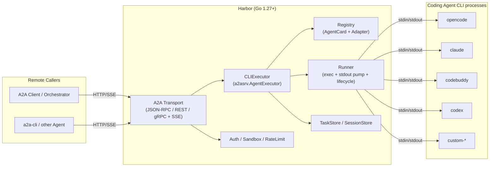

# Harbor — A Design for Wrapping Coding Agent CLIs as A2A Remote Agents

> Version: v1-rc (key decisions finalized, see A.12)
> Target language: Go 1.27+ (`iter.Seq2`, `log/slog`, `os/exec`, context cancellation)
> Dependencies: `github.com/a2aproject/a2a-go/v2` (A2A protocol v1.0, currently v2.6.0, requires Go 1.25+)
> Project codename: Harbor (a port for berthing/scheduling various "professional coding Agent processes")

---

## 1. Background and Goals

CLIs such as `opencode`, `codebuddy`, `claude`, and `codex` are all highly capable coding Agents, and **most already provide a server/remote mode** (e.g. `opencode serve`, `codebuddy --serve`, `codex app-server`). The problem is not "whether they can be remote", but that **their respective protocols and APIs differ from one another**:

| CLI | Wrappable form | Interface form |
|---|---|---|
| opencode | `serve` / `web` / `acp` | proprietary REST + SSE |
| codebuddy | `--serve` (REST/ACP-over-SSE) **and headless `-p`** | proprietary REST + ACP / headless |
| codex | `app-server` / `exec-server` / `remote-control` **and headless `exec`** | proprietary JSON-RPC-like protocol / headless |
| claude | **no local serve** (only headless `-p` / SDK / `--cloud`) | headless stream-json / SDK |

> Note: `-p/--print` is the **headless (non-interactive)** mode, **not serve**; Harbor's `exec` / `stream-json` adapters target exactly the headless mode, while `serve` / `app-server` are long-running services.

Their **discovery, authentication, session, task, streaming, and capability models are all non-uniform**, making it hard for remote systems and other Agents to invoke and orchestrate them through **a single client**.

**Goal**: Write a service in Go that normalizes any coding-agent CLI into a unified Agent Server conforming to **A2A (Agent2Agent) v1.0**, so as to:

- Invoke these heterogeneous CLIs through **a unified protocol** (JSON-RPC + SSE), instead of writing a separate client for each;
- Have each CLI expose a standard **AgentCard** that can be discovered and negotiated (including multi-CLI federation);
- Support **streaming output, task cancellation, multi-turn session resumption, permission/clarification interactions**;
- Unify **authentication, quota, sandboxing, auditing** (§9/§10/§11);
- Allow new coding-agent CLIs to be added **with no code changes** (configuration-driven), while also retaining Go interface-level extensibility.

**Protocol scope**: **only A2A v1.0 is supported** (as defined by `a2a.Version` exported by `github.com/a2aproject/a2a-go/v2`); v0.x / early drafts are not compatible. When the `A2A-Version` carried by a request does not match, `ErrVersionNotSupported` is returned.

**Non-goals (v1)**: no UI; no multi-Agent automatic routing decisions (DAG orchestration is left to the upper layer); no implementation of its own model access — it fully reuses each CLI's built-in capabilities and credentials.

---

## 2. Design Principles

| Principle | Description |
|---|---|
| **Thin wrapper, no reinvention** | Only responsible for "invoking the CLI + parsing output + translating into A2A events", not copying the CLI's agent logic. |
| **CLI differences isolated** | Each CLI's differences are concentrated in its `Adapter`, while the core executor and A2A layer remain free of special-casing. |
| **Configuration-first extension** | Adding a CLI prefers YAML configuration + built-in parser; only special cases require writing Go code. |
| **A2A semantic alignment** | Precisely express CLI behavior using A2A's `TaskState`, `contextId`, `artifact`, and `input-required`. |
| **Mechanisms built in, policies configurable** | Harbor only builds in mechanisms with "enforceable boundaries" (auth hooks, workdir constraints, process isolation, concurrency/timeout ceilings); the specific toggles and values are all configuration items, defaulting to least privilege. |

### 2.1 Mechanisms vs. Policies

Sandboxing, authentication, dangerous switches, etc. are all **configurable policies**, not design principles themselves. The principles only guarantee that "boundaries can be enforced", while whether to enable them and what values to use are left to the deployer:

| Configurable item | Config key | Default | Meaning of enabling |
|---|---|---|---|
| Authentication | `server.auth.mode` | `none` (local) / `bearer` (external) | Integrate with external systems |
| Workdir | `agents[].workdir` | Harbor's working directory | Pin a CLI to a project directory |
| Environment variables | `sandbox.inherit_env` | `true` (inherit the launching user's environment) | When set to `false`, only a whitelist is injected |
| Dangerous switches | `agents[].allow_dangerous` | `false` | Enable `--dangerously-skip-permissions`/`-y`/`bypassPermissions` |
| Container sandbox | `sandbox.container` | off | Strong isolation (network/filesystem) |
| Concurrency/timeout | `agents[].limits.*` | conservative values | Increase throughput |

> Conclusion: Harbor guarantees "boundaries can be enforced", but does not decide policies on behalf of the deployer; dangerous capabilities are always opt-in and are highlighted with warnings in the startup log.

---

## 3. Overall Architecture



### Component Responsibilities

| Component | Responsibility |
|---|---|
| `a2asrv.RequestHandler` | Provided by a2a-go; handles the protocol, task state machine, event persistence, and push. |
| `CLIExecutor` | Implements `a2asrv.AgentExecutor`; translates CLI output into A2A events. |
| `Registry` | Maintains `agentID → (AgentCard, Adapter, concurrency quota)`. |
| `Runner` | Starts/kills child processes, pumps stdout line/byte-wise, handles timeouts and process groups. |
| `Parser` | Parses raw CLI output (stream-json / text / custom) into unified events. |
| `SessionStore` | Maintains the `A2A contextId ↔ CLI native sessionId` mapping. |
| `Sandbox` | Per-agent workdir, environment variable trimming, optional containerization. |

### 3.1 Multi-CLI Management

Harbor's very purpose is to **host multiple coding CLIs simultaneously**, in three layers:

- **Host multiple CLIs (v1)**: a single process loads multiple CLIs according to the `agents:` list, each generating its own `/agents/{id}` route and independent AgentCard; the `Registry` maintains `agentID → (Card, Adapter/Launcher, quota)`.
- **Per-agent isolation**: each agent has independent capabilities (→Card projection), concurrency quota, workdir, `allow_dangerous`, and **credential/home isolation** (§10.3), without cross-contamination.
- **Same CLI, multiple modes**: the same binary can be registered multiple times (e.g. `codebuddy`(stream-json) + `codebuddy-acp`), each producing a card for the client to choose from.

**Out of scope**: **intelligent routing/automatic selection** across CLIs (belongs to upper-layer orchestration, §1 non-goal); **installation/upgrade** of CLI binaries (only `Probe` liveness and login-state detection, §10.5).

> Optional deployment: a single process with multiple agents (unified auth/quota/operations) or an independent process/container per agent (stronger isolation); see §18.

---

## 4. Core Abstraction: Adapter + Parser + Runner

### 4.1 Unified Event Model

Different CLIs have different output formats; first normalize them into an internal event stream:

```go
package agent

type EventKind int

const (
    EventSession    EventKind = iota // a CLI session id was discovered
    EventTextDelta                   // incremental streamed text
    EventTextFinal                   // final text
    EventThinking                    // reasoning/thinking content (optional)
    EventToolCall                    // a tool call started
    EventToolResult                  // a tool call finished
    EventPermissionRequest           // the CLI asks for permission/clarification
    EventUsage                       // token/cost usage
    EventError
    EventDone
)

type Event struct {
    Kind      EventKind
    Text      string
    Tool      string
    ToolInput map[string]any
    SessionID string
    Usage     *Usage
    Err       error
    Raw       []byte // raw record, for passthrough/debugging
}
```

### 4.2 Request Model (A2A → normalized)

```go
type Request struct {
    Prompt      string
    SystemExtra string // appended system prompt
    Model       string
    Agent       string // CLI-internal agent name (claude/codebuddy)
    WorkDir     string
    SessionID   string // CLI-native session id (for resume)
    Continue    bool   // --continue
    MaxTurns    int
    Meta        map[string]any
}
```

### 4.3 Adapter Interface (the key to extensibility)

```go
type Adapter interface {
    // Name returns the agent id, e.g. "opencode".
    Name() string
    // Probe checks the binary's presence/version, for health checks and the AgentCard.
    Probe(ctx context.Context) (Info, error)
    // Invocation builds one CLI invocation (command, args, env) from a request.
    Invocation(req *Request) (*Invocation, error)
    // Parser returns the output parser for this CLI.
    Parser() Parser
    // Capabilities declares the effective capabilities, driving AgentCard projection
    // and request validation.
    Capabilities() Capabilities
}

type Invocation struct {
    Bin  string
    Args []string
    Env  []string
    Dir  string
    Stdin io.Reader // optional: stream-json input mode
}

type Parser interface {
    // Parse handles one record (line/JSON) and emits 0..N events via out.
    Parse(rec []byte, out func(Event)) error
    Flush(out func(Event)) error
}
```

> **Decoupling point**: the `Adapter` decides "how to invoke", the `Parser` decides "how to read", and the `Runner` decides "how to run". All three can be replaced independently, thereby covering the vast majority of CLIs.

### 4.4 Runner: process lifecycle

```go
type Runner struct {
    MaxConcurrent int
    sem           chan struct{}
    procs         sync.Map // taskID -> *Process
}

func (r *Runner) Start(ctx context.Context, taskID string, inv *Invocation, p Parser) (<-chan Event, error) {
    cmd := exec.CommandContext(ctx, inv.Bin, inv.Args...)
    cmd.Dir = inv.Dir
    cmd.Env = sandboxEnv(inv.Env) // build explicitly; do not inherit the parent env implicitly
    // Separate process group so the whole tree can be killed together.
    setProcessGroup(cmd)
    // Pipe stdout line by line into the Parser; collect stderr separately as a log.
    // ctx.Done() -> SIGTERM the process group, then SIGKILL after a grace period.
    ...
}
```

Key points:

- **Process-group isolation**: CLIs often spawn further child processes (shell, MCP server), so the whole group must be killed.
- **Idle/total timeout**: `WithAgentInactivityTimeout` (provided by a2a-go) + a custom total timeout.
- **stderr must not pollute the protocol stream**: it is merged only into logs and error diagnostics, never treated as an artifact.
- **Backpressure**: the event channel has a bounded buffer; when the client consumes slowly, reads block to avoid memory growth.
- **Process control is platform-specific**: Unix uses process groups (`SysProcAttr{Setpgid:true}` + `kill(-pgid, ...)`), while Windows uses a Job Object / `taskkill /T`; split implementations by build tag (`runner_unix.go` / `runner_windows.go`) (see §10.3 for details).
- **Cancellation must go through `Runner.Kill` (process group)**: cancelling the ctx of `exec.CommandContext` only kills the **direct child process**, not the process group; both idle and total timeouts should call `Runner.Kill`, not rely solely on the ctx default behavior.

### 4.5 Complexity Control: Modes Are Shared Infrastructure, No Runtime Negotiation

"Automatically selecting a mode by capability (ACP → stream-json → exec)" looks flexible, but in reality it explodes complexity: N CLIs × M modes, runtime fallback branches, and the behavioral differences between bidirectional (ACP) and unidirectional (line) leaking into the executor. Therefore it is **converged** to:

1. **One Adapter binds to exactly one integration mode** (determined **statically** at registration/configuration time); the core performs no runtime mode negotiation.
2. **Modes are shared infrastructure, not rewritten per CLI**: **`headless` (with a `text` / `stream-json` parser), `server`, and `acp`** each only need to be implemented once and can be reused by multiple CLIs (claude+codebuddy share headless/stream-json; opencode+codebuddy share ACP or server; codex uses headless/jsonl). **The number of Launchers ≈ 3, not CLI×mode.**
3. **CLI differences should be as declarative as possible**: argument templates, capability flags, and session-flag mappings go into the Spec/configuration; only quirks require writing a thin Adapter.
4. **The core recognizes only one contract**: `Launcher.Start → Session{ Events(); Send(); Cancel() }`. Both line-based and ACP implement it, and the Executor is unaware (`Send` is used for **duplex** modes: permission/clarification/continuation answers in ACP and stream-json stdin input; it is a no-op for pure one-shot `exec` mode).
5. **Fallback is explicitly optional**: when "degrade if a certain mode is unavailable" is truly needed, use an **explicit composite launcher** or a configuration policy, rather than core default behavior.

```go
// The single core contract; transport-agnostic.
type Session interface {
    Events() <-chan Event
    Send(ctx context.Context, in Input) error // duplex (ACP / stream-json stdin) for permission/clarification/answers; no-op for one-shot exec
    Cancel() error
    Wait() error
}

type Launcher interface { // implemented once per mode, reused by many CLIs
    Name() string
    Capabilities() Capabilities
    Probe(ctx context.Context) Info              // liveness/version/capability only; no mode negotiation
    Start(ctx context.Context, req *Request) (Session, error)
}
```

> Relationship: the `Adapter`/`Parser` of §4.3 and the `Runner` of §4.4 are the internal implementation of the **line-based mode** (exec / stream-json) under the same contract; the ACP mode is another implementation of `Launcher/Session`. To the Executor the two are indistinguishable.

Thus the complexity upper bound = **number of modes + number of CLI configurations**, rather than a Cartesian product.

---

## 5. Per-CLI Adaptation Strategy

The Adapter selects an "integration mode" for each different CLI. The following is based on the actual `-h` arguments of each CLI:

| Agent | Adaptation form | Key arguments | Session resumption | Notes |
|---|---|---|---|---|
| **claude** | headless `stream-json` | `-p --output-format stream-json --verbose --input-format stream-json --include-partial-messages` | `--resume <id>` / `--session-id <uuid>` | Structured stream; `--append-system-prompt`, `--allowedTools`, `--permission-mode`. |
| **codebuddy** | headless `stream-json` / `exec` / `acp` / `server` | `-p --output-format stream-json --input-format stream-json --include-partial-messages`; `--serve` | `-r/--resume`, `--session-id`; server uses `conversation.id` | Same lineage as claude; the dangerous switch is `-y/--dangerously-skip-permissions`; `--acp` (stdio); `--serve` exposes **two protocols, HTTP API and ACP-over-HTTP** (`server_protocol`, see §5.4). |
| **opencode** | headless `text` or `server` | `run <msg> -m provider/model --agent <a> --session <id> --continue`; or `serve` / `acp` | `--session` / `--continue` / `--fork` | `run` has no stream-json, so line buffering approximates streaming; for structured output use `serve`(HTTP) or `acp`. |
| **codex** | headless `exec` (`--json`) or `server` | `codex exec "<prompt>"`; `-m` / `-C/--cd` / `-s/--sandbox` / `-a/--ask-for-approval` / `-i/--image` / `--add-dir` / `--json` / `--output-schema` / `-o/--output-last-message` | `codex exec resume --last` / `codex exec fork` | Dangerous switch `--dangerously-bypass-approvals-and-sandbox`; for a long-running service use `app-server`. |
| **custom** | headless `text` / `regex` | specified by YAML | specified by YAML | Generic template Adapter, covering any binary. |

> Note: claude/codebuddy prompts are passed via `--input-format stream-json` from **stdin** (the first user message), not as positional arguments; this makes the Session bidirectional (`Session.Send`), so permission/clarification can be answered natively (see §4.5, §7.4). codex has no structured input; `exec` passes the prompt as stdin text.
>
> **CLI Profile**: Harbor has built-in profiles recognized by **binary name** (`codebuddy`→`stream-json`, `claude`→`stream-json`, `opencode`/`codex`→`exec`). When the configuration omits `integration`, its default is used; when it is configured explicitly but **not supported by that CLI**, startup fails (e.g. `claude`+`exec`); **an unknown binary must specify `integration` explicitly**. Therefore there is no need to memorize "when to configure which mode".
>
> **Minimum version**: the profile records the **minimum version** already adapted (e.g. codebuddy `2.161.4`, claude `2.1.292`, opencode `1.18.35`, codex `0.160.1`). The version is probed at startup, and **if it is below that version, startup is refused with a prompt to upgrade**; if the version cannot be probed, the check is skipped. If a future version turns out to be incompatible, a **compatibility branch keyed by version number** is added in the corresponding adapter (rather than introducing a variants framework now).
>
> **See §5.4 for each CLI's concrete launch arguments, credential environment variables, and configuration root.**

### 5.1 Integration Mode Definitions

First distinguish **transport/interaction form**, then subdivide headless modes by **input/output framing**. The following are all implementation forms of the `Adapter`, **statically chosen** at registration time (§4.5); none is superior to another:

**A. Headless**: Harbor spawns a CLI child process and communicates via stdin/stdout. `-p/--print`, `codex exec`, and `opencode run` all belong here. They are further divided by framing:

- `stream-json` / JSONL: `-p --output-format stream-json` (claude/codebuddy), `codex exec --json`; structured streams, each schema mapped by its own Parser.
- `text`: one-shot stdout as the final text artifact (`opencode run`; `codex exec` without `--json`). When configured as `exec`, **the args must contain `{{.Prompt}}`** (otherwise startup validation fails and suggests switching to `stream-json`).

**B. Server**: the CLI is a long-running HTTP/app-server (`opencode serve`, `codebuddy --serve`, `codex app-server`); Harbor acts as a **client proxying its API** → A2A. It is just one implementation of "how to invoke". **Already implemented: opencode** — Harbor lazily launches `opencode serve` (`--port 0`, parsing the listening URL from stdout; `server_url` can also be used to connect to an existing instance), and reuses the server-side session by `contextId` (the first task `POST /session` creates a session and reports its id; subsequent tasks with the same context reuse it directly). **Per-token streaming**: first subscribe to `GET /event` (SSE), then `POST /session/:id/message {parts:[{type:"text",text}]}`; the `delta` of `message.part.delta` (`field=="text"`, filtered by sessionID) is used as incremental output, and the blocking reply of the prompt serves as a **fallback** (when SSE is unavailable, the whole text is used); `POST /session/:id/abort` cancels. Measured: a real-machine single round returned 9 deltas, with the text `"1 2 3 4 5"`.

**Already implemented: codebuddy** — the HTTP server of `codebuddy --serve` **exposes two protocols at once**; Harbor selects one with `server_protocol`:

- **HTTP API** (default, `server_protocol: http`): Harbor spawns `codebuddy --serve --host 127.0.0.1 --auth none` (parsing the listening URL from the `Endpoint` line of stdout; `server_url` can also be used to connect to an existing instance), and drives its runs API: `POST /api/v1/runs` (Gateway message body, with `source.conversation.id` = session id) → `runId` → `GET /api/v1/runs/:runId/stream` (SSE). The reply is **turn-level**: one `message` (`content.markdown` holds the whole text) followed by `done`; `POST /api/v1/runs/:runId/cancel` cancels. Multi-turn continuity is maintained by `source.conversation.id`, and Harbor reports the generated session id as an `EventSession` and reuses it. All requests carry `X-CodeBuddy-Request: 1` (CSRF header).
- **ACP over HTTP** (`server_protocol: acp`): `/api/v1/acp` of the same server (JSON-RPC over SSE, the same ACP protocol as `--acp` (stdio), only the transport differs). Harbor does `POST /api/v1/acp/connect` to obtain a `connectionId`; **commands are sent with `POST /api/v1/acp`, and their responses plus the notifications related to that command flow back in the SSE reply of that same POST**; a separate `GET /api/v1/acp` (with the `acp-connection-id` header) receives server-**initiated** notifications. Harbor reuses the exact same `conn`/`session` mapping as stdio ACP (`initialize` → `session/new` (or `session/load`) → `session/prompt`, `session/update` streaming, `session/request_permission` bridging), so its capabilities match `--acp` (per-token, tool trace, permission interaction). The `connectionId` is established per task and `DELETE`d at the end of the turn, while the server process is reused across tasks.
  - **`--acp-transport streamable-http` (`server_protocol: acp-streamable-http`)**: `codebuddy --acp --acp-transport streamable-http` starts a long-running ACP service that prints `ACP streamable-http endpoint: http://host:port/api/v1/acp` to **stderr** (so `SpawnServer` scans both stdout and stderr to obtain the listening address). Its wire protocol is **exactly the same** as above (`POST /api/v1/acp/connect` obtains a `connectionId`; `POST /api/v1/acp` + the `acp-connection-id` header sends commands and returns frames over SSE; `GET` subscribes to initiated notifications, all carrying `X-CodeBuddy-Request: 1`), so it reuses the same ACP-over-HTTP client; the only differences are the launch arguments (changed to `--acp --acp-transport streamable-http`) and **endpoint normalization**: the printed URL already contains `/api/v1/acp`, so Harbor strips that suffix to get the base and re-appends `acpPath`, letting `--serve` (which prints the server root) and this mode share the same path assembly.

**Already implemented: codex** — `codex app-server` (**newline-delimited JSON-RPC over stdio**; the protocol is produced by `codex app-server generate-json-schema` and verified on a real machine via `initialize`/`thread/start`/`turn/start`). Flow: `initialize` → `thread/start` by context (with `approvalPolicy:"never"` for unattended operation) or `thread/resume {threadId}` → `turn/start {threadId, input:[{type:"text",text}]}`; the `delta` of `item/agentMessage/delta` is used as incremental output, `turn/completed` (`status`) finishes it, `error` (`willRetry:false`) fails it, and `turn/interrupt` cancels. Harbor acts as a client proxying its API. (Note: the local codex login has expired, so on a real machine only the handshake/thread/turn/error routing can be verified; the successful incremental path is covered by tests with a fake server.)

**C. ACP**: the CLI is a long-running ACP server (`opencode acp`, `codebuddy --acp`) over stdio; Harbor acts as an ACP client, bidirectional. **Already implemented** (stdio; the serverized endpoint of `codebuddy --acp --acp-transport streamable-http` is implemented, see §5.4 `server_protocol: acp-streamable-http`).

> Interactive TUI is not used. `-p/--print` is a **headless flag** (present in both claude/codebuddy), **not serve** — it is the carrier of `stream-json` / `text` modes.
>
> Configuration value mapping for `integration`: `exec` (headless/text), `stream-json` (headless/structured), `server`, `acp`.

> Implementation order: **M1 = headless `stream-json` (codebuddy; claude comes along from the same lineage) + headless `text` (opencode `run`)** → then `exec` (codex/custom) → `server` → `acp`. **The order reflects only implementation cost, not mode superiority.** Current status: `stream-json` / `exec` / `acp` / `server` (opencode, codebuddy, codex) are already implemented.

### 5.2 Integration Mode Trade-offs (Why ACP Is Not Prioritized)

ACP (Agent Client Protocol) is very appealing, but it is a **conditionally optimal** choice and not universally superior, so it is not the v1 first choice / sole implementation:

| Dimension | ACP | Headless (stream-json / exec) |
|---|---|---|
| Coverage | Some CLIs: `opencode` / `codebuddy` have it; `claude` / `codex` do not | claude / codebuddy / codex support it directly |
| Role | Harbor acts as an ACP **client**, needing to implement the protocol + callbacks (`fs/*`, `terminal/*`, `permission`) | Harbor only reads stdout |
| Scenario | Transport is not limited to stdio: opencode uses stdio; `codebuddy --acp-transport streamable-http` can be serverized | Remote / batch / unattended one-shot tasks |
| Alignment cost | Unifies the "downstream", but the upstream A2A projection (§7) stays the same | One Parser per CLI |
| Stability | The protocol is still evolving; the schema may change with CLI upgrades | claude/codebuddy have official stream-json implementations |
| Security surface | Must respond to fs / terminal callbacks; larger boundary | Smaller boundary |

Decision:

- **The mode is statically chosen at registration/configuration time (one Adapter, one mode)**, and the core performs no runtime mode negotiation; `Probe()` only does liveness/version/capability detection (see §4.5 for details). Selection rationale: needs rich interaction and supports ACP → `acp`; needs a structured stream → headless `stream-json`/JSONL; has a stable serve/app-server and needs high concurrency/session reuse → `server`; otherwise headless `text`.
- The real hard constraints are **coverage** (claude/codex have no ACP) and **the implementation cost of Harbor as a client**, not "ACP can only be stdio/editor".
- **The implementation order follows "coverage + cost"**: v1 uses stream-json/exec to first cover all four → v2 uses ACP to converge and unify (only for CLIs that support it). Both serverized paths of codebuddy are already implemented: `--serve` (`server_protocol: acp`) and `--acp --acp-transport streamable-http` (`server_protocol: acp-streamable-http`), which use the same ACP-over-HTTP client.
- ACP is the only **cross-CLI standardized** integration protocol, and in the long run it is indeed the optimal convergence point; but "long-term unification" does not equal "short-term priority". (The various HTTP `app-server`/`serve` implementations also differ from one another and are not standardized, so ACP remains the long-term goal.)
- **ACP is already implemented along this path (stdio)**, and `opencode acp` passes end-to-end in real-machine testing. Coverage: the single-turn lifecycle of `initialize` → `session/new` → `session/prompt`, the streaming mapping of `session/update` (`agent_message_chunk` / `agent_thought_chunk` / `tool_call` / `tool_call_update`), and the bridging of `session/request_permission` → A2A `input-required` (the answer being the selected `optionId`). `fs/*` and `terminal/*` are **neither declared nor implemented**: real-machine testing shows opencode uses its own tools and does not call back to these methods, so method-not-found is returned only for undeclared capabilities. Cross-task session resumption (`session/load`) is **already implemented**: each task still corresponds to one process/session lifecycle, but when a request carries a `sessionId` (recorded by the executor per `contextId` from an `EventSession`), after `initialize` it switches to `session/load` to load that session (falling back to `session/new` if the CLI does not support it), and reports an `EventSession` after startup so that subsequent tasks can resume.

### 5.3 stream-json → Unified Event Mapping (illustrative)

```go
// Input looks like {"type":"assistant","message":{"content":[{"type":"text","text":"..."}]}}
// or {"type":"content_block_delta","delta":{"text":"..."}}, {"type":"result",...}
func (p *streamJSONParser) Parse(rec []byte, out func(Event)) error {
    var e struct {
        Type    string          `json:"type"`
        Subtype string          `json:"subtype"`
        Session string          `json:"session_id"`
        Message json.RawMessage `json:"message"`
        Result  string          `json:"result"`
        IsError bool            `json:"is_error"`
    }
    if err := json.Unmarshal(rec, &e); err != nil { return err }
    if e.Session != "" { out(Event{Kind: EventSession, SessionID: e.Session}) }
    switch e.Type {
    case "content_block_delta": // incremental text
        out(Event{Kind: EventTextDelta, Text: extractDelta(e)})
    case "assistant": // a full assistant message (may contain tool calls)
        for _, blk := range extractBlocks(e) {
            if blk.Type == "tool_use" { out(Event{Kind: EventToolCall, Tool: blk.Name, ToolInput: blk.Input}) }
        }
    case "result":
        out(Event{Kind: EventTextFinal, Text: e.Result})
        out(Event{Kind: EventDone})
    }
    return nil
}
```

> This section is a **simplified illustration**; the complete implementation is governed by **A.7** (including `stream_event` nesting and thinking / tool_result).
>
> **Text rule**: `stream_event` increments take priority — once increments have been seen, the whole text of `assistant` is skipped (to avoid duplication); if neither appears, `result.result` is used as the **fallback** (`EventTextFinal`, written by the Executor). The parser is stateful; one instance is created per task (`NewParser`) to avoid interference between concurrent tasks.

### 5.4 Each CLI's Launch Arguments and Environment Variables (concrete values)

Harbor drives the CLIs **only in non-interactive mode**: **credentials are always injected via environment variables**, and Harbor does not run login commands or handle `/login` (see §10.4). Below are the concrete conventions for each CLI; `agents[].args` / `agents[].env` / `agents[].session` can be configured accordingly, and when unset the profile defaults are used (§5).

> **Scope**: this section lists only the credential / configuration / gateway variables and launch arguments that **Harbor depends on to drive that CLI**; it is **not the complete set of each CLI's environment variables** (each CLI has many additional telemetry, UI, MCP, A2A, etc. variables unrelated to Harbor; for the complete list refer to each CLI's official documentation, e.g. codebuddy <https://www.codebuddy.ai/docs/zh/cli/env-vars>).

**Common environment base**: when isolating, redirect the CLI's configuration root to `sandbox.cli_home` (§10.3) — on Unix use `HOME` / `XDG_CONFIG_HOME`, on Windows use `USERPROFILE` / `APPDATA` / `LOCALAPPDATA`, then layer each CLI's dedicated configuration variables on top.

#### claude

- **Integration mode**: `stream-json`.
- **Launch arguments**: `-p --output-format stream-json --verbose --input-format stream-json --include-partial-messages` (the prompt is passed via a stream-json user message on **stdin**). Harbor appends `--model <m>` and `--append-system-prompt <s>`; `allow_dangerous` → `--dangerously-skip-permissions`.
- **Session resumption**: `--resume <id>` / `--session-id <uuid>` / `-c/--continue` / `--fork-session`.
- **Credential variables**: `ANTHROPIC_API_KEY` (`X-Api-Key`; under `-p` it is used as long as it exists), `ANTHROPIC_AUTH_TOKEN` (`Authorization: Bearer`), `CLAUDE_CODE_OAUTH_TOKEN` (claude.ai OAuth, taking precedence over Keychain). Third-party backends each have their own variables: Bedrock `CLAUDE_CODE_USE_BEDROCK` + `AWS_BEARER_TOKEN_BEDROCK`, Vertex `CLAUDE_CODE_USE_VERTEX`, Foundry `CLAUDE_CODE_USE_FOUNDRY` + `ANTHROPIC_FOUNDRY_API_KEY`.
- **Configuration root**: `CLAUDE_CONFIG_DIR` (default `~/.claude`).
- **Self-hosted gateway**: `ANTHROPIC_BASE_URL`.
- **Isolation point**: `--bare` (equivalent to the environment variable `CLAUDE_CODE_SIMPLE=1`) skips Keychain and OAuth; in this case Anthropic direct authentication **strictly uses `ANTHROPIC_API_KEY`** (or the `apiKeyHelper` of `--settings`), and `ANTHROPIC_AUTH_TOKEN` does not apply — this is the cleanest mode in a headless and isolated environment.

#### codebuddy

- **Integration mode**: `stream-json` (default) / `exec` / `acp` / `server`.
- **Launch arguments**: `-p --input-format stream-json --output-format stream-json --include-partial-messages` (the prompt is passed via **stdin**). Harbor appends `--model` and `--append-system-prompt`; `allow_dangerous` → `-y/--dangerously-skip-permissions`.
- **server mode** (`--serve`, including two protocols selected by `server_protocol`): Harbor spawns `codebuddy --serve --host 127.0.0.1 --auth none`, parsing the listening URL from the `Endpoint` line of stdout (or using `server_url`); all requests carry `X-CodeBuddy-Request: 1`.
  - `http` (default): `POST /api/v1/runs` (Gateway message body) + `GET /api/v1/runs/:runId/stream` (SSE, turn-level `message` + `done`), with `source.conversation.id` maintaining multi-turn continuity.
  - `acp`: `/api/v1/acp` (ACP over HTTP/SSE, the same protocol as `--acp`) — `connect` → commands go through `POST` (responses/related notifications flow back in the SSE reply of that POST) → `GET` receives initiated notifications; reuses the stdio ACP mapping of `session/new`/`session/load`/`session/prompt`/`session/update`/`session/request_permission`, with capabilities matching `--acp` (per-token, tool trace, permission interaction).
- **Interaction** (headless `stream-json`): permissions are bridged to `input-required` via `control_request`/`can_use_tool`; questions (`AskUserQuestion`) likewise go through `can_use_tool` and require `sdk_capabilities: true` to declare the `askUserQuestion` capability before the first prompt, degrading to `InteractionQuestion` (see §7.4).
- **Session resumption**: `--resume` / `--session-id` / `-c` (headless); `server`+`http` uses `source.conversation.id`; `server`+`acp` uses ACP `session/load` (the id returned by `session/new` is reused as `EventSession`).
- **Credential variables**: `CODEBUDDY_API_KEY` (official docs: **always used** in non-interactive `-p` mode), `CODEBUDDY_AUTH_TOKEN`, `ANTHROPIC_API_KEY` (for a self-hosted gateway speaking the Anthropic protocol).
- **Configuration root / model / gateway**: `CODEBUDDY_CONFIG_DIR` (default `~/.codebuddy`), `CODEBUDDY_MODEL`, `CODEBUDDY_BASE_URL`.
- **dangerous fully enabled**: `-y` **and** the process environment `CODEBUDDY_IS_SANDBOX=1` (isolated sandbox only).
- **Other optional**: `CODEBUDDY_INTERNET_ENVIRONMENT` (`internal`/`ioa` builds), `CODEBUDDY_STREAM_TIMEOUT_MS` / `CODEBUDDY_FIRST_TOKEN_TIMEOUT_MS` (stream silence ceilings), `CODEBUDDY_CODE_MAX_TURNS` (turn limit), `DISABLE_TELEMETRY` / `DISABLE_AUTOUPDATER`.
- **`--serve`'s own authentication**: `--auth password|none` (default `password`; `none` disables authentication, allowing any local process to execute commands/read/write files through that service). Harbor spawns with `--host 127.0.0.1 --auth none` (loopback only, not exposed externally; consistent with the unauthenticated loopback stance of the opencode server), and always carries `X-CodeBuddy-Request: 1`. This is serve's own HTTP authentication and is unrelated to Harbor's A2A authentication (§9).
- **Official complete set**: <https://www.codebuddy.ai/docs/zh/cli/env-vars>.

#### opencode

- **Integration mode**: `exec` (default) / `acp` / `server`.
- **Launch arguments**: exec `run {{.Prompt}} -m {{.Model}}` (also `--agent`, `--variant`, `-f/--file`, `--format json`); acp `acp`; server `serve --hostname 127.0.0.1 --port 0` (`--port 0` is assigned by the kernel; the listening URL is parsed from stdout).
- **Session resumption**: `-s/--session <id>` / `-c/--continue` / `--fork`.
- **Credential variables**: provider key (`ANTHROPIC_API_KEY` / `OPENAI_API_KEY` / `GEMINI_API_KEY`, etc., or `OPENCODE_API_KEY`); or the credential file `~/.local/share/opencode/auth.json` (written by `opencode providers login`), and headless injection can use `OPENCODE_AUTH_CONTENT` (inline auth.json content; confirmed from source/binary, not listed in official docs).
- **Configuration root**: `OPENCODE_CONFIG` (custom config file), `OPENCODE_CONFIG_DIR` (custom config directory), `OPENCODE_CONFIG_CONTENT` (inline JSON, highest priority); default `~/.config/opencode`, following `XDG_CONFIG_HOME`.
- **HTTP authentication of `serve`/`web`**: `OPENCODE_SERVER_PASSWORD` (+ `OPENCODE_SERVER_USERNAME`, default `opencode`) — applies only to the long-running service and is unrelated to Harbor A2A authentication.
- **dangerous**: `--auto`.

#### codex

- **Integration mode**: `exec` (default) / `server`.
- **Launch arguments**: exec `exec --json --skip-git-repo-check {{.Prompt}}` (also `-m/--model`, `-s/--sandbox`, `-a/--ask-for-approval`, `-C/--cd`, `--output-schema`, `-o/--output-last-message`); server `app-server` (with the default `--listen stdio://`; `thread/start` carries `cwd` and `approvalPolicy:"never"`).
- **Session resumption**: `exec resume --last` / `exec resume <id>`.
- **Credential variables**: `OPENAI_API_KEY` (read from stdin by `codex login --with-api-key`), `CODEX_API_KEY` (used directly by **non-interactive** `exec`/`review`/SDK), `CODEX_ACCESS_TOKEN` (trusted automation; `login --with-access-token`).
- **Configuration root**: `CODEX_HOME` (default `~/.codex`), with configuration in `config.toml`.
- **Self-hosted gateway / custom provider**: via `openai_base_url` in `config.toml`, or `model_providers.<id>.base_url` (+ `env_key`). The official env docs do not list a base-url variable (the binary contains the string `OPENAI_BASE_URL` but this is not confirmed to take effect; `config.toml` is authoritative).
- **dangerous**: `--dangerously-bypass-approvals-and-sandbox`.

#### Cross-CLI Notes

- **Prompt passing**: claude / codebuddy pass the first user message via `--input-format stream-json` on **stdin** (the Session is therefore bidirectional and can natively answer permissions/clarifications); opencode / codex use the argument template `{{.Prompt}}`.
- **Model / system prompt**: claude / codebuddy have `--model` / `--append-system-prompt` appended by Harbor; opencode / codex go through their own templates (e.g. `-m {{.Model}}`).
- **Configuration-root isolation**: each CLI loads project-level configuration from **cwd** (`opencode.json`/`.opencode`, `.codebuddy`, `.claude`, `.codex`, etc.); Harbor only sets cwd to the task workdir and optionally redirects the configuration root (§10.3, §6.7).
- **Permission mode**: `allow_dangerous` maps to each CLI's dangerous argument (see above); codebuddy additionally requires `CODEBUDDY_IS_SANDBOX=1`.
- **Structured output / questions**: when the request carries `harbor.outputSchema`, stream-json appends `--json-schema` and the result becomes a `result` DataPart (§6.8); `sdk_capabilities: true` declares `askUserQuestion`, causing the agent's questions to go through `input-required` (§7.4).

---

## 6. A2A Mapping Design

### 6.1 AgentCard (Discovery and Negotiation)

Each agent generates a card; `stream-json`/`server` modes declare streaming capability.

```go
func CardFor(a agent.Launcher, info agent.Info, endpoint string) *a2a.AgentCard {
    caps := a.Capabilities() // effective capabilities, projected onto the card
    desc := info.Description // agents[].description override
    if desc == "" {
        desc = "Remote A2A wrapper for the " + a.Name() + " coding agent CLI"
    }
    return &a2a.AgentCard{
        Name:        "Harbor/" + a.Name(),
        Description: desc,
        Version:     info.Version,
        SupportedInterfaces: []*a2a.AgentInterface{
            {
                URL:             endpoint, // e.g. https://host/agents/<id>/ (with a trailing slash)
                ProtocolBinding: a2a.TransportProtocolJSONRPC,
                ProtocolVersion: a2a.Version, // fixed A2A v1.0
            },
        },
        Capabilities: a2a.AgentCapabilities{
            Streaming:         caps.Streaming != agent.StreamNone, // projected from capabilities; false for exec
            PushNotifications: true,
        },
        DefaultInputModes:  caps.InputModes(),   // text/plain[, image/*, application/json...]
        DefaultOutputModes: caps.OutputModes(),
        // Auth is part of the A2A surface; only declared when the server enforces it.
        SecuritySchemes:      cardSecuritySchemes(),      // nil when auth is none
        SecurityRequirements: cardSecurityRequirements(), // nil when auth is none
        // Skills advertise the agent's abilities to callers; they come from
        // agents[].skills (operator-configured). When none are set the card
        // advertises an empty skills list (the A2A field is still present).
        Skills: cardSkills(info.Skills),
    }
}
```

> Card override: `agents[].description` replaces the description text and
> `agents[].skills` lists the advertised skills (`display_name`/`version`
> likewise shape `name`/`version`). Each `AgentSkill` requires `id`, `name`, and
> `description` (A2A 1.0 §4.4.5; `tags` is part of the spec, emitted as an empty
> array when unset). Skills are operator-authored and describe what the agent can
> do for a caller; Harbor does not infer them from the CLI (its tools/subagents
> are internal and not reliably exposed).

> Authentication is at the transport layer: an HTTP middleware validates `Authorization: Bearer`, `a2asrv.NewCallContext` injects `CallContext.User`; the handler side reads the user with `CallContextFrom(ctx)` for auditing/quota. (The exact `a2a` security type fields are subject to the actual SDK.)

Exposure methods (a2a-go):

- `a2asrv.NewStaticAgentCardHandler(card)` mounted at `/.well-known/agent-card.json`;
- Multiple agents: `/agents/{id}/.well-known/agent-card.json` + `/agents/{id}/` (JSON-RPC handler, **with a trailing slash**, consistent with the card url);
- **Transports**: JSON-RPC (default), HTTP+JSON (A2A REST, `a2asrv.NewRESTHandler`, mounted at `<agent>/rest/`), and gRPC (`a2agrpc.NewHandler`, with one listener per `agents[].grpc_listen`). All three bindings are declared in the AgentCard's `supportedInterfaces`.
- **Protocol version fixed to A2A v1.0** (`ProtocolVersion: a2a.Version`): when `A2A-Version` does not match, `ErrVersionNotSupported` is returned.

#### 6.1.1 Compatibility Discovery Endpoint (codebuddy)

codebuddy ships with its own A2A client, whose remote discovery `CODEBUDDY_REMOTE_AGENTS_URL` expects an **array of cards** (top-level `[]AgentCard` or `{"cards":[...]}`), whereas the A2A standard well-known path returns only a **single card object**. Therefore an **additive, non-standard** endpoint is added:

- `GET /.well-known/agents.json` (**always provided**) → returns an **array of all agents' cards** `[]*a2a.AgentCard`; each card's `supportedInterfaces[].url` points to its own `/agents/{id}/` (with trailing slash).
- This endpoint **does not alter A2A v1.0 semantics**; it is only a compatibility layer; the standard single-card path is still retained.
- **Cards and the discovery endpoint are public** (RPC excluded): even when `auth.mode=bearer`, no token is required (see §9).

```go
// Aggregate discovery (additive compatibility endpoint): returns the built card
// array (each with its own /agents/{id}/ url).
func NewCardsHandler(cards []*a2a.AgentCard, cors ...string) http.Handler {
    return http.HandlerFunc(func(w http.ResponseWriter, r *http.Request) {
        if r.Method != http.MethodGet { w.WriteHeader(http.StatusMethodNotAllowed); return }
        setCORS(w, cors)
        w.Header().Set("Content-Type", "application/json")
        _ = json.NewEncoder(w).Encode(cards) // top-level array
    })
}
```

> The endpoint's `url` is generated by `endpointURL(baseURL, r, id)`: **`BaseURL` takes priority; when empty, the request origin is used (recognizing `X-Forwarded-Proto/Host`)**, returning `/agents/{id}/` with a trailing slash. Reference implementation: `go-agent-sdk/a2a/server/server.go` (`DiscoveryPath`/`cardsHandler`, a bare array; codebuddy also accepts `{"cards":[...]}`).

### 6.2 Event Mapping Table (CLI → A2A)

| Internal event | A2A event | Description |
|---|---|---|
| Request arrival | `NewSubmittedTask` + `TaskStateSubmitted` | Emitted when there is no `StoredTask` for the first time. |
| Process start | `NewStatusUpdateEvent(Working)` | |
| `EventTextDelta` | `NewArtifactEvent` (first) / `NewArtifactUpdateEvent` (subsequent) | Incrementally appended to the same artifact; **this is how real-time output is done**. |
| `EventThinking` | `NewStatusUpdateEvent(Working, msg)` or a separate artifact | Reasoning/thinking increments; by default collapsed into a status or a separate artifact to avoid noise. |
| `EventToolCall` | `NewArtifactUpdateEvent` (`application/json` metadata) or a status message | By default used as artifact metadata; configurable as a separate artifact. |
| `EventToolResult` | `NewArtifactUpdateEvent` (metadata) | Tool result, convenient for observing progress. |
| `EventPermissionRequest` | `NewStatusUpdateEvent(TaskStateInputRequired, msg)` | **Key**: pauses the task and waits for the client to reply. |
| `EventError` | `NewStatusUpdateEvent(TaskStateFailed, msg)` | After the first event, no error is returned; state is used instead. |
| `EventDone` | `NewStatusUpdateEvent(TaskStateCompleted)` | |
| Task terminal state | First emit the **code-change artifact** (§6.8), then `Completed` | Code changes are delivered as an artifact |
| Cancel request | `Cancel()` → kill process group → `TaskStateCanceled` | |

> **Real-time requirement**: by default output is **per-token** (claude/codebuddy add `--include-partial-messages`), avoiding "no response for ages". Per-token output applies **coalescing throttling** to `TaskArtifactUpdateEvent` (flush once every ~50–100ms or after N accumulated characters), so the first character is seen as early as possible without flooding SSE. CLIs without partial capability (opencode `run` / codex `exec`) use the `Working` state and tool events as activity heartbeats.
>
> All events in the table above are already implemented: `EventThinking / EventToolCall / EventToolResult / EventUsage` serve as tool/reasoning trace events (by default collapsed into artifact metadata, see §6.3).

### 6.3 Executor Skeleton (Launcher/Session)

> M1 already adopts the `Launcher/Session` contract of §4.5 (rather than only the line-based `Adapter`); this is what gives duplex (`Send`), per-token throttling, and `input-required` resumption a place to land.

```go
type CLIExecutor struct {
    launcher agent.Launcher
    sessions SessionStore  // contextId -> cliSessionID
    live     LiveSessions  // taskID -> agent.Session (kept alive for duplex)
}

func (e *CLIExecutor) Execute(ctx context.Context, execCtx *a2asrv.ExecutorContext) iter.Seq2[a2a.Event, error] {
    return func(yield func(a2a.Event, error) bool) {
        // A. input-required resume: the client replies with the same taskId; write
        //    the answer back to the original process and continue.
        if t := execCtx.StoredTask; t != nil && t.Status.State == a2a.TaskStateInputRequired {
            sess, ok := e.live.Get(execCtx.TaskID())
            if !ok { yield(failed(execCtx, "session lost"), nil); return }
            if err := sess.Send(ctx, answerFrom(execCtx.Message)); err != nil {
                e.live.Del(execCtx.TaskID()); yield(failed(execCtx, err.Error()), nil); return
            }
            if !yield(a2a.NewStatusUpdateEvent(execCtx, a2a.TaskStateWorking, nil), nil) { return }
            e.pump(execCtx, sess, yield) // keep consuming
            return
        }

        // B. First execution
        if execCtx.StoredTask == nil {
            if !yield(a2a.NewSubmittedTask(execCtx, execCtx.Message), nil) { return }
        }
        if !yield(a2a.NewStatusUpdateEvent(execCtx, a2a.TaskStateWorking, nil), nil) { return }

        req, err := e.toRequest(ctx, execCtx) // extract prompt/model/workdir/session
        if err != nil { yield(failed(execCtx, err.Error()), nil); return }

        sess, err := e.launcher.Start(ctx, req) // Session contract, implemented by line-based or ACP
        if err != nil { yield(failed(execCtx, err.Error()), nil); return }
        e.live.Put(execCtx.TaskID(), sess)
        e.pump(execCtx, sess, yield)
    }
}

// pump consumes session events, coalescing token deltas; on input-required it
// keeps the session and returns.
func (e *CLIExecutor) pump(ec *a2asrv.ExecutorContext, sess agent.Session,
    yield func(a2a.Event, error) bool) {

    var artifactID a2a.ArtifactID
    co := newCoalescer(80*time.Millisecond, 1024) // flush every ~80ms or 1KB
    emit := func(s string) bool { return yield(e.artifactEvent(ec, &artifactID, s), nil) }

    for ev := range sess.Events() {
        switch ev.Kind {
        case agent.EventSession:
            e.sessions.Bind(ec.ContextID(), ev.SessionID)
        case agent.EventTextDelta:
            if !co.Add(ev.Text, emit) { return }
        case agent.EventPermissionRequest:
            co.Flush(emit) // flush buffered text first
            // Keep sess (do not delete it); the task enters input-required.
            yield(a2a.NewStatusUpdateEvent(ec, a2a.TaskStateInputRequired,
                a2a.NewMessage(a2a.MessageRoleAgent, interactionPart(ev))), nil)
            return
        case agent.EventError:
            co.Flush(emit)
            e.live.Del(ec.TaskID()); yield(failed(ec, ev.Err.Error()), nil); return
        }
    }
    co.Flush(emit)
    e.emitChanges(ec, yield) // emit the code-change artifact before the terminal state
    e.live.Del(ec.TaskID())
    yield(a2a.NewStatusUpdateEvent(ec, a2a.TaskStateCompleted, nil), nil)
}

func (e *CLIExecutor) Cancel(ctx context.Context, ec *a2asrv.ExecutorContext) iter.Seq2[a2a.Event, error] {
    return func(yield func(a2a.Event, error) bool) {
        if sess, ok := e.live.Get(ec.TaskID()); ok {
            _ = sess.Cancel(); e.live.Del(ec.TaskID())
        }
        yield(a2a.NewStatusUpdateEvent(ec, a2a.TaskStateCanceled, nil), nil)
    }
}
```

Key points:

- **duplex resumption**: when a task is in `input-required`, a2a-go calls `Execute` again with the **same `taskId`** (`StoredTask != nil`); at this point the process is **not restarted**; instead `sess.Send(answer)` is written back to stdin to continue.
- **Process lifecycle decoupled from RPC**: the process's run ctx is derived by the Executor with `context.WithoutCancel` and stored by `taskID` (layered with `limits.timeout`); it **is not cancelled when `Execute`/RPC returns** — otherwise, when paused at `input-required`, the process would be reclaimed along with it and `Send` would write to an already-closed stdin (`file already closed`). It is cancelled only on **terminal state / `CancelTask` / timeout**. Trade-off: pause time (including waiting for an answer) counts toward the timeout; a paused task with no timeout configured lives forever, so interactive tasks should configure a timeout.
- **live session table**: `taskID → Session`, used by resumption and cancellation to locate the live process; deleted only on terminal state.
- **taskID threading**: the Executor passes `taskID` to the Launcher/Session via ctx (`agent.WithTaskID`); the line-based Launcher uses it to align the keys of `Runner.Start/Kill`, avoiding "cancel cannot find the process".
- **Coalescing throttling**: the `coalescer` flushes by time / bytes, avoiding flooding SSE per token.
- **One-way exec mode**: `Session.Send` is a no-op, and Capabilities declares interaction unsupported, so `input-required` is never reached.
- **pump scope (already implemented)**: handles `EventSession / EventTextDelta / EventTextFinal / EventStructuredOutput / EventPermissionRequest / EventThinking / EventToolCall / EventToolResult / EventUsage / EventError / EventDone`; tool/reasoning/usage events serve as trace and usage records.
- **live TTL/reaper**: `live` entries carry a last-activity time and TTL; when the client does not reply for a long time, they expire and are automatically `Cancel`ed and cleaned up, avoiding process/entry leaks (echoing the interaction persistence of §11).

### 6.4 Sessions and Multi-turn Resumption

- A2A `contextId` = a conversation thread; `taskId` = a single request.
- The first task parses the native `sessionId` from the CLI output and writes `SessionStore: contextId → sessionId`.
- For subsequent requests with the same `contextId`, the Adapter automatically appends `--resume <sessionId>` (claude/codebuddy) or `--session <id>` / `--continue` (opencode).
- **Scoped by caller**: since `contextId` is supplied by the client, both the `contextId → CLI session` and `contextId → working tree` bindings add the **authenticated user** (key = `user + "\x00" + contextId`); otherwise A could reuse B's `contextId` to continue into B's session/working tree. When unauthenticated (no user), it degrades to being keyed by `contextId` alone.
- **fork (already implemented)**: the `--fork` / `--fork-session` semantics select "continue writing or fork" via the A2A metadata `harbor.fork` (`Message.Metadata`); when the request carries a sessionId, `agents[].session.fork_flag` is appended after resume (profile defaults: claude/codebuddy `--fork-session`, opencode `--fork`), and the new session id is reported by the CLI and replaces the old one.

### 6.5 Permission/Clarification Interaction (input-required)

This is the difficulty in wrapping a coding agent (the complete capability-alignment model is in **§7**, and interaction normalization in **§7.4**): the CLI will ask "is it allowed to run this command?". Design:

1. The Parser recognizes a permission-request event;
2. The executor emits `TaskStateInputRequired` + a Message containing the question and options;
3. The client submits the answer with another `message/send` using the same `taskId`;
4. The executor, in **duplex mode** (`--input-format stream-json`), writes the answer back to the original process stdin;
5. The task resumes `Working`.

**M1 implementation**: claude/codebuddy use **native duplex** (the original process suspends and the answer is written back to stdin via `Session.Send`, see §6.3) with no degradation; CLIs without interaction capability such as opencode(exec) enable "non-interactive mode": configure `--auto` / preset `--allowedTools` or pre-authorize within the sandbox, **never emit** `input-required`, and truthfully declare unsupported in the Card. See §7.4 for the complete degradation matrix.

### 6.6 Streaming and Push

```go
handler := a2asrv.NewHandler(executor,
    a2asrv.WithTaskStore(store),
    a2asrv.WithPushNotifications(cfgStore, sender),
    a2asrv.WithAgentInactivityTimeout(10*time.Minute),
)
mux.Handle("/agents/codebuddy/", a2asrv.NewJSONRPCHandler(handler))
```

- Streaming: the client calls `message/stream`, and Harbor pushes `TaskArtifactUpdateEvent` over SSE.
- Push: very long tasks (compilation, tests) go through push notification so the client can be offline.

### 6.7 Workdir (from configuration)

A coding agent only makes sense inside a **real codebase**, and a CLI treats its **cwd as the project root** (loading `opencode.json`/`.opencode`/`.codebuddy`/`.claude`/`.codex`, skills and sub-agents from there). So which directory a CLI runs in is a **deployment property of the agent**, not a per-request parameter:

- **Source**: `agents[].workdir` — the directory the CLI is started in (its project root). When unset, the CLI inherits **Harbor's working directory**. To serve several projects, register several agents (one card each) — this matches how a CLI is normally used (`cd project && cli`).
- **Validation**: `agents[].workdir`, when set, must exist and be a directory (checked at startup; the agent is otherwise refused).
- **No per-request override**: A2A has no notion of a working directory, and requiring a custom `harbor.*` metadata key would not interoperate with standard clients. Harbor does not expose the server's filesystem layout to callers.
- **Binding to `contextId`**: the resolved directory is bound to the A2A `contextId` so that subsequent tasks of the same context (including `--resume`) **reuse the same working tree**.
- **Isolation strategy** (`sandbox.isolation`, configuration; determines concurrency safety):
  - `shared`: run directly in the configured directory (fastest; concurrent runs in the same directory interfere and are **lock-serialized by directory**).
  - `worktree` (recommended): when the directory is a git repository, create a `git worktree` for **each context** (under `sandbox.isolation_root`) for isolation and concurrency.
  - `copy`: for non-git directories, copy the directory per context.
- **cwd and `PWD`**: the child process is started with the resolved directory as **cwd**, and **`PWD`** is set to it in sync — `exec` only changes the kernel cwd and does not update the inherited `PWD`, while some CLIs (e.g. opencode) determine the session/project directory from `PWD`; if not synchronized, they read and write Harbor's cwd.

### 6.8 Collecting Code Changes and Expressing Them as Artifacts

The core output of a coding agent is **code changes**, which must be delivered as an artifact rather than only as final text.

- **Baseline snapshot**: record a baseline at task start — for a git repository take `HEAD` + `git status --porcelain`; for a non-git directory record the hashes of files within `workDir`.
- **Produce the diff**: at terminal state (or after a tool reports an edit), compute the changes: for git use `git diff <base>` (including tracked) + untracked files; for non-git compare against the baseline hashes to generate a unified diff.
- **artifact form**:
  - **diff artifact**: `Name="changes"`, `TextPart` (mime `text/x-diff`) or, for large changes, `FilePart` (URL, served by Harbor);
  - **per-file artifact (already implemented, optional)**: when `sandbox.file_artifacts: true`, in addition to the diff, each changed file is emitted as its own `FilePart` (MIME determined by extension, single file ≤1MiB, images not duplicated);
  - `Artifact.Metadata = {"agent","base","files":[...],"truncated":bool}`.
- **Streaming vs finalization**: by default it is delivered **once at finalization** (stable); if the CLI can report per-file edits (tool_result carrying a path), `ArtifactUpdateEvent` can be emitted incrementally per file.
- **Boundary**: only collect changes within the resolved workdir; very long diffs are trimmed and marked `truncated`; binaries report only paths.
- In coordination with §6.7: in `worktree` mode the diff is relative to that context's baseline.
- **Concurrency affects diff reliability**: in `shared` mode, concurrent runs in the same directory mix in others' changes → the diff is unreliable; production should use `worktree` or lock by directory (§6.7).

### 6.9 Request Metadata and Error-Code Contract

**Metadata keys** (`Message.Metadata`, uniformly prefixed with `harbor.`):

| Key | Type | Meaning |
|---|---|---|
| `harbor.model` | string | Model (passed through to the Adapter) |
| `harbor.agent` | string | CLI-internal agent name |
| `harbor.systemPrompt` | string | Appended system prompt |
| `harbor.fork` | bool | Fork the session instead of continuing |
| `harbor.maxTurns` | int | Maximum turns |
| `harbor.continue` | bool | Continue the most recent session when there is no sessionId (`--continue`) |
| `harbor.outputSchema` | object | JSON Schema: requires the CLI to produce a structured result, returned as a `result` DataPart artifact (stream-json: `--json-schema`, see §7.6) |
| `harbor.interactionId` | string | The interaction id to be echoed back when answering `input-required` (§7.4) |

**Error codes** (on failure placed in `TaskStatus.Message.Metadata["harbor.errorCode"]`, with a fixed value domain):

| code | Trigger |
|---|---|
| `unsupported_content` | The requested capability is not within the effective capabilities (§7.5) |
| `auth_required` | CLI provider not logged in / authentication invalid (§10.5). Value domain reserved; currently surfaced by the CLI's own error (not actively emitted) |
| `cli_not_found` | Binary missing or not executable |
| `agent_unavailable` | agent circuit-broken (consecutive failures) or not enabled; fast-fail (§11.2) |
| `timeout` | Total / idle timeout |
| `parse_error` | Output cannot be parsed |
| `internal` | Other |

> The client performs machine-level handling (re-login / switch agent / degrade) based on `errorCode`, rather than parsing natural language.

---

## 7. Capability Alignment Model

> This is the **most central difficulty** of this design: A2A defines a general capability surface (input/output MIME, streaming, `input-required`, extensions), while each CLI's real capabilities are a **heterogeneous subset** — some support image input, some have a separate "structured question" tool, and some have a completely different permission model. Taking the "least common denominator" wastes capability, while forcing uniformity fabricates it. Principle: **declare real capabilities + normalize via projection + degrade explicitly**.

### 7.1 Three Layers of Capability Surface

| Layer | Who defines it | Examples |
|---|---|---|
| CLI native capabilities | each CLI | claude's image input / `AskUserQuestion` / `--permission-mode`; opencode's `--auto` (permission system); codebuddy's text-to-image model |
| Harbor canonical capabilities | this design | An internal capability descriptor `Capabilities` finer-grained than A2A |
| A2A exposed capabilities | A2A spec | The AgentCard's `DefaultInputModes`/`DefaultOutputModes`, `Capabilities`, `Extensions` |

Alignment = **projection**: Canonical → A2A fields (externally, fidelity may be lost); at the same time Canonical serves as the basis for **request-time validation** (internally, rejecting unsupported capabilities). Neither can be missing.

### 7.2 Canonical Capability Descriptor

```go
type Capabilities struct {
    // Input
    InputText   bool
    InputImage  []string // accepted MIME types, e.g. image/png
    InputFile   bool     // accepts file/directory references
    InputData   bool     // accepts structured DataPart input
    InputPrompt bool     // supports system / append system prompt
    // Output
    OutputText bool
    OutputFile bool // produces files / patches
    OutputData bool // structured JSON (json-schema)
    ToolTrace  bool // tool calls are observable
    // Interaction
    Permission          PermissionModel   // none | flag_only | interactive
    AskQuestion         bool              // proactive clarification (choice / free text)
    PlanApproval        bool
    InputRequiredResume bool              // can answer within the original process after a pause
    // Session / streaming / other
    SessionResume bool
    SessionFork   bool
    Streaming     StreamGranularity // none | turn | token
    SubAgents     bool
    Worktree      bool
    Sandbox       bool
}
```

`Probe()` produces the **effective capabilities**: static declaration + `--version`/`--help` probing + configuration overrides. It simultaneously drives the AgentCard, request validation, and degradation strategy, and is the "single source of truth".

### 7.3 Projection to A2A (Canonical → Card)

| Canonical | A2A field |
|---|---|
| `InputText` / `InputImage` / `InputFile` / `InputData` | `DefaultInputModes` (`text/plain`, `image/png`, `application/pdf`, `application/json`, …) |
| `OutputText` / `OutputFile` / `OutputData` | `DefaultOutputModes` |
| `Streaming != none` | `Capabilities.Streaming` |
| `ToolTrace` / rich interaction | `Capabilities.Extensions[]` (interaction extension, see below) |
| `Permission` / `AskQuestion` / `PlanApproval` | see §7.4 interaction normalization |

> A2A only understands MIME and cannot express "only accepts an image **path** or raw bytes". The **form** of the input (raw / URL / local path) is supplemented through extension parameters.
>
> **Interaction extension URI**: `https://github.com/jiaweisky/harbor/extensions/interaction/v1` (`extensions/interaction.md` in the repo provides the JSON schema). It is declared in the Card only when `Permission==interactive || AskQuestion || PlanApproval`; clients that do not support the extension fall back to text Q&A.

### 7.4 Interaction Normalization (permission / ask question / plan)

The three kinds of "questions" have different semantics; they are unified into an **interaction description** carrying a `kind`, conveyed via A2A `input-required` + `DataPart`:

```json
{
  "kind": "permission",
  "id": "itx_abc123",
  "action": "run_shell",
  "target": "rm -rf build/",
  "risk": "high",
  "options": ["approve", "deny", "allow_always"],
  "resume": true
}
```

- `permission`: a **security gate** (approve / deny / allow-always). Maps claude `--permission-mode`/`--allowedTools`, opencode `--auto`, codebuddy `-y`.
- `question`: the Agent's **proactive clarification** (e.g. claude `AskUserQuestion`), with options + free text.
- `plan_approval`: plan-mode confirmation.

**Answer encoding**: the client replies with a `Message` containing `DataPart{kind,id,answer}`; Harbor validates that `id` matches the current `input-required` to prevent cross-talk.

**Degradation strategy (key)**:

| CLI capability | Behavior |
|---|---|
| Supports interaction and `InputRequiredResume` | Full `input-required`, with the **original process suspended** waiting for the stdin answer (duplex). **claude/codebuddy take this path** (`--input-format stream-json` + stdin, see §5). |
| Supports interaction but not suspend-and-resume | Register the CLI session ID and **restart with `--resume`** to inject the answer (lossy; may replay/lose context). |
| Does not support interaction | Determined by configuration policy (pre-authorize / auto-deny / bypass); **never emits** `input-required`; the Card declares unsupported. |
| Client can only send text | The question is presented as text + an option list; structured answers are available only to clients supporting the extension. |

**Already implemented**: interaction normalization is implemented on both the **ACP** and **stream-json** paths — the `input-required` message carries both a human-readable `TextPart` and a structured `DataPart` (`{kind,id,action,target,risk,options,resume}`); the answer may use an isomorphic `DataPart` (Harbor validates `id`, rejecting a mismatch) or plain text as a fallback; the Card declares the extension `https://github.com/jiaweisky/harbor/extensions/interaction/v1` (schema in `extensions/interaction.md`) when interaction capability exists.

- **ACP**: `session/request_permission` → `input-required` (answered with an optionId).
- **stream-json**: `control_request` with `request.subtype="can_use_tool"` (the actual permission/question channel in claude/codebuddy headless mode), dispatched by `tool_name`:
  - Default → `InteractionPermission` (`id`=`request_id`, options `allow`/`deny`); the answer is encoded as `control_response` (`response.response` carries both codebuddy's `allowed` and claude's `behavior`, common to both CLIs).
  - `AskUserQuestion` → `InteractionQuestion` (`id`=`request_id`, `target`=the first question's text, `options`=its option labels, `questions` listing **all** questions and their options); the answer is encoded as `control_response` injecting `updatedInput.answers{question: choice}` — for multiple questions the client answers them all at once with `DataPart{id,content:{question:choice,...}}`. Because this tool requires the client to declare the capability first, `agents[].sdk_capabilities: true` sends `initialize` before the first prompt to declare `askUserQuestion` (see §5.4); when not enabled the CLI does not expose the tool.
  - `request.subtype="elicitation_create"` (**form**) → `InteractionQuestion` (`action:"form"`, with `schema` carrying `requestedSchema`, and `options` listed directly for a single-field enum); the client answers with `DataPart{id,content}`, and the answer is encoded as `control_response` `{action:"accept",content:{...}}` (`decline` if no content). Requires `sdk_capabilities: true` to declare `elicitation.form`.
  - `tool_name="ExitPlanMode"` (plan mode) → `InteractionPlanApproval` (options allow/deny), answered the same as permission (the `allowed` of `control_response`).
  - In all the above cases the **original process suspends** waiting on stdin; no restart is needed. Real-machine testing with codebuddy: permission (pause → `allow` → Bash executes → complete), `AskUserQuestion` question (pause → choose `Blue` → complete), form elicitation (pause → submit `content` → complete), and plan approval (`ExitPlanMode` → pause) all pass.

**Live-process-lost recovery (lossy)**: the `input-required` message metadata records the CLI session id (`harbor.sessionId`, from `EventSession`). When an answer arrives but the live process no longer exists (typically because after a Harbor restart `runs`/`live` have been cleared), if that session id exists and the CLI's `SessionResume` capability is true, it **restarts with `--resume <id>`** and injects the answer text as the next prompt (`resumeFresh`); otherwise it fails with `internal` and prompts a resend. The injection is lossy: the CLI restarts, context may be replayed, and the workdir is the agent's configured `workdir`. ACP does not report a session id, so after a restart this path fails for lack of an id.

### 7.5 Media Type Alignment

| Request Part | Generic handling | Per-CLI implementation (example) |
|---|---|---|
| `TextPart` | concatenated into the prompt | all |
| `FilePart`(raw/URL) | Images: native image block (`InlineImages`) or persisted via `image_args` (`{{.Image}}`) and attached; otherwise, with `file_args` configured → persist and attach via arguments (`{{.File}}`); otherwise → persist and indicate the path in the prompt | codebuddy: images via image block (implemented); opencode: `-f {{.File}}` (implemented, real-machine tested); codex: `-i {{.Image}}` (implemented, covered by a fake CLI); claude stream-json does not support images |
| `DataPart` | one content block per part | stream-json: `TextPart`/`DataPart` each become an independent `text` content block (DataPart as a JSON block); exec: serialized and merged into the prompt. **Structured output** see also §6.8/§7.6. |
| Output files/images | monitor workdir changes | No standard interface: generate `FilePart` artifacts from git diff / newly added files; codebuddy text-to-image results are output as image artifacts |

Key point: **capability validation up front** — if the media type/interaction in the request is not within the effective capabilities, immediately return with `ErrUnsupportedContentType` / a rejected state, and **do not** start the CLI and fail afterward.

**Already implemented**: the Executor assembles the input by part type — each `TextPart`/`DataPart` (the latter as JSON) becomes an **independent content block** under stream-json (`EncodeStreamJSONBlocks`) and is merged into the prompt text under exec; `FilePart(raw)` is persisted to `<workDir>/.harbor/uploads/` and **attached via `agents[].file_args`** (`{{.File}}` → path; the opencode profile defaults to `-f {{.File}}`, which real-machine testing shows passes the file content to the model) — when `file_args` is unconfigured it falls back to "giving the path in the prompt"; `FilePart(URL)` directly references the URL. **Capability validation up front**: when an image MIME is not within `InputImage`, or a file is sent without `InputFile`, it returns `unsupported_content` and does not start the CLI; `InputModes()` projects `application/octet-stream` when `InputFile`.

**Image input (already implemented, codebuddy's stream-json)**: once the profile's `InputImage` (png/jpeg/gif/webp) is declared, images in `FilePart(raw)` are **no longer persisted** but sent as a native **image content block** (base64) with the first user message over stdin, so the model sees the pixels directly; URL images are still handled by reference. Real-machine testing with codebuddy: sending a pure red PNG → answered `Red`. claude's stream-json input returns `[Unsupported Image]` for images, so `InputImage` is **not** declared for it (images fall back to persisting + path reference).

**Image output (already implemented)**: at task end, in addition to the existing diff, `emitChanges` emits **newly added/changed image files** in the workdir (by extension png/jpg/jpeg/gif/webp, each ≤8MiB) as **raw image artifacts** (`FilePart`, with `MediaType`/`Filename`/`path` metadata) — so text-to-image results (e.g. images persisted by codebuddy `--text-to-image-model`) reach the client as images rather than merely as diff lines. `Profile.OutputImage` declares the producible image MIME, projected via `Capabilities.OutputImage` into the card's `defaultOutputModes` (already declared for codebuddy). Note: the mechanism is generic workdir monitoring and is not bound to a specific CLI.

**Structured output (already implemented)**:
- **stream-json**: when the request metadata `harbor.outputSchema` provides a JSON Schema, Harbor appends `--json-schema`, and the CLI's `structured_output` is parsed into `EventStructuredOutput` and returned as a `result` DataPart artifact (real-machine tested with claude/codebuddy).
- **exec**: `agents[].output_schema_args` (codex profile defaults to `["--output-schema","{{.SchemaFile}}"]`) writes the schema to a temporary file and appends the argument when the request carries a schema (`{{.SchemaFile}}`/`{{.Schema}}`); since exec CLIs have no explicit structured event, on task completion Harbor attempts to parse the **final text** as a JSON object and returns it as a `result` DataPart (not triggered when no schema is configured or the text is not JSON). codex is not logged in on the local machine, so this is covered only by a fake CLI.

**Image/attachment arguments (already implemented, codex)**: `agents[].image_args` (codex profile defaults to `["-i","{{.Image}}"]`) lets the CLI receive images as arguments — the image is persisted (extension preserved/completed) and appended per `{{.Image}}`; once `InputImage` is declared the image is accepted and projected as an input MIME; other arguments such as `add_dir` can be written directly into `agents[].args` (the template contains `{{.WorkDir}}`). codex is not logged in on the local machine, so this is covered only by a fake CLI.

### 7.6 Feature Support Matrix (based on real-machine `-h` testing)

Basis: the user-provided, locally-tested `opencode -h` / `codebuddy -h` / `claude -h` / `codex -h` and `codex exec -h`.

| Feature \ Agent | claude | codebuddy | opencode | codex | generic |
|---|---|---|---|---|---|
| Text input/output | ✅ | ✅ | ✅ | ✅ (`exec`) | ✅ |
| Image input | ✅ (interactive built-in reading; stream-json unsupported) | ✅ (implemented, stream-json native image block) | ✗ | ✅ (implemented, `image_args` → `-i`; local machine not logged in, covered by fake CLI) | config |
| Image output | ✗ | ✅ (`--text-to-image-model`) | ✗ | ✗ | config |
| File/patch output | ✅ (built-in) | ✅ (built-in) | ✅ (built-in) | ✅ (built-in + `apply`) | config |
| Structured output (`--json-schema`/`--output-schema`) | ✅ (implemented, `harbor.outputSchema`→DataPart) | ✅ (same as left) | ✗ | ✅ (implemented, `output_schema_args`; local codex not logged in, covered by fake CLI) | config |
| Structured input (`--input-format stream-json`) | ✅ | ✅ | ✗ | ✗ (prompt goes via arguments/stdin) | config |
| Streaming granularity | token (`stream-json` + `--include-partial-messages`) | token (same as above) | turn (`run`); can use SSE via `serve` | JSONL event stream (`exec --json`); `app-server` supports streaming | config |
| Permission interaction | ✅ (`--permission-mode` / `--allowedTools` / `--permission-prompts`) | ✅ (same as left + `--subagent-permission-mode`) | ✅ (`--auto`; permission system) | ✅ (`-a/--ask-for-approval`, `--approve-for-me`) | config |
| Plan approval | ✅ (`plan` mode) | ✅ (`plan` mode) | ✗ | ✗ | config |
| Proactive clarification (`--brief` / ask) | ✅ (`--brief`) | ✅ (`--brief`) | ✗ | ✗ | — |
| Session resumption / fork | ✅ (`--resume` / `--fork-session`) | ✅ (`--resume` / `--fork-session`) | ✅ (`--session` / `--fork`) | ✅ (`resume` / `fork` / `queue`) | config |
| Sub-agents | ✅ (`--agents`) | ✅ (`--agents`, plus `--swarm`) | ✅ (`opencode agent` / `--agent`) | ✗ | — |
| MCP configuration | ✅ (`--mcp-config`) | ✅ (`--mcp-config`) | ✅ (`opencode mcp`) | ✅ (`codex mcp`) | config |
| Long-running Server | ✗ | ✅ (`--serve`, HTTP) | ✅ (`serve` / `web`) | ✅ (`app-server` / `exec-server`) | config |
| Sandbox policy | ✅ (`--restricted`) | ✅ (`--sandbox`) | ✗ | ✅ (`-s/--sandbox`: read-only/workspace-write/danger-full-access) | config |
| ACP mode | ✗ (not exposed by `-h`) | ✅ (`--acp`; `--acp-transport` stdio/streamable-http) | ✅ (`acp`, stdio) | ✗ (uses `app-server`, not ACP) | config |

Legend: `✅` = clearly visible in the local `-h` or a built-in CLI capability; `✗` = not exposed by `-h`, no clear basis; `config` = determined by the Adapter template. The matrix is the basis for Adapter declaration, Card projection, and degradation strategy.

### 7.7 Why "Alignment" Cannot Be One-Size-Fits-All

- **Do not take the least common denominator**: otherwise advanced capabilities such as images, structured output, and interaction can never be used → each agent exposes its **real** capability set.
- **Do not pretend to be uniform**: CLI semantics differ greatly (a security gate ≠ proactive clarification); distinguish them with `kind` rather than forcing them into the same `input-required`.
- **Negotiable**: the client chooses an agent / degrades based on the Card; unsupported is explicitly rejected rather than silently failing.
- **Evolvable**: new capabilities first enter Canonical, then the projection is filled in; the A2A layer and Adapter layer need no major changes.

---

## 8. Extension Mechanism (Key Requirement)

Design **three levels of extension**, covering everything from "zero code" to "fully custom":

### Level 1: Pure Configuration Extension (recommended, covers 80% of CLIs)

Just add an entry in `agents.yaml`. Built-in parsers: `stream-json`, `text`, `regex`.

```yaml
agents:
  - id: my-coder
    display_name: "My Coder CLI"
    binary: my-coder
    integration: exec          # stream-json | server | acp | exec
    parser: text               # stream-json | text | regex
    args: ["--prompt", "{{.Prompt}}", "--cwd", "{{.WorkDir}}"]
    env:
      MY_CODER_MODE: "ci"
    session:
      id_flag: "--session-id"  # used for resume
      resume_flag: "--resume"
      continue_flag: "--continue"
    limits:
      max_concurrent: 2
      timeout: 30m
      max_turns: 100
```

### Level 2: Custom Parser (a little Go code) — **already implemented**

Implement and register the `Parser` interface for CLIs whose output format is unusual but which are still child processes. Parsers are registered by name (`internal/parser.RegisterParser`); adding a format = **creating one file + registering in `init()`**, without touching a central switch; the built-in `text`/`stream-json`/`codex`/`regex` are all registered this way.

```go
// internal/parser/mine.go
func init() {
    RegisterParser("my-format", func(pattern string) (agent.Parser, error) { return &myParser{}, nil })
}
```

### Level 3: Full Adapter (complex CLI) — **already implemented (compile-time registration)**

Implement and register an **AdapterBuilder** for CLIs requiring a handshake, multiple stdin round-trips, or a dedicated transport. Registration is by **CLI binary base name**: `integration.New` preferentially calls it when there is a registration for that name; a builder returning `agent.ErrUnhandled` means that integration is not its concern, falling back to the built-in generic assembly (`stream-json`/`exec`). Adding a complex CLI = **creating one package + registering in `init()`**, without touching a central switch.

```go
func init() {
    agent.RegisterAdapter("weird-cli", func(ac config.AgentConfig, opts agent.AdapterOptions) (agent.Launcher, error) {
        if ac.Integration != config.IntegrationServer { return nil, agent.ErrUnhandled }
        return newWeirdLauncher(ac, opts), nil
    })
}
```

**Loading methods**:

- **Compile-time registration** (adopted): `agent.RegisterAdapter` (`internal/agent/adapter.go`) maintains a `binary name → AdapterBuilder` registry. First-party adapters (the `acp`/`server` of `opencode`/`codebuddy`/`codex`) are registered in the `init()` of `internal/integration/adapters.go`; external/new CLIs register in their own package's `init()` (triggered by a compile-time import).
- **Go plugin (the `plugin` package)**: `.so` files can be loaded at runtime (**already implemented**, experimental): `plugins: ["/path/x.so"]` opens each plugin at startup and calls its exported `Register()` (which internally uses `agent.RegisterAdapter` to register adapters). Subject to CGO/platform restrictions — available only under `cgo` on linux/darwin/freebsd (`internal/plugins` provides the implementation and degradation via build tags).
- Everything is exposed uniformly through the registry; the HTTP layer and A2A layer are completely unaware of the specific CLI. config still validates the **configuration shape** (integration value, profile version, argument templates); adapter construction only happens in `integration.New`.

---

## 9. Security Design

> These CLIs have the ability to read/write files and execute commands; security is the primary constraint.

1. **Authentication (mandatory in M1; no unauthenticated version)**: these CLIs can execute arbitrary code, so a **reachable unauthenticated A2A endpoint = remote RCE** and cannot be the default. M1 implements:
   - An HTTP middleware validates `Authorization: Bearer <token>` (static token table) and injects `CallContext.User` via `a2asrv.NewCallContext`, threading through auditing/multi-tenancy;
   - The AgentCard declares `securitySchemes` (HTTP bearer) + `securityRequirements` (see §6.1);
   - **Security interlock**: when `listen` is non-loopback **and there is no authentication** (`auth.mode == none`), **refuse to start** unless `allow_insecure: true` is explicitly set (for scenarios where a reverse proxy/mesh already authenticates); any non-`none` authentication method is allowed through. loopback requires no authentication by default.
   - **Scope**: the Bearer middleware **wraps only the JSON-RPC endpoints**; cards and discovery endpoints (`/.well-known/agent-card.json`, `/.well-known/agents.json`, `/agents/{id}/.well-known/agent-card.json`) are **public** — a client needs the card first to learn the auth scheme, and codebuddy does not carry a token when fetching cards.
   **Not planned to support** OAuth2 / mTLS / token introspection / fine-grained authorization (YAGNI). Per-caller credentials (model B in §10.2) are not implemented; if per-user quota/billing is needed, start multiple Harbor instances each with a different OS user.
2. **Upstream credentials and login**: see **§10** (the CLI's own provider login/credential isolation, a separate matter from this item's service authentication).
3. **Workdir**: each agent runs in its configured `agents[].workdir` (its project root), which must exist; when unset it inherits Harbor's working directory (see §6.7 for details).
4. **Environment variables**: **by default the launching user's environment is inherited** (many CLIs depend on it); when `sandbox.inherit_env: false`, only a whitelist (`PATH`/`HOME`/`LANG`/`LC_ALL`/`TERM`/`TMPDIR`) + `agents[].env` are injected, to reduce credential exposure.
5. **Dangerous switches made explicit**: `--dangerously-skip-permissions`/`-y`/`bypassPermissions` can only be enabled by the deployer in the configuration (`agents[].allow_dangerous`, default `false`), with **no environment-variable bypass**, and are highlighted with warnings in the startup log. Hardening (already implemented, optional): when `sandbox.require_container_for_dangerous: true`, any `allow_dangerous` agent may only start if `sandbox.container` is configured; otherwise `config.Load` errors out and refuses to start.
6. **Optional container sandbox (already implemented)**: when `sandbox.container: {image, network, runtime}` is enabled, each CLI process starts with `<runtime> run --rm -i --network <network>` (the `Runner`, covering exec/stream-json/acp and the long-running process of server). The agent's **workdir**, the `isolation_root`, and `cli_home` are bind-mounted at their **host original paths** (`-v <path>:<path>`), and the workdir is specified via `-w`, so `PWD` and each CLI's configuration root remain valid inside the container; the environment is forwarded entry by entry via `--env` (including the results of `inherit_env`/`cli_home`). `network` defaults to `none`, `runtime` to `docker` (can be set to `podman`). The image must ship the corresponding CLI. Trade-off: in-container paths match the host, so `inv.Bin` is not rewritten; image selection and credential injection are the deployer's responsibility.
7. **Resource limits**: concurrency cap, CPU/memory (`ulimit`/cgroup), per-task timeout and maximum turns, to prevent runaway loops.
8. **Audit log**: record `user → agent → prompt summary → taskId → result status`, with sensitive content redactable.
9. **Network**: CORS allows trusted domains only; the AgentCard may be public but the invocation interface requires authentication.

---

## 10. Upstream Credentials and CLI Login (CLI Auth)

> This is the underappreciated **real difficulty**: these CLIs must connect to their respective model services, and most require a login first; moreover, **capabilities vary with login state** (the full set of models / agents / quota is available only after login). Harbor must treat "CLI authentication" as a first-class citizen, rather than assuming the CLI is ready.

### 10.1 Problem Breakdown

- Credential forms differ: environment variables (`ANTHROPIC_API_KEY`, `OPENAI_API_KEY`, …), CLI configuration/home directories (`~/.claude`, `$CODEX_HOME`, `~/.config/opencode`, `~/.codebuddy`), macOS Keychain, long-lived tokens (`claude setup-token`).
- Login methods differ: browser OAuth, device code, API key. **A headless server cannot complete browser OAuth**.
- Credentials expire/become invalid → refresh/re-login is needed.
- Multi-tenancy: "whose account/quota to use".

### 10.2 Credential Ownership Model (choose one, can be mixed)

| Model | Description | Applicable |
|---|---|---|
| **A. Service-level credentials** | Harbor runs as some OS user, with **one login ticket per CLI**; all callers authenticated via A2A share it. Callers are distinguished by authentication + session (`contextId`). | **Adopted by this project**; multiple credentials → multiple Harbor instances (each with a different OS user) |
| **B. Per-caller credentials** | Each A2A user uses their own provider key / login state; Harbor stores it isolated per user or injects it per request. | **Not implemented** (see below); for per-user quota/billing, use multiple instances rather than in-process multi-credentials |

### 10.3 Key Mechanism: Isolating the CLI's config/home

It is recommended that the child process's CLI config/home live in a Harbor-managed directory rather than directly reading/writing the server's real `~` (when it can be redirected; `~` is overridden with `HOME`/`XDG_*` etc., while Keychain cannot be redirected). The main mechanism is to redirect the CLI's config/home root to `sandbox.cli_home` (single credential for this project, so one suffices), then layer CLI-specific variables on top for precise overrides; by default the launching user's environment is inherited (`inherit_env: true`), and when set to `false` only the whitelist + `agents[].env` are injected.

| CLI | Default config root | Override variable | Basis |
|---|---|---|---|
| claude | `~/.claude` | `HOME`; `CLAUDE_CONFIG_DIR`; credentials `ANTHROPIC_API_KEY` / `ANTHROPIC_AUTH_TOKEN` | ✅ confirmed by the binary's variable table |
| codebuddy | `~/.codebuddy` | `HOME`; `CODEBUDDY_CONFIG_DIR`; credential `CODEBUDDY_API_KEY` | ✅ official env-vars docs |
| opencode | `~/.config/opencode` | `HOME` / `XDG_CONFIG_HOME`; `OPENCODE_CONFIG` / `OPENCODE_CONFIG_DIR` | ✅ confirmed by the binary's variable table |
| codex | `$CODEX_HOME` (default `~/.codex`) | `CODEX_HOME` | ✅ confirmed by `codex -h` |

```
HOME=<cli_home>
CLAUDE_CONFIG_DIR=<cli_home>/.claude
CODEBUDDY_CONFIG_DIR=<cli_home>/.codebuddy
OPENCODE_CONFIG_DIR=<cli_home>/.config/opencode
CODEX_HOME=<cli_home>/.codex
XDG_CONFIG_HOME=<cli_home>/.config   # opencode and others follow XDG
USERPROFILE=<cli_home>               # Windows root
APPDATA=<cli_home>/AppData/Roaming
```

> Prefer `HOME` (effective for all CLIs); dedicated variables are only for precise overrides; see §5.4 for a summary of each CLI's launch arguments and credential variables.

**Cross-platform (Linux / macOS / Windows)**: the isolation **strategy** is platform-independent, but three platform shims are needed:

1. **The root environment variables to override differ**: Unix uses `HOME` + `XDG_*`; Windows uses `USERPROFILE` + `APPDATA`/`LOCALAPPDATA`. After overriding these root variables, the CLI resolves the platform-correct subpaths (`~/.claude`, `%APPDATA%\…`) **inside the Harbor sandbox directory** — **do not hardcode absolute paths**.
2. **OS credential stores cannot be redirected**: macOS Keychain / Windows Credential Manager / Linux libsecret store per user and **cannot be isolated with environment variables**. The design **avoids** depending on them: prefer env injection of API keys / CLI-specific config directories, and use modes that can skip Keychain (e.g. claude `--bare` forcing `ANTHROPIC_API_KEY` and not reading Keychain/OAuth).
3. **Process control is platform-specific**: Unix uses process groups (`Setpgid` + `kill(-pgid)`), while Windows uses a Job Object / `taskkill /T`; the Runner implements this by build tag (see §4.4).

> Conclusion: **the architecture does not depend on platform differences**; the differences are reduced to "a root environment variable shim + avoiding Keychain + process-control build tags"; for deployment it is recommended to **pin each agent to a fixed platform** (e.g. a Linux container), without pursuing cross-platform behavioral consistency for the same CLI.

### 10.4 Credential Injection: Non-interactive Mode + Environment Variables

Harbor only starts CLIs in **non-interactive mode**, and credentials are injected via **environment variables** (Harbor does not run any login command or handle `/login`). Each CLI provides an env or dedicated config root for setting the ticket (see **§5.4** for the complete launch arguments, config roots, and gateway/model variables):

| CLI | Main environment variables | Config root |
|---|---|---|
| claude | `ANTHROPIC_API_KEY`, `ANTHROPIC_AUTH_TOKEN`, `CLAUDE_CODE_OAUTH_TOKEN` | `CLAUDE_CONFIG_DIR` (`--bare` = `CLAUDE_CODE_SIMPLE=1`: does not read Keychain/OAuth, direct authentication strictly uses `ANTHROPIC_API_KEY`) |
| codebuddy | `CODEBUDDY_API_KEY` (always used in non-interactive `-p` mode), `CODEBUDDY_AUTH_TOKEN`, `ANTHROPIC_API_KEY` | `CODEBUDDY_CONFIG_DIR`; `CODEBUDDY_BASE_URL` can point to a self-hosted gateway |
| opencode | provider key (`ANTHROPIC_API_KEY` / `OPENAI_API_KEY`, etc.), `OPENCODE_API_KEY`, `OPENCODE_AUTH_CONTENT` | `OPENCODE_CONFIG` / `OPENCODE_CONFIG_DIR` / `OPENCODE_CONFIG_CONTENT` |
| codex | `OPENAI_API_KEY`, `CODEX_API_KEY` (non-interactive exec/review/SDK), `CODEX_ACCESS_TOKEN` | `CODEX_HOME`; a self-hosted gateway can only be changed via `config.toml` (no base-url env) |

- **Pre-provisioned (recommended)**: complete the login / generate the key on a machine with a browser, then mount the result as a **secret** into the above env or config directory; Harbor is not responsible for interactive login.
- **BYO (not implemented)**: the caller carries the provider key per request and it is injected only into that invocation's child-process env — this project adopts a single credential (model A) and does not implement it.
- It is explicitly **not a goal** to run browser OAuth callbacks on a headless machine.

### 10.5 Login State = Capability State

- **Implementation trade-off (important)**: Harbor **does not disable/degrade agents based on ticket state**, nor does it run logins at startup by its own judgment. Reason: the CLI's credential resolution is a multi-level process of "project-level (cwd) → host-level → Keychain → env", which Harbor cannot accurately replicate; guessing on its own would be inconsistent with the CLI, producing "the CLI starts fine on its own but Harbor errors". Therefore the CLI is treated as authoritative: tasks are handed to the CLI as usual, and project-level configuration such as `.opencode`/`opencode.json` is resolved by the CLI itself from the workdir.
- The `auth` field of `/readyz` comes from the CLI's own status command (claude/codex; opencode/codebuddy have no status command, so it is always true), and **is for information only**, not affecting readiness.
- Authentication invalid during runtime: reported by the CLI as an error within the task (currently mapped to a generic failure; for precision, the adapter can recognize that CLI's authentication error and map it to `auth_required`). Re-fetching the ticket is done by the deployer updating the injected env/secret.

### 10.6 Credential Storage and Lifecycle

- Storage: prefer **external secrets (mount / KMS / Vault)**; when self-managed, encrypt to disk with a master key; **do not depend on the server Keychain**.
- Rotation/deletion: support update and revocation; the login-state directory can be cleared in its entirety.
- Minimal exposure: credentials do not enter logs / artifacts / push; error messages are redacted.
- Auditing: record "which user ran which task with which agent" (single-credential model).

### 10.7 Clarification: Do Not Confuse the Two "OAuth2"s

| | Layer | Role | This project's choice |
|---|---|---|---|
| **Harbor authentication** | A2A client ↔ Harbor | Who may call Harbor | **Bearer only**; not an OAuth2 resource server (§9) |
| **CLI login** | CLI ↔ model provider | The CLI obtains provider credentials | Often OAuth2 / device code / API key, but **performed by the CLI itself**; Harbor does not implement OAuth |

- "OAuth2 not supported" **refers only to the former**: Harbor itself is not an OAuth2 resource server.
- Harbor **need not implement an OAuth client**: the CLI runs in non-interactive mode and credentials are injected by the deployer via env/secret (§10.4); token refresh/lifecycle belongs to the CLI (Harbor only isolates/rotates its config directory).

> M1 scope: **service-level credentials (model A) + CLI home isolation + `Probe` auth detection + typed authentication-invalid errors**. Per-caller credentials (model B) are left for later.

**Already implemented (model A, single credential)**: Harbor runs as some OS user and **maintains only one login ticket per CLI under that OS user**, shared by all A2A-authenticated callers; callers are distinguished by **authentication (who can call) + session (`contextId`)**, with no per-caller credential isolation. (If multiple credentials are needed, simply start multiple Harbor instances, each with a different OS user.)

The authentication logic is abstracted into the `agent.Authenticator` interface (`LoggedIn(home, env)` / `StatusArgs` / `LoggedInStatus`), implemented by each CLI in its own file under `internal/adapters/`, registered by binary name (`adapters.AuthFor(binary, version)`). The factory receives the **probed version number**, so when a version changes the status/output format, a compatibility branch keyed by version number is added in **that one adapter file** (`Factory(version)`), without pre-building a variants framework or touching other packages. Mechanism:

- **Harbor imposes no threshold on tickets (key)**: the CLI is authoritative. Harbor does **not** detect tickets at startup, **does not** automatically run logins (so it will not, based on Harbor's own judgment, produce "CLI starts but Harbor errors"), and **does not** disable an agent because of not being logged in. Tasks are handed to the CLI as usual, and the CLI decides for itself whether it can run (following its own project-level (cwd)/host-level/Keychain/env resolution). `integration.Build` only probes the binary and version.

- **Ticket location**: `sandbox.cli_home` is optional — when set, redirect the **Unix roots** `HOME`/`XDG_*`, the **Windows roots** `USERPROFILE`/`APPDATA`/`LOCALAPPDATA`, and the CLI-specific `CLAUDE_CONFIG_DIR`/`CODEX_HOME`/`CODEBUDDY_CONFIG_DIR`/`OPENCODE_CONFIG_DIR` to that directory; when unset, the OS user's real home/keychain is used. **Project-level configuration** is read by the CLI from the task workdir (cwd) (`agents[].workdir` can give a default project directory, see §6.7).
- **`/readyz`**: ready = breaker closed; `AuthReady` (the CLI's own status command, claude/codex; always true for opencode/codebuddy which have no status command) is **for information only** and does not affect the readiness determination.
- **Do not duplicate the CLI's resolution logic**: Harbor does not build "credential file/env guessing" (which would be inconsistent with the CLI's project-level/host-level resolution and cause misjudgment). If the CLI truly cannot run, it reports the error within the task.

**Deliberately not done**: Harbor does not run any login command and does not handle `/login` — the CLI is started in non-interactive mode and credentials are injected by the deployer via env/secret (§10.4).

---

## 11. Concurrency, Lifecycle, and Reliability

| Concern | Approach |
|---|---|
| Concurrency | A `max_concurrent` semaphore per agent; `a2asrv.WithConcurrencyConfig` limits total concurrency. |
| Process cleanup | Process-group kill + `defer`; on service exit, iterate `procs` and reclaim all. |
| Crash recovery | TaskStore persistence; after restart `GetTask`/`SubscribeToTask` still work; orphan processes are cleaned up at startup. |
| Interaction persistence | **Already implemented (durable interaction)**: the `input-required` interaction is persisted with the TaskStore, and after restart is **rebuilt from the stored input-required message** (no in-memory state needed); the answer is preferentially written back to the original process; if the process is gone, it degrades per §7.4 to injecting the answer via `--resume` (lossy). Together with `server.session_store_dir` persisting the CLI session id, resumption across restarts also works. |
| Idempotency | **Already implemented**: deduplicate by `messageId`; a repeated `message/send` does not re-run the CLI, but instead **replays the original task's artifacts/state** into a new task (the new task metadata `harbor.duplicateOf` points to the original task). A repeated message for an already-completed task also directly returns its result. |
| Timeouts | Idle timeout (no events) + total timeout; timeouts are handled as `TaskStateFailed`. |
| Rate limiting | A token bucket per (user, agent) (already implemented): `server.rate_limit: {per_minute, burst}`; the bearer key is the token hash, the anonymous key is the client IP, applied to JSON-RPC/REST/gRPC, with 429 / `ResourceExhausted` on exceeding the limit. |
| Graceful shutdown | Stop accepting new tasks → wait for in-flight tasks or force-kill on timeout → close listeners. |

### 11.1 Failure Modes and Handling

| Failure | Detection | Handling |
|---|---|---|
| Binary missing at startup | `Probe` (**with timeout**) | The agent is disabled + WARN; **if all are unavailable, refuse to start** (A.9) |
| Binary disappears / not executable at runtime | `exec.Start()` returns errno | `ENOENT`→`cli_not_found`; `EACCES`→`internal` (with errno); task Failed |
| Crashes immediately on start (missing library / architecture mismatch) | Exits before the first event | Failed + **truncated stderr** (redacted) |
| Crashes during run (signal / non-zero exit) | exit/signal from `cmd.Wait()` | Failed `internal`; **but if `result`/`Done` has already been emitted, it is treated as Completed** (non-zero exit does not override a successful result) |
| CLI hangs with no output | Idle timeout (`limits.idle_timeout`, triggered when there are no events) | Failed `timeout`; cancel the run → kill the process group |
| **Process exits after user cancellation** | — | **The post-cancel `EventError` must be suppressed** (canceled flag), otherwise it would override `Canceled` |
| Repeated crashes | Consecutive failure count | The agent is marked unhealthy / circuit-broken; `/readyz` fails and it stops accepting requests |
| Harbor crashes leaving orphans | Startup scan (already implemented) | The `Runner` records each process's **process group** in `<state_dir>/procs` (`sandbox.state_dir`, default temporary directory); the record is removed when the process exits. At startup `SweepOrphans` reads the records and kills **only when that group's command still matches the recorded binary** (to prevent PID reuse), then clears the records. Windows does not verify and therefore does not clean up. |

Key points:

- **errno classification**: the errno from `exec.Start` must be mapped to the §6.9 error codes; it must not all be `internal`.
- **Cancellation suppression**: the `Runner`/`Session` maintains a `canceled` flag; after cancellation `pump` no longer emits Failed/Completed (to avoid a race overriding the result).
- **Partial output retention**: on failure, artifacts already produced are retained; `TaskStatus.Message` carries `harbor.errorCode` + truncated stderr (redacted).
- **Breaker included in health check**: the unhealthy state enters `/readyz` (§10.5, §13).

### 11.2 Circuit Breaking, Backoff, and Health

**State machine (independent per agent)**: `closed → open → half-open → closed`

```
closed    accepting normally; consecutive failure count ++
open      fast-fail (reject new tasks), lasts for cooldown; on expiry → half-open
half-open allows 1 probe request; success → closed (count reset); failure → open (cooldown doubles, capped at max)
```

**Counts and thresholds** (configurable via `limits.breaker`):

- **Counted as failure**: `cli_not_found`, `internal` (crash/startup failure), consecutive `timeout`.
- **Not counted**: user cancellation (`canceled`), `unsupported_content`, `input-required` pauses.
- Defaults: `threshold: 3` (consecutive failures within a time window), `window: 5m`, `cooldown: 30s`, `max_cooldown: 10m`.

**Behavior after triggering**:

- New tasks are **immediately** returned with `TaskStateRejected` + `harbor.errorCode=agent_unavailable` (the process is not started; fast-fail).
- `/readyz` marks that agent `unhealthy`; if **all** agents are unavailable the service is `not ready`.
- During the breaker period, background `Probe` (or half-open probing) runs according to the cooldown to auto-recover.

**Difference from startup disable**: a startup `Probe` failure = **permanently disabled** (until configuration/environment is fixed); a runtime breaker = **temporarily open**, recoverable automatically.

**Task-level isolation**: `a2asrv.WithExecutionPanicHandler` + executor `recover`, so a single task's panic does not affect the service; that task counts as one failure under `internal`.

```yaml
limits:
  breaker: { threshold: 3, window: 5m, cooldown: 30s, max_cooldown: 10m }
```

---

## 12. Persistence and State Storage

- **TaskStore**: in-memory by default; with `server.store: sqlite` (and `server.store_path`), tasks are stored in SQLite, which is the source of truth (no in-memory copy of the task set). **durable interaction** depends on it: the `input-required` interaction is persisted with the task and rebuilt from the stored messages after restart (§11).
- **SessionStore**: `contextId → cliSessionID`; with `server.store: sqlite` (and `server.session_store_dir`), one `<dir>/<id>.db` SQLite database is persisted per agent, making CLI session resumption work across restarts.
- **PushConfigStore / Sender**: `a2asrv.WithPushNotifications(store, sender)`; `sender` delivers an HTTP webhook (validating the URL against SSRF, with retry on failure). **Already implemented**, with Card `PushNotifications:true`.
- **Execution log (already implemented, optional)**: with `sandbox.raw_stream_dir` (+ `raw_stream_compress`), each task's raw stdout/stderr is persisted as `<taskID>.out/.err(.gz)`, convenient for replay and troubleshooting.

---

## 13. Observability

- **Logs**: `log/slog` structured logging, with `taskId`/`agentID`/`user` as fields.
- **Metrics**: Prometheus — task count, duration, failure rate, per-agent concurrency, **breaker state** (§11.2), tokens/cost (if the CLI reports usage).
- **Tracing**: OpenTelemetry, A2A request → CLI child-process span.
- **Health checks**: `/healthz` (service), `/readyz` (each CLI's `Probe` + **authentication state**, see §10.5).

**Already implemented**: `/metrics` exposes, in Prometheus text format, per-agent `harbor_tasks_submitted_total`, `harbor_tasks_total{outcome}`, `harbor_tasks_active`, `harbor_breaker_state`, **the task-duration histogram `harbor_task_duration_seconds` (submission→terminal, across resume), and `harbor_task_tokens_total{direction}` with `harbor_task_cost_usd_total` (accumulated from CLI usage events)**; `/readyz` returns JSON (`{ready, agents{id:{breaker,auth,ready}}}`), where agent readiness = breaker closed **and** CLI authenticated (§10.5), and all unavailable gives 503; task submission/terminal states are audited via `log/slog` (`agent`/`task`/`user`/`outcome`).

**OpenTelemetry tracing (already implemented)**: `telemetry: {endpoint, insecure, service_name}` configures OTLP/gRPC export (disabled by default; when unconfigured a no-op provider is used, with zero overhead). Each A2A request produces a `harbor.task` span (attributes `harbor.agent`/`harbor.task_id`/`harbor.user`, setting `harbor.outcome` on terminal state; cancellation goes through `harbor.cancel`), and the CLI child process produces its child span `harbor.cli` (attributes `process.executable.name`/`harbor.workdir`, ending when the process exits). Tracing is injected via the global `TracerProvider` (`internal/telemetry`) and flushed when the main process exits. **Metrics**: the same `telemetry.endpoint` also exports OTLP metrics (`harbor.tasks.submitted`/`harbor.tasks{outcome}`/`harbor.tasks.active`/`harbor.task.duration`/`harbor.task.tokens{direction}`/`harbor.task.cost`), coexisting with the Prometheus text endpoint. **Cross-process context**: the W3C `tracecontext` propagator is installed, extracted by the HTTP middleware from the `traceparent` header and by the gRPC interceptor from metadata, making the `harbor.task` span a child of the caller's trace.

## 14. Directory Structure

```
harbor/
├── cmd/
│   └── harbor/                 # service entrypoint (agents loaded from config)
├── internal/
│   ├── agent/
│   │   ├── launcher.go         # Launcher / Session contract + line-based impl
│   │   ├── adapter.go          # Adapter / Invocation / Info interfaces
│   │   ├── parser.go           # Parser interface + registry
│   │   ├── event.go            # unified event model
│   │   ├── runner.go           # process execution + lifecycle
│   │   ├── registry.go         # agentID -> (card, launcher, quota)
│   │   └── session.go          # contextId <-> cliSessionID; LiveSessions
│   ├── adapters/
│   │   ├── claude/             # stream-json
│   │   ├── codebuddy/          # stream-json
│   │   ├── opencode/           # exec / server / acp
│   │   ├── codex/              # exec
│   │   └── generic/            # driven by config templates
│   ├── parsers/
│   │   ├── streamjson/
│   │   ├── text/
│   │   └── regex/
│   ├── a2a/
│   │   ├── executor.go         # a2asrv.AgentExecutor implementation
│   │   ├── card.go             # AgentCard construction
│   │   ├── discovery.go        # aggregate discovery endpoint (codebuddy compat)
│   │   └── server.go           # routing / transport assembly
│   ├── config/                 # YAML parsing and validation
│   ├── artifact/               # change capture / diff -> A2A artifact
│   ├── sandbox/                # workdir / env / container
│   └── store/                  # taskstore / sessionstore / live sessions
├── extensions/
│   └── interaction.md          # interaction extension JSON schema
├── examples/
│   ├── agents.yaml
│   └── client/                 # a2a client call examples
├── testdata/fake-cli/          # fake CLI scripts (deterministic tests)
├── go.mod
└── DESIGN.md
```

---

## 15. Configuration Example (`agents.yaml`)

```yaml
version: 1
server:
  listen: "0.0.0.0:8080"      # a non-loopback bind with auth.mode=none refuses to start unless allow_insecure: true
  # allow_insecure: false     # explicitly allow a non-loopback unauthenticated bind (behind an authenticated proxy)
  base_url: "https://harbor.example.com"
  auth:
    mode: bearer
    tokens: ["${HARBOR_TOKEN}"]
  cors_allowed_origins: ["https://ops.example.com"]

sandbox:
  isolation: shared                  # shared | worktree | copy
  # isolation_root: "/srv/iso"       # required for worktree/copy
  inherit_env: true
  cli_home: "/srv/harbor-cli-home"   # optional: redirect the CLI config/home here
  state_dir: "/var/lib/harbor"       # runtime state (orphan records); defaults to the temp dir
  # container: { image: "harbor/claude:latest", network: none }  # optional strong isolation

agents:
  - id: claude
    display_name: "Claude Code"
    binary: claude
    integration: stream-json
    workdir: "/srv/projects/my-project"   # the CLI's project root (defaults to Harbor's cwd)
    # the prompt is delivered via a stdin stream-json user message (not as an argument)
    args:
      - "-p"
      - "--input-format"; "stream-json"
      - "--output-format"; "stream-json"
      - "--include-partial-messages"
      - "--verbose"
    session: { id_flag: "--session-id", resume_flag: "--resume", continue_flag: "--continue" }
    allow_dangerous: false
    env:
      ANTHROPIC_API_KEY: "${ANTHROPIC_API_KEY}"   # credential/gateway variables
    limits: { max_concurrent: 3, timeout: 30m, idle_timeout: 5m }

  - id: codebuddy
    binary: codebuddy
    integration: stream-json
    args: ["-p", "--input-format", "stream-json", "--output-format", "stream-json", "--include-partial-messages"]
    session: { id_flag: "--session-id", resume_flag: "--resume", continue_flag: "-c" }
    sdk_capabilities: true   # let the agent ask via AskUserQuestion (as input-required)
    env:
      CODEBUDDY_API_KEY: "${CODEBUDDY_API_KEY}"   # optional: CODEBUDDY_BASE_URL / CODEBUDDY_MODEL

  - id: opencode
    binary: opencode
    integration: exec
    parser: text
    args: ["run", "{{.Prompt}}", "-m", "{{.Model}}"]   # opencode run takes positional args only
    session: { id_flag: "--session", continue_flag: "--continue" }
    env:
      OPENCODE_API_KEY: "${OPENCODE_API_KEY}"     # or a provider key (ANTHROPIC_API_KEY, ...)

  - id: codex
    binary: codex
    integration: exec
    parser: text
    args: ["exec", "-"]        # prompt is passed via stdin (avoids argv limits)
    env:
      OPENAI_API_KEY: "${OPENAI_API_KEY}"         # or CODEX_API_KEY / CODEX_ACCESS_TOKEN

  # ACP mode: a built-in launcher drives the CLI's ACP mode over stdio (no runtime negotiation)
  # When a CLI supports several modes, pick one statically or register two agents (two cards)
  - id: opencode-acp
    binary: opencode
    integration: acp
    # the built-in profile supplies the default args: ["acp"], so this may be omitted
    args: ["acp"]
  - id: codebuddy-acp
    binary: codebuddy
    integration: acp
    args: ["--acp"]
  # ...the codebuddy(stream-json) agent above can coexist with this one

  # server mode (opencode): Harbor lazily starts `opencode serve` and reuses its session
  - id: opencode-server
    binary: opencode
    integration: server
    # server_url: "http://127.0.0.1:4096"   # optional: connect to an existing instance

  # server mode (codebuddy, HTTP API): the `codebuddy --serve` runs API (turn-level), reused by conversation
  - id: codebuddy-server
    binary: codebuddy
    integration: server
    # server_protocol: http   # default

  # server mode (codebuddy, ACP over HTTP): the same `--serve` /api/v1/acp, same capabilities as --acp
  - id: codebuddy-server-acp
    binary: codebuddy
    integration: server
    server_protocol: acp

  # server mode (codex): Harbor starts `codex app-server` (stdio JSON-RPC), reuse by thread
  - id: codex-server
    binary: codex
    integration: server

  # zero-code extension: any CLI
  - id: my-coder
    binary: my-coder
    integration: exec
    parser: regex
    regex:
      text: '(?m)^OUT:\s*(.+)$'
    args: ["--prompt", "{{.Prompt}}"]
```

---

## 16. Client Invocation Example (validating the design)

```go
card, _ := agentcard.DefaultResolver.Resolve(ctx, "https://harbor.example.com/agents/codebuddy")
client, _ := a2aclient.NewFromCard(ctx, card)

msg := a2a.NewMessage(a2a.MessageRoleUser, a2a.NewTextPart("fix the failing test in pkg/foo"))
stream, err := client.SendStreamingMessage(ctx, &a2a.SendMessageRequest{Message: msg})
for event, err := range stream {
    // handle TaskArtifactUpdateEvent / TaskStatusUpdateEvent
}
```

Command-line validation:

```bash
a2a discover https://harbor.example.com/agents/codebuddy
a2a send https://harbor.example.com/agents/codebuddy "review the current diff"
```

codebuddy as an A2A client (via the aggregate discovery endpoint, §6.1.1):

```sh
CODEBUDDY_A2A_OUTBOUND_ENABLED=1 \
CODEBUDDY_REMOTE_AGENTS_URL=http://localhost:8080/.well-known/agents.json \
codebuddy
```

---

## 17. Testing Strategy

- **Fake CLI fixtures**: the `testdata/fake-cli` scripts emit stream-json at a preset cadence, deterministically validating the Adapter/Parser/Executor.
- **Unit tests**: golden tests for each Parser (raw record → expected events).
- **Integration tests**: use httptest to stand up the A2A server + a fake CLI, running `SendMessage`/`SendStreamingMessage`/`Cancel`/resumption/input-required end to end.
- **Real CLI tests**: build tag `//go:build integration`, executed when the binary exists locally (not on the default CI path).
- **Concurrency/cancellation tests**: inject slow output to verify that cancel really kills the process group and the task enters `Canceled`.

---

## 18. Deployment and Operation

- **Single-agent deployment**: one process per CLI, one port and one card, the simplest.
- **Multi-agent deployment**: one process mounts `/agents/{id}` for unified authentication, quota, and operations; `base_url` generates the card URL.
- **Packaging**: statically compile the Go binary; the CLI binaries are runtime dependencies (pre-installed in the image or mounted).
- **Containers**: one dedicated container per agent with a restricted filesystem is recommended, with CLI credentials injected as secrets.

---

## 19. Milestones

| Phase | Deliverables |
|---|---|
| **M1 Skeleton** | Go module, Adapter/Parser/Runner, Registry, A2A server assembly; **codebuddy (`stream-json`, proving the complete architecture) + opencode (`exec`, capability-limited)**; **Bearer authentication + security interlock**; **CLI home isolation + `Probe` auth detection** (§10); per-token streaming; workdir pinned per agent and bound to context (§6.7). |
| **M2 Reliability and testing** | Fake CLI fixtures + golden tests; concurrency quota / timeout / cancellation; SSE throttling; crash recovery, orphan cleanup, **breaker/health** (§11.1/§11.2). |
| **M3 Multi-agent breadth** | codex (standalone JSONL Parser), generic config Adapter, claude along the way; multi-agent routing and multiple cards. |
| **M4 Output and interaction refinement** | ~~code-change artifact (diff / file)~~, ~~push notifications~~, ~~interaction normalization (Canonical interaction + `input-required` DataPart + Card extension)~~, ~~complete interaction degradation matrix (question / plan_approval / `--resume` lossy injection)~~, ~~durable interaction~~ (all implemented). |
| **M5 Security and operations** | ~~container / worktree sandbox~~, ~~metrics~~ (Prometheus text + OTLP), ~~audit log~~ (slog), ~~persistent TaskStore~~ (SQLite), ~~rate limiting~~, ~~dangerous-switch hardening~~. |
| **M6 Advanced** | ~~ACP integration mode~~ (implemented, stdio, including codebuddy `streamable-http`), ~~server integration mode (opencode `serve` / codebuddy `--serve` / codex `app-server`)~~ (implemented), ~~service-level credentials (§10, model A)~~ (implemented), ~~compile-time Adapter registry (§16 level 3)~~ (implemented), ~~Go plugin extension~~ (implemented, experimental, §16), ~~REST/gRPC transport, stdio ACP `session/load`, codex attachment arguments, OTLP metrics/cross-process context~~ (implemented, §7/§13). |

---

## 20. Risks and Trade-offs

| Risk | Impact | Mitigation |
|---|---|---|
| CLI output format unstable / version upgrades | Parser parsing failure | Version probing + golden tests + lenient parsing (unknown records are passed through as raw); prefer the official stream-json format. |
| Permission interaction is complex to implement | Cannot be unattended | claude/codebuddy M1 **native duplex**; non-interactive CLIs use `--auto`/`allowedTools` pre-authorization (the Card declares unsupported). |
| Process and credential security | Remote command execution risk | Mandatory authentication + sandbox + explicit dangerous switches. |
| `a2a-go` API still evolving | Upgrade cost | Use `/v2` semantic versioning; the A2A layer and Adapter layer are decoupled, so upgrades only touch `internal/a2a`. |
| Long tasks and resource usage | OOM / runaway | Concurrency cap, timeout, maximum turns, resource limits. |
| Poor Go plugin portability | Limited extensibility | Configuration + compile-time registration are the primary path; plugins are experimental only. |

---

## 21. Conclusion

Harbor uses the layering of **"Adapter handles how to invoke, Parser handles how to read, Runner handles how to run, CLIExecutor handles how to translate into A2A"** to turn any coding-agent CLI into a standard A2A Agent. The core value lies in:

1. **Protocol standardization**: remote systems discover and invoke professional Agents through A2A, rather than binding to a particular CLI.
2. **Extensibility**: adding a CLI prioritizes YAML changes, then a Parser, and only lastly an Adapter.
3. **Semantic completeness**: fully leverages A2A's streaming, `contextId` resumption, `input-required` interaction, cancellation, and push.
4. **Capability alignment**: with the Canonical capability descriptor + projection + explicit degradation (§7), it truthfully exposes each CLI's heterogeneous capabilities in media types, permission confirmation, proactive clarification, etc., neither taking the least common denominator nor pretending uniformity.
5. **Controllable boundaries**: mechanisms built in, policies configurable (§2.1); sandboxing, authentication, and dangerous switches are all configurable policies, with dangerous capabilities opt-in and highlighted with warnings.

---

## Appendix A: M1 Skeleton Detailed Design

> This appendix brings M1 down to a "ready-to-start" granularity. The key decisions are all finalized in **A.12**, so implementation can begin directly.

### A.1 M1 Scope and Acceptance Criteria

**Scope**: two agents — **codebuddy (`stream-json`, proving the complete architecture: per-token streaming / session resumption / duplex interaction)** + **opencode (`exec`, first connectivity, capability-limited: no token streaming, no native `input-required`)** → a runnable A2A server with streaming, cancellation, and contextId resumption. claude can be enabled along the way since it shares the Parser with codebuddy.

**Acceptance checklist**:

- [ ] `go build ./...` passes; `go vet ./...` has no warnings.
- [ ] `harbor --config examples/agents.yaml` starts; when a single agent's `binary` does not exist it degrades to disabled with WARN; **when all agents are unavailable (or unconfigured) it refuses to start**.
- [ ] `GET /agents/codebuddy/.well-known/agent-card.json` returns a valid AgentCard (`supportedInterfaces[].url` points to `/agents/codebuddy/` (with trailing slash), `protocolVersion` is A2A v1.0; input/output modes are projected by `Capabilities()`).
- [ ] Protocol version: when the request `A2A-Version` is not v1.0, `ErrVersionNotSupported` is returned without entering execution.
- [ ] `GET /.well-known/agents.json` **always** returns a **card array** (one card per agent), and **requires no token** (codebuddy compatibility, §6.1.1).
- [ ] codebuddy: `message/send` returns a `Task` whose final artifact contains the model text, with status `completed`.
- [ ] codebuddy: `message/stream` pushes incremental `TaskArtifactUpdateEvent`s over SSE (per token).
- [ ] opencode (`exec`): `message/send` returns the final text artifact; the Card truthfully states **turn-level streaming only** (no token support) and no native `input-required`.
- [ ] After `tasks/cancel`, the child process's **process group** is killed and the task enters `canceled`.
- [ ] codebuddy: a second request with the same `contextId` automatically does `--resume <sessionId>` (assertable via a fake CLI's arguments).
- [ ] `go test ./...` is all green (depending on `testdata/fake-cli`, not on a real `codebuddy`/`opencode`).
- [ ] When concurrency exceeds `max_concurrent`, requests queue rather than being rejected outright.
- [ ] Auth interlock: when non-loopback and `auth.mode=none`, **refuse to start** unless `allow_insecure: true`.
- [ ] Auth scope: cards and `/.well-known/agents.json` are **accessible without a token**; `/agents/{id}/` RPC returns 401 without a token and succeeds with one; `CallContext.User` is readable.

### A.2 File List (what M1 will actually create)

```
harbor/
├── go.mod
├── go.sum
├── cmd/harbor/main.go
├── internal/agent/
│   ├── event.go          # Event / EventKind / Usage
│   ├── launcher.go       # Launcher / Session contract + line-based impl
│   ├── adapter.go        # Adapter / Invocation / Info interfaces + registry
│   ├── parser.go         # Parser interface + parser registry
│   ├── runner.go         # process execution / stdout pump / process-group cancel
│   ├── session.go        # LiveSessions (taskID -> Session)
│   └── registry.go       # agentID -> entry(card, launcher, sem)
├── internal/adapters/codebuddy/
│   ├── adapter.go        # codebuddy Adapter (same origin as claude; shared stream-json Parser)
│   └── parser.go         # stream-json Parser
├── internal/adapters/opencode/
│   └── adapter.go        # opencode Adapter (exec / text)
├── internal/a2a/
│   ├── executor.go       # CLIExecutor (a2asrv.AgentExecutor)
│   ├── card.go           # AgentCard construction
│   ├── discovery.go      # aggregate discovery endpoint (codebuddy compat)
│   └── server.go         # routing / handler assembly
├── internal/config/
│   └── config.go         # agents.yaml structure and validation
├── internal/session/
│   └── store.go          # contextId <-> cliSessionID (in-memory)
├── testdata/fake-cli/fake-codebuddy.sh
├── testdata/fake-cli/fake-opencode.sh
├── examples/agents.yaml
└── internal/a2a/e2e_test.go
```

### A.3 go.mod

```go
module github.com/jiaweisky/harbor

go 1.27

require github.com/a2aproject/a2a-go/v2 v2.6.0
```

### A.4 Core Interfaces (M1 finalized)

```go
package agent

type Info struct {
    Name    string
    Version string
    Path    string
    Enabled bool
    Err     error
}

type Invocation struct {
    Bin  string
    Args []string
    Env  []string
    Dir  string
    Stdin io.Reader // claude/codebuddy: the prompt and later answers are written here (duplex)
}

type Adapter interface {
    Name() string
    Probe(ctx context.Context) Info
    Invocation(req *Request) (*Invocation, error)
    Parser() Parser
    Capabilities() Capabilities
}

type Parser interface {
    // Parse handles one NDJSON/text record and emits 0..N events via out.
    Parse(rec []byte, out func(Event)) error
    Flush(out func(Event)) error
}

// Registry: compile-time registration, looked up by id from the config.
func RegisterAdapter(id string, f func(cfg AdapterConfig) (Adapter, error))
func NewAdapter(id string, cfg AdapterConfig) (Adapter, error)
```

> The `Adapter/Parser` above are the internal implementation of the **line-based mode**; M1's **core contract** is the `Launcher.Start → Session{Events,Send,Cancel}` of §4.5, and the Executor depends only on the latter (see §6.3).

### A.5 Configuration Structures (M1 needs only these fields)

```go
package config

type Config struct {
    Version   int            `yaml:"version"`
    Server    ServerConfig   `yaml:"server"`
    Sandbox   SandboxConfig  `yaml:"sandbox"`
    Telemetry TelemetryConfig `yaml:"telemetry"` // OTLP traces/metrics
    Plugins   []string       `yaml:"plugins"`     // Go plugin .so paths
    Agents    []AgentConfig  `yaml:"agents"`
}

type ServerConfig struct {
    Listen             string          `yaml:"listen"`
    BaseURL            string          `yaml:"base_url"`
    AllowInsecure      bool            `yaml:"allow_insecure"` // allow a non-loopback unauthenticated bind
    StorePath          string          `yaml:"store_path"`       // SQLite DB path for tasks (store: sqlite)
    SessionStoreDir    string          `yaml:"session_store_dir"` // dir for per-agent session DBs
    Store              string          `yaml:"store"`             // persistence: "" (in-memory) | sqlite
    Auth               AuthConfig      `yaml:"auth"`
    CORSAllowedOrigins []string        `yaml:"cors_allowed_origins"`
    RateLimit          *RateLimitConfig `yaml:"rate_limit"` // per-(caller, agent) token bucket
}

type RateLimitConfig struct {
    PerMinute int `yaml:"per_minute"` // 0 disables
    Burst     int `yaml:"burst"`      // default PerMinute
}

type AuthConfig struct {
    Mode   string   `yaml:"mode"`   // none | bearer
    Tokens []string `yaml:"tokens"`
}

type SandboxConfig struct {
    Isolation      string           `yaml:"isolation"`       // shared | worktree | copy
    IsolationRoot  string           `yaml:"isolation_root"`  // for worktree/copy
    InheritEnv     *bool            `yaml:"inherit_env"`     // default true
    CLIHome        string           `yaml:"cli_home"`        // redirect the CLI config/home
    StateDir       string           `yaml:"state_dir"`       // orphan process records
    Container      *ContainerConfig `yaml:"container"`       // optional strong isolation
    RequireContainerForDangerous bool `yaml:"require_container_for_dangerous"` // dangerous-mode hardening
    FileArtifacts                 bool   `yaml:"file_artifacts"`               // per-file artifacts
    RawStreamDir                  string `yaml:"raw_stream_dir"`               // raw stream output dir
    RawStreamCompress             bool   `yaml:"raw_stream_compress"`          // gzip raw stream files
}

type ContainerConfig struct {
    Image   string `yaml:"image"`
    Network string `yaml:"network"` // none (default) | bridge
    Runtime string `yaml:"runtime"` // container runtime binary; default docker
}

type AgentConfig struct {
    ID             string            `yaml:"id"`
    DisplayName    string            `yaml:"display_name"`
    Binary         string            `yaml:"binary"`
    Integration    string            `yaml:"integration"` // exec | stream-json | acp | server
    Parser         string            `yaml:"parser"`      // exec modes: text | codex | regex
    Args           []string          `yaml:"args"`        // for acp, the ACP subcommand (opencode defaults from the profile)
    ServerURL      string            `yaml:"server_url"`       // server: connect to an existing instance instead of spawning
    ServerProtocol string            `yaml:"server_protocol"`  // server: http (default) | acp | acp-streamable-http
    GRPCListen     string            `yaml:"grpc_listen"`      // optional: A2A gRPC listen address
    Env            map[string]string `yaml:"env"`
    AllowDangerous bool              `yaml:"allow_dangerous"`
    SDKCaps        bool              `yaml:"sdk_capabilities"`  // stream-json: declare askUserQuestion before the first prompt
    OutputSchemaArgs []string         `yaml:"output_schema_args"` // exec: structured output
    FileArgs         []string         `yaml:"file_args"`          // exec: file attachments ({{.File}})
    ImageArgs        []string         `yaml:"image_args"`         // exec: image attachments ({{.Image}}), e.g. codex ["-i","{{.Image}}"]
    InputImage       []string         `yaml:"input_image"`        // accepted image MIME types (default from the profile)
    Description      string           `yaml:"description"`        // card description override (default template when empty)
    Skills           []SkillConfig    `yaml:"skills"`             // card skills override (replace; generic single skill when empty)
    Session        SessionConfig     `yaml:"session"`
    Limits         LimitsConfig      `yaml:"limits"`
}

type SkillConfig struct {
    ID          string   `yaml:"id"`           // required
    Name        string   `yaml:"name"`         // required
    Description string   `yaml:"description"`  // required
    Tags        []string `yaml:"tags"`
    Examples    []string `yaml:"examples"`
    InputModes  []string `yaml:"input_modes"`
    OutputModes []string `yaml:"output_modes"`
}

type SessionConfig struct {
    IDFlag       string `yaml:"id_flag"`
    ResumeFlag   string `yaml:"resume_flag"`
    ContinueFlag string `yaml:"continue_flag"`
    ForkFlag     string `yaml:"fork_flag"` // fork flag used when harbor.fork is set
}

type LimitsConfig struct {
    MaxConcurrent int            `yaml:"max_concurrent"`
    Timeout       time.Duration  `yaml:"timeout"`
    IdleTimeout   time.Duration  `yaml:"idle_timeout"` // fail with no events for this long
    MaxTurns      int            `yaml:"max_turns"`    // max turns (start + resume) per task
    Breaker       *BreakerConfig `yaml:"breaker"`      // failure circuit breaker
}

type BreakerConfig struct {
    Threshold   int           `yaml:"threshold"`    // consecutive failures to open
    Window      time.Duration `yaml:"window"`       // counting window
    Cooldown    time.Duration `yaml:"cooldown"`     // initial open duration
    MaxCooldown time.Duration `yaml:"max_cooldown"` // backoff cap
}
```

> This corresponds one-to-one with the YAML of §15; `Defaults & validation` are performed in `config.Load` (e.g. `isolation` defaults to `shared`, and a non-loopback bind must have `auth`).

### A.6 Runner Implementation Points

```go
type Process struct {
    cmd      *exec.Cmd
    pgid     int
    stdin    io.WriteCloser
    done     chan struct{}  // closed when the process exits; used by Kill
    canceled atomic.Bool    // set by Kill; suppresses spurious post-cancel errors
}

// Start runs the CLI and feeds stdout line by line to the Parser; taskID lets
// Cancel target the exact process.
func (r *Runner) Start(ctx context.Context, taskID string, inv *Invocation, p Parser) (<-chan Event, error) {
    ctx, cancel := context.WithCancel(ctx)
    cmd := exec.CommandContext(ctx, inv.Bin, inv.Args...) // bound to ctx
    cmd.Dir = inv.Dir
    cmd.Env = sandboxEnv(inv.Env) // always build the full env explicitly; do not inherit the parent implicitly

    setProcessGroup(cmd) // platform-specific: unix=Setpgid; windows=Job Object (build tag)

    stdout, _ := cmd.StdoutPipe()
    stdin, _ := cmd.StdinPipe()
    var stderr bytes.Buffer
    cmd.Stderr = &stderr
    if err := cmd.Start(); err != nil { cancel(); return nil, classifyStartErr(err) } // ENOENT -> cli_not_found, etc.

    // duplex uplink: write the first message, then keep the pipe open for Session.Send
    if inv.Stdin != nil {
        go func() { _, _ = io.Copy(stdin, inv.Stdin) }()
    }

    out := make(chan Event, 64)
    proc := &Process{cmd: cmd, pgid: cmd.Process.Pid, stdin: stdin, done: make(chan struct{})}
    r.procs.Store(taskID, proc) // register first, so an early exit/Cancel still finds the key

    go func() {
        defer close(out); defer close(proc.done); defer cancel()
        rd := bufio.NewReaderSize(stdout, 64*1024)
        for {
            line, err := rd.ReadBytes('\n') // no line-length cap, so large records are not truncated
            if len(line) > 0 {
                rec := append([]byte(nil), line...) // copy: Raw is sent with the event, so the buffer must not be reused
                if perr := p.Parse(rec, func(e Event) { out <- e }); perr != nil {
                    out <- Event{Kind: EventError, Err: fmt.Errorf("parse: %w", perr)}
                }
            }
            if err != nil { // io.EOF or a read error
                if err != io.EOF { out <- Event{Kind: EventError, Err: err} }
                break
            }
        }
        p.Flush(func(e Event) { out <- e })
        if werr := cmd.Wait(); werr != nil && !proc.canceled.Load() { // a post-cancel exit must not report a spurious error
            out <- Event{Kind: EventError, Err: fmt.Errorf("cli exit: %w; stderr=%s", werr, stderr.String())}
        }
    }()
    return out, nil
}

// Kill sends SIGTERM to the process group, then SIGKILL after a grace period; a
// process that already exited is left alone.
func (r *Runner) Kill(taskID string) {
    v, ok := r.procs.LoadAndDelete(taskID)
    if !ok { return }
    p := v.(*Process)
    p.canceled.Store(true)          // suppress the subsequent exit error
    signalGroup(p, syscall.SIGTERM) // platform-specific
    select {
    case <-p.done: // already exited
    case <-time.After(5 * time.Second):
        signalGroup(p, syscall.SIGKILL)
    }
}

// Stdin returns the process stdin, for lineSession.Send to write back (duplex).
func (r *Runner) Stdin(taskID string) io.WriteCloser {
    if v, ok := r.procs.Load(taskID); ok { return v.(*Process).stdin }
    return nil
}
```

### A.6b line-based Launcher/Session Skeleton

`Session` is the only contract the Executor depends on; the line-based mode wires it to the Runner's output and the process stdin.

```go
type lineSession struct {
    events <-chan Event
    stdin  io.WriteCloser // reuses Runner's Process.stdin
    kill   func()         // Runner.Kill(taskID)
}

func (s *lineSession) Events() <-chan Event { return s.events }
func (s *lineSession) Send(_ context.Context, in Input) error {
    _, err := s.stdin.Write(encodeInput(in)) // permission/clarification answers go to the same stdin (duplex)
    return err
}
func (s *lineSession) Cancel() error { s.kill(); return nil }
func (s *lineSession) Wait() error   { return nil }

// lineLauncher.Start: build Invocation -> Runner.Start -> wrap as a Session.
func (l *lineLauncher) Start(ctx context.Context, req *Request) (Session, error) {
    taskID := agent.TaskIDFrom(ctx) // passed by the Executor via ctx
    inv, err := l.adapter.Invocation(req)
    if err != nil { return nil, err }
    events, err := l.runner.Start(ctx, taskID, inv, l.adapter.Parser())
    if err != nil { return nil, err }
    return &lineSession{
        events: events,
        stdin:  l.runner.Stdin(taskID),
        kill:   func() { l.runner.Kill(taskID) },
    }, nil
}
```

> Corresponds to CLIs with `InputRequiredResume=true` in `Adapter.Capabilities()` (claude/codebuddy); for the one-way `exec` mode, `Send` can directly return `ErrUnsupportedOperation`.

### A.7 codebuddy Adapter + stream-json Parser

```go
// codebuddy (same origin as claude): the prompt is delivered via a stdin stream-json
// user message, not as an argument. This keeps stdin as the uplink, so the Session
// is naturally bidirectional.
func (a *codebuddyAdapter) Invocation(req *Request) (*Invocation, error) {
    args := []string{
        "-p",
        "--input-format", "stream-json",
        "--output-format", "stream-json",
        "--include-partial-messages",
        "--verbose",
    }
    if req.SessionID != "" {
        args = append(args, "--resume", req.SessionID)
    } else if req.Continue {
        args = append(args, "--continue")
    }
    if req.Model != ""       { args = append(args, "--model", req.Model) }
    if req.SystemExtra != "" { args = append(args, "--append-system-prompt", req.SystemExtra) }
    if a.cfg.AllowDangerous  { args = append(args, "--dangerously-skip-permissions") }
    // the first message (including multimodal parts) is encoded as stream-json on stdin
    return &Invocation{
        Bin:   a.cfg.Binary,
        Args:  args,
        Dir:   req.WorkDir,
        Env:   a.env(),
        Stdin: encodeStreamJSONUserMessage(req), // {"type":"user","message":{"role":"user","content":[...]}}
    }, nil
}
```

> Corresponds to `Session.Send`: during a task, permission/clarification answers are re-encoded as stream-json and written to the same stdin; `--input-format stream-json` allows the same process to send and receive multiple rounds.

```go
// parser.go: recognizes stream-json events (shared by codebuddy/claude)
// Note: the parser carries internal state (sawDelta); with partial messages enabled,
// the assistant text is not emitted twice.
func (p *streamJSONParser) Parse(rec []byte, out func(Event)) error {
    var raw map[string]json.RawMessage
    if err := json.Unmarshal(rec, &raw); err != nil {
        out(Event{Kind: EventTextDelta, Text: string(rec) + "\n", Raw: rec}) // lenient fallback
        return nil
    }
    var typ string
    _ = json.Unmarshal(raw["type"], &typ)
    switch typ {
    case "system":
        var s struct{ SessionID string `json:"session_id"` }
        _ = json.Unmarshal(rec, &s)
        out(Event{Kind: EventSession, SessionID: s.SessionID, Raw: rec})
    case "stream_event": // --include-partial-messages: per token
        p.sawDelta = true
        if t := extractDelta(rec); t != "" { out(Event{Kind: EventTextDelta, Text: t, Raw: rec}) }
    case "assistant": // a full assistant message (text / thinking / tool_use)
        for _, b := range extractBlocks(rec) {
            switch b.Type {
            case "text":
                // with partial enabled the text was already emitted by stream_event
                if b.Text != "" && !p.sawDelta { out(Event{Kind: EventTextDelta, Text: b.Text, Raw: rec}) }
            case "thinking":
                out(Event{Kind: EventThinking, Text: b.Text, Raw: rec})
            case "tool_use":
                out(Event{Kind: EventToolCall, Tool: b.Name, ToolInput: b.Input, Raw: rec})
            }
        }
    case "user": // tool_result echoed back (optional observability)
        for _, b := range extractBlocks(rec) {
            if b.Type == "tool_result" { out(Event{Kind: EventToolResult, Raw: rec}) }
        }
    case "result":
        var r struct {
            Result    string `json:"result"`
            IsError   bool   `json:"is_error"`
            SessionID string `json:"session_id"`
            CostUSD   float64 `json:"total_cost_usd"`
            Usage     *Usage `json:"usage"`
        }
        _ = json.Unmarshal(rec, &r)
        if r.IsError { out(Event{Kind: EventError, Err: errors.New(r.Result), Raw: rec}); return nil }
        // the result text is emitted only when partial was not used, to avoid duplication
        if !p.sawDelta { out(Event{Kind: EventTextFinal, Text: r.Result, SessionID: r.SessionID, Usage: r.Usage, Raw: rec}) }
        out(Event{Kind: EventDone, Raw: rec})
    }
    return nil
}
```

> Note: `--include-partial-messages` produces `stream_event`/`content_block_delta` per-token increments; M1 **enables it by default** for a real-time experience (see A.12-Q1), and the Parser coalesces/throttles the increments before emitting `TaskArtifactUpdateEvent`.

### A.8 CLIExecutor Skeleton

This is the implementation of §6.3 in the main text; M1 additionally adds:

```go
func (e *CLIExecutor) toRequest(ctx context.Context, ec *a2asrv.ExecutorContext) (*agent.Request, error) {
    prompt := firstTextPart(ec.Message)
    if prompt == "" { return nil, errors.New("no text part in message") }
    sid, _ := e.sessions.Get(ec.ContextID()) // resume
    return &agent.Request{
        Prompt:      prompt,
        SystemExtra: metaString(ec.Message, "harbor.systemPrompt"),
        Model:       metaString(ec.Message, "harbor.model"),
        Agent:       metaString(ec.Message, "harbor.agent"),
        WorkDir:     e.workdirFor(ec), // the agent's configured workdir
        SessionID:   sid,
        Continue:    sid == "" && metaBool(ec.Message, "harbor.continue"),
        MaxTurns:    metaInt(ec.Message, "harbor.maxTurns"),
        Meta:        ec.Message.Metadata,
    }, nil
}
```

> Metadata keys are unified in **§6.9**. If the task is already in `input-required`, `Execute` takes the `Session.Send(answerFrom(ec.Message))` branch and does not go through here.

Task key: use `execCtx.TaskID()` to associate with the process in the Runner, so `Cancel` can kill it precisely.

### A.9 server Assembly (cmd/harbor/main.go)

```go
func main() {
    cfg := config.MustLoad(flag.String("config", "examples/agents.yaml", ""))
    if err := auth.RequireAuthOnExposedBind(cfg.Server.Listen, cfg.Server.Auth.Mode, cfg.Server.AllowInsecure); err != nil {
        slog.Error("refusing to start", "err", err); os.Exit(1)
    }
    mux := http.NewServeMux()

    rpcAuth := func(h http.Handler) http.Handler { // auth wraps only the RPC, not the card
        if cfg.Server.Auth.Mode == "bearer" { return auth.Middleware(cfg.Server.Auth, h) }
        return h
    }
    // BaseURL is required; resolving from the request origin (X-Forwarded-*) is a later enhancement
    endpoint := func(id string) string { return cfg.Server.BaseURL + "/agents/" + id + "/" } // trailing slash

    cards := make([]*a2a.AgentCard, 0, len(cfg.Agents)) // built once, reused by single/first/aggregate
    for _, ac := range cfg.Agents {
        // build the launcher (line-based=exec/stream-json or acp); uses Adapter/Parser/Runner
        ln, err := agent.NewLauncher(ac.Integration, ac)
        if err != nil { slog.Warn("agent disabled", "id", ac.ID, "err", err); continue }
        info := ln.Probe(context.Background())
        if !info.Enabled { slog.Warn("binary missing", "id", ac.ID, "err", info.Err); continue }

        exec := a2a.NewCLIExecutor(ln, session.NewMemStore(), a2a.NewLiveSessions())
        h := a2asrv.NewHandler(exec,
            a2asrv.WithLogger(slog.Default()),
            // note: this is the "no events" idle timeout; the total timeout is enforced
            // by Runner/Session from ac.Limits.Timeout
            a2asrv.WithAgentInactivityTimeout(10*time.Minute),
        )

        ep := endpoint(ac.ID)               // /agents/{id}/ (trailing slash, matching the card url)
        card := a2a.BuildCard(ln, info, ep) // card url = ep
        cards = append(cards, card)

        mux.Handle(ep, rpcAuth(a2asrv.NewJSONRPCHandler(h)))                                 // RPC: requires Bearer
        mux.Handle(ep+".well-known/agent-card.json", a2asrv.NewStaticAgentCardHandler(card)) // single card: public
    }

    // standard first card + compatibility aggregate discovery (codebuddy); always served
    if len(cards) > 0 {
        mux.Handle("/.well-known/agent-card.json", a2asrv.NewStaticAgentCardHandler(cards[0]))
    }
    mux.Handle(a2a.DiscoveryPath, a2a.NewCardsHandler(cards)) // aggregate: public, fixed path

    slog.Info("harbor listening", "addr", cfg.Server.Listen)
    _ = http.ListenAndServe(cfg.Server.Listen, corsMiddleware(cfg.Server.CORSAllowedOrigins, mux))
}
```

> Three key points: **① build `[]*AgentCard` once and reuse** (no longer needing `Launcher.Info()`); **② both the endpoint and the card url carry the trailing slash `/agents/{id}/`** (consistent with the reference implementation, otherwise a client POST gets a 404); **③ authentication is applied per route** (wrapping only RPC), with cards and the aggregate endpoint public.

### A.10 Fake CLI and Tests

`testdata/fake-cli/fake-codebuddy.sh`: parses arguments (echoing whether `--resume` exists) and emits NDJSON at intervals:

```bash
#!/usr/bin/env bash
# simulates codebuddy (stream-json): init, two text chunks, then result
echo '{"type":"system","subtype":"init","session_id":"sess-123"}'
sleep 0.05
echo '{"type":"assistant","message":{"content":[{"type":"text","text":"Hello "}]},"session_id":"sess-123"}'
sleep 0.05
echo '{"type":"assistant","message":{"content":[{"type":"text","text":"world"}]},"session_id":"sess-123"}'
echo '{"type":"result","subtype":"success","result":"Hello world","session_id":"sess-123","is_error":false}'
```

`testdata/fake-cli/fake-opencode.sh` (exec/text, simulating chunked stdout).

Test cases (`e2e_test.go`, using httptest + the above scripts, with the `binary` configured to point at the scripts):

- `TestSendMessage_codebuddy`: assert the final artifact text is `Hello world` and the status is `completed`.
- `TestStreaming_codebuddy`: assert ≥1 `TaskArtifactUpdateEvent` is received (per token).
- `TestSessionResume_codebuddy`: obtain `sess-123` after the first call, then assert on the second request that the script received `--resume sess-123` (the script writes argv to a temporary file for assertion).
- `TestSendMessage_opencode`: in exec mode the final text artifact is correct, and the Card states turn-level streaming only and no `input-required`.
- `TestCancel`: the script does `sleep 30`; call cancel and assert the process exits and the status is `canceled`.
- `TestVersionMismatch`: a request with a non-v1.0 `A2A-Version` asserts that `ErrVersionNotSupported` is returned and no CLI is started.
- `TestDiscoveryAggregate`: `GET /.well-known/agents.json` returns an array (length = number of agents), and is **200 even without a token** (codebuddy compatibility).
- `TestAuthScope`: in Bearer mode, cards and the aggregate endpoint return 200 without a token, while `/agents/{id}/` RPC returns 401 without a token.

### A.11 Run / Validation Commands

```bash
go build ./...
go test ./...
./harbor --config examples/agents.yaml &
curl -s localhost:8080/agents/codebuddy/.well-known/agent-card.json | jq .
a2a send http://localhost:8080/agents/codebuddy "say hello"
a2a send http://localhost:8080/agents/opencode  "list files"
```

### A.12 Key Decision Record (finalized)

1. **Streaming granularity (finalized, M1)**: by default **per-token streaming** (claude/codebuddy add `--include-partial-messages`), avoiding "no response for ages"; incremental `TaskArtifactUpdateEvent`s are **coalesced/throttled** (~50–100ms or flush every N characters), preserving real-time behavior without flooding SSE; CLIs without partial capability use status/tool events as activity heartbeats. (The earlier suggestion of "turn-based first, partial in M2" is void.)
2. **Prompt passing method (finalized, M1)**: claude/codebuddy **directly use `--input-format stream-json` + stdin**, with the prompt written to stdin as the first stream-json user message and **no positional arguments**. Reasons: ① this is the only form that natively supports `input-required` (permission/clarification) bidirectional answering, consistent with the `Session.Send` contract of §4.5; ② it avoids argv length/escaping limits and naturally carries the structured/multimodal input of §7.5; ③ using positional arguments = a one-shot Session, making `Send` impossible, which would weld shut the degradation path of §7.4 and force rework later. Therefore positional arguments are **not chosen for being "simpler"**. (Text is fallen back to only when the CLI has no structured-input capability, e.g. codex `exec` passing the prompt via stdin.)
3. **Workdir (finalized)**: the directory a CLI runs in is a per-agent deployment property (`agents[].workdir`), not a per-request parameter; it defaults to Harbor's working directory and is **bound to `contextId`** (`--resume` reuses the same working tree); concurrent isolation uses the `worktree`/directory-lock strategy (see §6.7 for details).
4. **Authentication (finalized)**: M1 implements the **Bearer static token middleware** (injecting `CallContext.User`) and adds a **security interlock**: when `listen` is non-loopback and `auth.mode=none`, refuse to start unless `allow_insecure: true` is explicit (reverse proxy/mesh already authenticates). **OAuth2 / mTLS / fine-grained authorization are explicitly unsupported** (YAGNI). The CLI's own provider login is in §10. Reason: a reachable unauthenticated endpoint = remote RCE and cannot be the default, and M1 completes the AgentCard's `securitySchemes`.
5. **Dangerous switch (finalized)**: `allow_dangerous` is a **pure configuration item** (`agents[].allow_dangerous`, default `false`), set explicitly by the deployer; **no environment-variable bypass is provided** (a hidden switch would break "explicit opt-in + auditable"). For local debugging, use a separate debug config file. Hardening (already implemented): when `sandbox.require_container_for_dangerous: true`, `allow_dangerous: true` requires the container sandbox to be enabled at the same time, otherwise `config.Load` refuses to start.
6. **Module path/naming (finalized)**: `github.com/jiaweisky/harbor` (corresponding to the repo `https://github.com/jiaweisky/harbor.git`).
7. **codex adaptation (finalized, M3)**: confirmed the non-interactive entry `codex exec`, event stream `--json` (JSONL), structured output `--output-schema`, long-running `app-server`, and resumption `codex exec resume`. **Why a standalone Parser is needed**: JSONL is only framing; codex's item/turn event schema differs from claude's message/`content_block` schema, so a Parser must first normalize it, and configuration/regex cannot reliably map nested events (only one more Parser is registered; everything else is reused). **Why not in M1**: M1 pursues "connecting the chain with the fewest adapters"; codebuddy's stream-json covers the most complete construction and shares the Parser with claude, so the effort covers 2 agents at once; codex only adds breadth and does not validate new architecture points, so it belongs to M3 "Multi-Agent". It can be moved up to M2 as needed.
8. **Capability model adoption scope (finalized, M1)**: M1 introduces the `Capabilities` type and `Adapter.Capabilities()`, read by AgentCard projection; **only the fields used by M1 are filled** (text in/out, per-token streaming, session resumption, permission model), and the rest are left at default zero values. Reason: capabilities are the single source of truth from day one (§7.2), avoiding M2 rework; the cost is just one more struct, not over-engineering.
9. **CLI credential model (finalized)**: adopt **service-level credentials (model A)** — Harbor runs as some OS user, with one login ticket per CLI, shared by all authenticated callers; caller isolation relies on authentication + session (`contextId`). **Harbor imposes no threshold on tickets**: no startup detection, no automatic login, no disabling an agent because of not being logged in — the CLI is authoritative, and its project-level/host-level/Keychain/env resolution is done by the CLI itself (see §10.5 for details). Credentials are injected by the deployer via env/secret (§10.4); Harbor does not run login commands. Per-caller credentials (model B) and per-request BYO injection are **not implemented**; if multiple credentials are needed, start multiple Harbor instances each with a different OS user.
